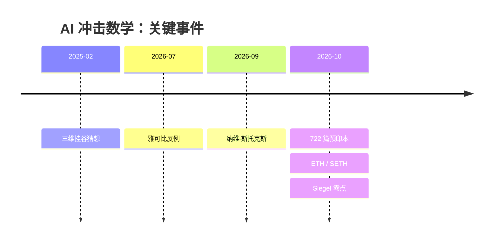
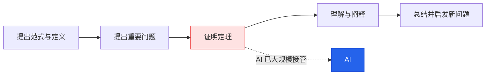
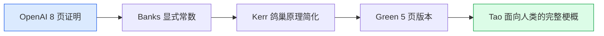

如果有一天，你花费几年时间研究一个数学问题，尝试了无数种方法，读过大量论文，写满了几本草稿纸，却始终没有找到答案。而一个 AI，只需要几十分钟，就给出了完整的证明。

你会怎么想？

是兴奋，因为人类终于解决了一个困扰数学界多年的难题？还是失落，因为你曾经引以为傲的研究能力，似乎在一夜之间变得不再稀缺？

这并不是一个遥远的假设。

2026 年，AI 在数学研究领域接连取得突破。从长期悬而未决的数学猜想到理论计算机科学中的重要问题，AI 开始展现出独立提出证明、寻找反例、组合已有理论工具的能力。过去需要研究者投入数月甚至数年才能完成的工作，如今可能在几个小时内就得到初步结果。

这场变化带来的冲击，远远不只是数学家多了一个好用的工具。

它正在动摇一个长期以来被数学界默认的前提：**数学研究之所以有价值，很大程度上是因为能够解决这些问题的人非常稀少。**

当证明不再稀缺，数学家的价值在哪里？当 AI 能够完成越来越多的数学推导，我们还有必要花费大量时间学习数学吗？

我认为，AI 真正改变的不是数学本身，而是数学价值的分配方式。

过去，数学研究的核心竞争力主要体现在解决问题的能力上：谁能证明一个猜想，谁就可能获得学术声誉、研究资源和历史地位。但当 AI 大幅降低证明的生产成本，这套评价体系就必然面临挑战。

未来，数学中真正稀缺的东西，可能不再是证明本身，而是三个更深层次的能力：

- **发现问题**：从复杂的现实世界和已有理论中，判断什么问题值得研究。
- **建立框架**：创造新的概念、语言和理论体系，让原本孤立的问题得到统一解释。
- **理解知识**：从大量 AI 生成的证明中提炼真正重要的思想，让数学结果成为人类可以理解、传承和继续发展的知识。

> **全文主线：解题能力正在贬值；发现问题、建立框架、理解与传递知识的能力正在升值。**
>
> 本文想讨论的，不是 AI 能不能取代数学家，而是当 AI 开始接管证明之后，数学究竟应该把价值建立在哪里，以及我们应该如何重新理解数学。

> **阅读提示：文中把三类信息分开写。**
>
> - **已发生**：有公开材料可查的事件与论文。
> - **尚未验证**：机构声称、预印本或社区仍在复核的结果。
> - **我的判断**：个人推论与预测，不等于事实。
>
> 文中会尽量标明，也请读者不要把三者混为一谈。

## 一、AI 已经做到了什么：一场关于“生产成本”的冲击

这一节只回答一个问题：**AI 到底做成了什么？**

先给不了解背景的读者补一课。2026 年的秋天，数学界几乎每个月都在经历一次“核爆”。把主要事件排成时间线，大概是这样：



<figure>
  
  <figcaption>2026 年 10 月 6 日，OpenAI 在 GitHub 上一次放出 722 篇数学预印本。仓库 README 自己注明：成果处于不同验证阶段，并非都有 Lean 形式化，应被视作“原始研究数据”。</figcaption>
</figure>

具体一点：

- **722 篇预印本**：覆盖约 370 个问题族，声称解决 300 多道此前未解的数学问题。据 OpenAI 说，平均每道题的计算成本只有几个小时。
- **纳维-斯托克斯方程**：千禧年大奖难题之一，模型用 88 小时写出了约 165 页的证明，还附了 Lean 形式化代码；OpenAI 表示不会去申领克莱研究所的百万美元奖金。
- **挂谷猜想**：2025 年 2 月，王虹与 Joshua Zahl 用 127 页论文证明了三维情形，王虹因此在 2026 年获得菲尔兹奖。随后 OpenAI 声称解决了全维度的局部平滑猜想，而局部平滑蕴含挂谷猜想，于是“所有维度的挂谷猜想”被一并宣告终结。
- **ETH / SETH**：理论计算机科学的地基之一。OpenAI 发布约 67 页手稿《指数时间假设是错的》，给出 k-CNF 可满足性的亚指数时间算法；如果成立，细粒度复杂度里大量下界结果会失去支点。

<figure>
  
  <figcaption>挂谷猜想的三维情形于 2025 年被证明，王虹因此获得 2026 年菲尔兹奖。</figcaption>
</figure>

但这里必须踩一脚刹车。

> **重要提醒：这些结果，并不都等于“数学已经被解决”。**
>
> 雅可比猜想的反例已被多种方式验证；而“全维度挂谷猜想”“ETH 被推翻”“纳维-斯托克斯被解决”目前都还带着“声称”二字。把它们当成已经写进教科书的定论，是不严谨的。

| 事件 | 领域 | 当前状态 |
| --- | --- | --- |
| 722 篇数学预印本 | 数学各领域 | OpenAI 发布，社区复核中 |
| 纳维-斯托克斯方程 | 偏微分方程 | 机构声称，附 Lean 代码 |
| 全维度挂谷猜想 | 调和分析 | 机构声称，待独立验证 |
| ETH / SETH 被推翻 | 理论计算机 | 机构声称，已邀独立验证 |
| 三维雅可比猜想反例 | 代数几何 | 反例已被多种方式验证 |
| 单位距离猜想被否定 | 离散几何 | 预印本，社区跟进 |
| Landau–Siegel 零点不存在 | 解析数论 | 预印本，已有多份人类改写 |

```fold 术语小抄：这些名词到底在说什么？
**挂谷猜想（Kakeya conjecture）**：一根单位长度的针在平面上转动 180°，扫过的面积能有多小？直觉上总得有点面积，但数学上可以做到“面积趋近于零”。挂谷猜想说的是，在更高维空间里，这类集合仍然必须有完整的维数。它是调和分析的核心问题之一。

**纳维-斯托克斯方程**：描述流体运动的一组方程。它是否有光滑解、会不会在有限时间“爆炸”，是千禧年七大难题之一。飞机、天气、血液流动都靠它，但数学上极难。

**ETH / SETH**：指数时间假设 / 强指数时间假设。简单说，它们猜测“某些 NP 问题不可能被显著加速”。大量算法下界（“这个问题至少要这么慢”）都建立在它们之上。如果 ETH 倒了，很多“下界”会一起失效。

**雅可比猜想**：一个关于多项式映射是否可逆的猜想，1939 年提出，人类努力了 80 多年。2026 年夏天，AI 辅助给出了三维情形的反例。

**Landau–Siegel 零点**：解析数论中一类可能存在的“坏零点”。如果它存在，很多定理只能写成“常数无法有效计算”的形式；如果不存在，数论里一大片结果会变强。
```

注意这里真正发生变化的东西。不是数学的真理性被推翻了，也不是所有数学工作都突然失去了意义，而是**某一大类证明的供给成本，在很短时间内被大幅压低**。

这就像印刷术没有改变“书里写了什么”，但它彻底改变了“谁能读到书、谁能印书、书值多少钱”。

> **我的判断：这场冲击的起点是成本曲线，不是数学本身。**
>
> 被冲击最严重的，是那些“技巧密集、可以分解、可被形式化验证”的证明工作；而提出问题、建立框架、判断价值这些事情，至少目前还没有被同等程度地自动化。

## 二、为什么数学家感到失落：被打破的不是真理，是稀缺性

这一节回答：**为什么偏偏是数学家反应这么激烈？**

在展开分析之前，先说说我自己的经历。它几乎是这一代理论工作者的共同处境。

我博士期间研究的核心课题是深度学习理论——AI 领域里最接近数学的那一块。基本工具全是高维统计：subgaussian 变量、ε-net、covering number、chaining……先埋头啃完一整套前置知识，才能去读领域里最新的论文。

读那些论文非常痛苦。动辄几十页、上百页，若干主定理，每个主定理背后是几十个层层嵌套的引理，每个引理还有微妙不同的假设。你要在海洋一样的符号里抽取出一个 high-level 的理解：这个证明到底在干什么？为什么成立？哪里是真正的局限？

那段时间的日常，是一支笔、一本书、一堆草稿纸，在图书馆或工位上算一天。几个星期之后，你才算刚刚入门。

为什么愿意把最青春的年纪投入这种痛苦？答案有两个，一个高尚，一个庸俗，而且两个都真实。

**高尚的答案**：这是攀登人类智力高峰的骄傲。你正在涉足前人没到过的地方，成为第一个看见山那边风景的人，还能为后人指出攀登的道路。

**庸俗的答案**：发论文、拿学位、获教职，拥有工作、地位和金钱，成为受人尊敬的教授。

很长一段时间里，我也一直想着以后要破解神经网络的谜团，建立一套解释深度学习的统计学习理论。

然后，大模型来了。

我在普林斯顿交换时留下过一个未解决的问题，和普林的小伙伴一起啃了几个月，试了很多方法，没有任何进展。一年多以后，GPT-5.5 出现了。我把它丢给 AI，短短 40 分钟，它给出了证明。

我花了几天把证明过了一遍，发现有一处跳步，就告诉它“这里不对，请解决”。又过了 20 分钟，这下彻底解决了。

```fold 那 40 分钟里，真正发生的是什么？
不是 AI “突然变聪明了”，而是三件事同时成熟了：

1. **检索**：模型能在训练语料里找到相关方法，并组合起来；
2. **生成**：它能写出形式上连贯、可检查的证明；
3. **迭代**：人指出跳步后，它能在上下文里补上缺口。

这三件事里，最容易被低估的是第三件。人类研究者几个月没做出来的问题，AI 用 60 分钟完成“初稿 + 修订”，靠的不是单次灵感，而是极低的试错成本。
```

那一刻，我静静地看着屏幕上几百行证明，想起在普林斯顿的那些日子：辗转反侧，走在路上都在想这些问题，茶不思饭不想，偶尔灵光一闪就赶紧去试，打了厚厚一叠草稿纸。那些草稿纸，在 AI 生成的证明面前，就像一个笑话。

我更意识到：这个理论方向的研究成果，几乎一文不值了。因为任何一个研究这个问题的人，都能像我这样，把问题扔给 AI，给一个提示词，然后得到结果。

以前我还能说“这个结果有一定的启发意义”，但理论研究者心里都清楚：一篇论文之所以有意义，最重要的原因是——**这个世界上能推导出这种结果的人没有几个**。

这里要区分两件事，否则很容易把问题说得太绝对。

我失去的，是一份职业路径的确定性，以及“会解这些题”带来的稀缺性溢价。我没有失去的，是对数学本身的理解、判断和兴趣。这两件事经常被混在一起，于是讨论很容易滑向“数学没用了”或者“数学家矫情”。

> **我的判断：第一波痛感来自重新定价，而不是来自真理失效。**
>
> 当供给突然放大，价格必然下跌。这不是数学独有的危机，而是所有靠智力稀缺性定价的职业共同的危机。承认这一点，比假装什么都没发生更有助于想清楚下一步。

## 三、旧评价体系为什么失效：first mover takes all

上一节讲的是个人感受。这一节换一个角度：**为什么整个学术共同体都会抗拒这件事？**

很多数学家拒绝检查 OpenAI 放出来的 700 多个结果，被一些人解读为“小气”“鸵鸟”。但事情没有这么简单。

数学界有一个根深蒂固的习惯：**第一个提出证明的人，享有几乎全部的荣耀。**

| 角色 | 贡献 | 通常获得的回报 |
| --- | --- | --- |
| A | 第一个给出证明（哪怕有瑕疵） | 几乎全部荣誉 |
| B | 补上 A 的漏洞 | 很少被记住 |
| C | 给出更简单漂亮的证明 | 很少被记住 |
| D | 提炼成新视角、新工具 | 往往要很久后才被承认 |

因为数学界极度崇拜智力，信奉“first one takes all”。最高荣誉属于第一个解出题的人。

现在，一个 AI 直接把这么多数学研究者的研究经费、毕业论文、长聘课题和菲尔兹奖的题目全都做完了。数学教授们还吃什么？

以往数学家阅读证明，是为了社区建设：确认一个工作是不是重要进展，学明白精髓，看看自己能不能做出突破。但现在，OpenAI 把一大坨自己也没有完全检查清楚的证明放在网上，数学家审阅论文，纯粹是帮 OpenAI 免费打工——钱捞不着，名也得不到。但为了让后人搞清楚这个证明到底算不算成功，还必须给出一个答案，只能捏着鼻子检查。

```fold 怀尔斯的故事，为什么可能成为绝响？
安德鲁·怀尔斯一个人秘密研究了七年，1993 年宣布证明费马大定理，随后被发现漏洞，又和 Richard Taylor 花了一年多补上，1995 年正式发表。

这个故事之所以动人，是因为它同时包含了：长期孤独的坚持、个人英雄式的突破、以及“第一个人”的荣耀。

如果同样的难题今天被 AI 在几小时内解决，怀尔斯式的叙事就失去了舞台。数学家哀悼的不只是一道题，而是一整套关于“什么是伟大的数学人生”的想象。
```

从制度的角度看，评价体系本质上是一套**激励协议**：它告诉年轻人“把时间花在哪里会得到回报”。过去几百年，这套协议把最聪明的头脑引导到“解难题”上，并且运转得相当成功。

问题在于，这套协议的底层假设是“证明稀缺”。当证明不再稀缺，协议本身就需要重写。

这不是说“优先权”没有意义，也不是说数学家应该放弃荣誉。而是说：**如果仍然只用“谁第一个证明”来分配资源和声望，那么大量真正重要的 AI 时代工作——理解、整理、阐释、建立联系——将无法被合理衡量。**

> **我的判断：评价体系会变，但不会一夜之间变。**
>
> 这是一个预测，不是既成事实。短期内，最先感到压力的会是研究生、博士后和青年教师；长期看，评价标准会向“理解与传播”倾斜，但速度取决于学术共同体内部的博弈。

## 四、价值会转移到哪里：问题、框架与理解

这一节回答：**如果解题不再是唯一的稀缺品，什么会变得稀缺？**

世界的底层经济规律是物以稀为贵。如果一件事有多个流程，赚取最多收益和认可的，往往是最稀有的那一环。

数学研究可以拆成五段：



过去几百年，最难、最慢的一环一直是“解题、证明”。一个猜想几十年没人证出来，谁证出来谁就是英雄。于是招聘、晋升、基金、大奖，几乎全部围绕这一环搭建。陶哲轩把这种状态称为“数学 1.0”：一个浪漫的个人英雄时代。

现在，至少在“已有明确框架、可以分解为引理、并且能够被形式化检查”的证明上，AI 把这一环的成本压得很低。

| 维度 | 数学 1.0 | 数学 2.0（正在形成） |
| --- | --- | --- |
| 稀缺资源 | 证明 | 判断、框架、理解与阐释 |
| 典型英雄 | 第一个证明的人 | 第一个理解、连接、讲清楚的人 |
| 评价重心 | 优先权、顶刊、引用 | 影响力、可传承性、是否开启新方向 |
| 培养方式 | 解题训练 | 提问、阅读、表达、跨领域连接 |

这个转变并不意味着“证明不重要了”。证明仍然是数学的硬通货，只是它从“稀缺的手工艺品”变成了“基础设施”。基础设施很重要，但基础设施不产生溢价。

历史上，这种事情发生过很多次。

印刷术出现之前，一本书要靠抄写员一笔一画抄上几个月，抄写是一门受人尊敬的手艺。

<figure>
  
  <figcaption>中世纪的抄写员。一本书要抄上几个月，抄写曾是受人尊敬的手艺。</figcaption>
</figure>

1492 年，修道院长 Johannes Trithemius 专门写了《赞抄写员》，劝修士们坚持手抄，说手抄才有灵魂。有意思的是，这篇文章没过多久就被印刷出版了。

<figure>
  
  <figcaption>古登堡式印刷机。复制文本变得廉价之后，真正值钱的是值得印的书、能校订的人，以及读得懂的读者。</figcaption>
</figure>

印刷术让复制变得廉价之后，出版业真正值钱的东西，变成了值得印的书、能校订编辑的人，以及读得懂书的读者。手抄文字不再像以前那样地位崇高。

那么，具体是哪三种能力在升值？前面已经列过，这里把它们的含义说透一点：

- **发现问题**：不是“随便提一个问题”，而是判断哪个问题背后有结构、有联系、有可能长出新理论。这需要品味，也需要对真实世界的敏感。
- **建立框架**：创造新的定义、语言和视角，让一堆原本孤立的结果突然变得可理解。这是“让理论海水上涨”的工作。
- **理解与阐释**：把一个正确的证明，变成人类可以理解、可以传授、可以继续发展的知识。它不是证明的附属品，而是知识真正沉淀下来的环节。

```fold 一个蛋糕的比喻
以前做一个蛋糕要花一整天，所以大家都在比谁做得又快又好：裱花最复杂、最平整、花样最多。

现在突然有了一台机器，你给它看一张照片、给一个菜谱，它几分钟就能做出一个完美的蛋糕。

这个时候再卷手速、卷裱花，意义就不大了。真正值得想的问题会变成：

- 还有哪种食物组合的菜谱没有人写过？
- 甜品这种形式，除了蛋糕，还有没有可能演化出完全没想过的形态？
- 什么样的场合、什么样的体验，是机器做不出来的？
```

> **我的判断：未来的“一流数学工作”，会越来越多地发生在定义、提问和阐释这一层。**
>
> 这不是说证明会消失，而是说证明会变成入场券，而不是终点。真正拉开差距的，是你选择证明什么、如何理解它、以及能否让别人也理解它。

## 五、好问题和新框架从哪里来：回到真实世界

上一节说“问题、框架、理解”会升值。这一节回答：**那好问题和好框架，到底从哪里长出来？**

清华大学的薛金鑫老师写过一篇长文，核心观点是：数学界脱离现实已经太久了，在越来越细分、越来越技术化的问题里自得其乐，自己提猜想、自己写证明、自己评审。

数学家为自己辩护时常说：“我现在做的东西虽然没有用，但过几十年说不定就有用。”比如黎曼几何后来被爱因斯坦用在了广义相对论里。

但薛老师提醒我们去翻黎曼 1854 年那篇报告的原文。黎曼明明白白地写着：几何学的命题无法从一般的量的概念中推导出来；空间之所以区别于其他可以设想的“三维延展量”，靠的是那些只能从经验中得来的性质。

黎曼想的，从一开始就是“真实的空间到底是什么样子”。

历史上开辟全新领域的数学大家，几乎都是这样从现实中找到入口的：

| 数学家 | 现实问题 | 由此诞生的理论 |
| --- | --- | --- |
| 傅里叶 | 热传导 | 傅里叶级数 |
| 高斯 | 汉诺威大地测量 | 微分几何、高斯绝妙定理 |
| 庞加莱 | 三体问题 | 动力系统定性理论 |
| 冯·诺依曼 | 人的经济行为 | 博弈论 |
| 香农 | 通信工程 | 信息论 |
| 蒙日 | 运土填坑 | 最优传输理论 |

最后一行值得展开。

18 世纪的法国有一个非常实际的工程问题：挖出来的大量泥土要运到其他地方填坑，怎么安排运输路线，才能让总成本最低？数学家蒙日把各个位置的土量抽象成分布，把搬运过程抽象成分布之间的匹配关系，从而开创了最优传输理论。后来发展出的 Wasserstein 距离，成了概率论、偏微分方程乃至机器学习的重要工具。

这么抽象的理论，最初的起点其实就是：**怎么运土最省钱。**

再比如广义函数。教科书定义是“测试函数空间上的连续线性泛函”，光理解这句话就需要不少前置知识。但它背后的具体需求来自物理：瞬时的冲量。

真实的碰撞当然需要时间。但如果你只关心物体挨了一下之后怎么运动，就会忽略内部细节，把它近似成“瞬间发生、但保留动量变化”的过程。100 牛顿的力持续 0.01 秒，和 1000 牛顿的力持续 0.001 秒，产生的冲量都是 1 牛顿·秒。画在图上，是一块越来越窄、越来越高、面积不变的长条。普通函数无法表示这种极限对象，于是数学家拓展了函数的概念，发展出狄拉克 δ 函数和广义函数理论。

这两个例子的共同点是：**抽象理论不是从抽象中来的，而是从具体问题中被“逼”出来的。**

> **薛金鑫的总结，也可以当作本文的核心判断之一：**
>
> **AI 时代稀缺的不是证明，而是判断力——判断什么问题值得问，什么框架值得建。**
>
> 这种判断力最好的来源，就是对真实世界的感知。

而且，AI 在这里并不只是威胁。它大幅降低了跨领域阅读的成本：你可以直接和最顶级的 AI 对话，快速理解一篇论文乃至一整个领域的思想方法。这意味着“从现实中发现问题”和“把不同领域连接起来”的门槛，反而降低了。

## 六、AI 的证明如何成为人类知识：从结果到可传承的理解

上一节讲“问题从哪来”。这一节讲另一半：**AI 已经给出的证明，如何变成人类的知识？**

很多数学家担心：AI 解题这么快，会“杀死下金蛋的母鸡”。

这个说法的前提是：一个好问题的价值，来自人类为了解决它而发展出来的新思想和新工具。费马大定理本身没有什么用，为了证明它而发展出来的模形式和椭圆曲线理论，才是金蛋。现在 AI 一下子把题做完了，鸡就没了。

这个担心有道理，但不能这么武断。短期内被“宰杀”的，不是数学理解本身，而是数学家的职业体系。

一个证明只要是对的，它就一定以某种形式触及了问题中最困难的那个原理的核心，一定绕不过去。于是只有两种可能：

**第一种**：猜想背后真的藏着重要的新知识。那么不管 AI 怎么做出来的，证明里一定包含本质上重要的方法和思想，只等人去挖出来、理解。

**第二种**：证明里什么深刻的东西都没有。那只能说明，人类当初提这个猜想时想多了，它只是一个小小的 corner case。

在 AI 一视同仁的狂轰滥炸下，尤其是它神一般的找反例能力面前，很多猜想被证明“纯属人类想多了”：

- **雅可比猜想**（1939 年提出）：人类努力了 80 多年想证明它是对的。2026 年夏天，研究者借助 AI 给出了三维情形的反例，只有几行式子；通过坐标填充，这个反例顺便否定了所有三维以上维度的情形。
- **单位距离猜想**：大家花了几十年想证明它，AI 转头去找反例，把代数数论里看似毫不相关的工具搬进了离散几何。Noga Alon、Timothy Gowers 等人随后给出简化，并把它放回整个领域的脉络里。

AI 在数学证明上不一定比人聪明，但它没有心理惯性、没有对权威的敬畏，也更有耐性。

而真正让我觉得“这是金矿”的，是 **Landau–Siegel 零点**这个案例：



<figure>
  
  <figcaption>陶哲轩 2026 年 10 月 19 日的博客：把“只有 AI 知道”的证明整理成人类可读的梗概。页面顶部还引用了 Thurston 1994 年的话：衡量成功的标准，是我们做的东西能否让人更好地理解和思考数学。</figcaption>
</figure>

不到两周，William D. Banks 写出详细阐述并给出显式常数；Bryce Kerr 用鸽巢原理和一个经典定理替换了复杂的插值与行列式分析；Ben Green 给出 5 页版本；陶哲轩写出完整的人类可读梗概。

原本只有 AI 知道的东西，一步一步变成了人类能理解、能传授、能接着往下做的知识。

```fold 如果你也想“淘金”，可以怎么做？
1. **先问值不值得读**：这个证明是否触及了领域里公认的难点？还是只是一个技术性推论？
2. **找骨架**：先让 AI 用三句话概括证明策略，再逐段核对关键引理。
3. **找反例**：让 AI 尝试构造反例，检验猜想的边界。
4. **重写**：用自己的语言、例子和图示重写一遍，直到能给同行讲清楚。
5. **接回脉络**：问它“这个方法还能用在哪些问题上”，把孤立结果接回领域地图。
```

但这里有一个关键区别，值得单独拎出来：

> **证明的自动化，并不意味着知识的自动积累。**
>
> AI 可以生成大量正确的数学结论，但如果没有人去理解、整理和建立联系，这些结论就可能只是散落在数据库中的孤立结果，而不能真正成为数学知识。
>
> 数学的发展不只是定理数量的增长，更是人类理解能力的增长。

所以，面对一份 AI 证明，真正重要的问题不是“它对不对”，而是后面这四个：

1. 这个证明究竟解决了什么？
2. 它是否具有真正的理论价值？
3. 能否从中提炼出可以迁移到其他问题的方法？
4. 如果人类逐渐失去理解数学的能力，未来由谁来决定 AI 应该研究什么？

> **我的判断：把 AI 证明“人类化”，本身就是一流的数学贡献。**
>
> 评价体系需要给这种工作更多 credit——陶哲轩提出的“数学 2.0”、Grant Sanderson 提议的“开放阐释问题清单”，说的都是这件事。

## 七、为什么理解和表达如此重要：知识需要“人类接口”

上一节讲的是“把结果变成知识”。这一节再往前一步：**为什么理解和表达，本身就是数学的一部分？**

我自己读数学教科书和大佬论文时，是非常痛苦的。

满篇都是“注意到”“易证”“显然”。至于人家当初怎么想到的，你只能自己猜。绝大多数数学书一上来就是极为抽象的定义，没有例子解释为什么要在那么细微的地方搞出那么多区别；接着是一大片你也不知道为什么要关注的性质。

杨振宁说过，数学家写的书有两种：一种是看了一页就看不下去的，一种是读了一行就看不下去的。

```fold 为什么数学家习惯“隐藏思维链”？
这不完全是故弄玄虚。

在知识产权保护还不完善的年代，很多数学家做的是一种接近“零知识证明”的事：我要让你知道我证明了、我的解法是对的，但你不能从中学习到我解决问题的任何思维方法。这就是所谓的“防御性证明”。

高斯信奉“大厦建成之后要拆掉脚手架”，只给你看最终光洁的证明。阿贝尔吐槽他，像一只狐狸，用尾巴把自己在沙地上的足迹全都抹掉。

那时候很多数学家本质上只有一两个绝活，但这一两个绝活可以系统性地在一系列问题里发挥作用，能吃一辈子。如果被别人学去，自己就完蛋了。

所以，这些密不外传的解题心法，和餐馆的独家秘方、魔术的表演流程，本质上非常类似。
```

薛金鑫还指出：数学家攻击 AI 的理由，是没有让人类理解他们；可是人类数学家内部此前的理解也非常有限。一篇上百页的论文，真正逐行看过细节的可能只有一两个人，其他人只是信任他们的判断。他把它叫做“信任外包”。

但历史上最出色的科学家，往往也是很好的表达者：

- 欧拉的推理写得清清楚楚，拉普拉斯说：“读读欧拉吧，他是我们所有人的老师。”
- 法拉第在英国皇家研究院给孩子们讲《蜡烛的化学史》，一讲就是很多年。
- 希尔伯特是最讲究形式化的数学家之一，但他和 Cohn-Vossen 合写的《直观几何》满书都是图，人人都能看懂。
- 费曼的《物理学讲义》非常平实，到今天还是经典。
- Thurston 在叶状结构领域短时间内证明了一大堆定理，结果这个领域几乎被清空——因为大家觉得问题都被他做完了，而他的论证又很难懂。后来做几何化纲领时，他花很大力气写讲义、讲清思路，才在周围长出一整个研究群体。

Thurston 后来在《论数学中的证明与进展》里写下了一段话，我觉得它可以直接当作“数学 2.0”的宣言：

> “我们不是要完成某种抽象的定义、定理和证明的生产配额。衡量我们成功的标准，是我们所做的工作能否让人们更清晰、更有效地理解和思考数学。”
>
> —— William Thurston，1994

这也引出了本文最想强调的一个区分：

> **AI 降低的是知识生产的成本，而不是知识理解的成本。**
>
> 甚至可以说，AI 越是能够批量生产答案，人类就越容易陷入“信息过剩、理解不足”的状态。

过去，证明本身就是一道很高的门槛。能够通过这道门槛的人，自然积累了相当程度的专业知识。现在，AI 可以直接给出证明，但这会带来新的问题：我们如何知道这个证明解决了什么？如何判断它是否真的有价值？如何把方法迁移到别处？如果人类整体失去理解能力，谁来给 AI 指方向？

所以，“讲清楚”在未来仍然重要，但它的价值形态会变。AI 的讲解会越来越流畅，单纯“把定义念一遍”不再稀缺；真正稀缺的，是**值得信任的讲清楚**——一个具体的人，能让另一个人相信这件事值得花时间，并且真的带他走完这段路。

> **我的判断：未来数学教育真正稀缺的，是“人类接口”。**
>
> 把 AI 的结果翻译成人类能理解、能判断、能继续追问的知识，这个环节不会因为 AI 变强而消失，反而会变得更关键。

## 八、AI 会如何改变人类的数学能力：围棋的启示

前面讨论的都是“数学内部的价值”。这一节换一个视角：**AI 到底是在替代人类，还是在扩展人类的认知边界？**

2017 年，世界排名第一的柯洁 0:3 输给 AlphaGo。第三局中途，他一度离席，在镜头前忍不住落泪。他说，AlphaGo 就像围棋之神，和 AI 下棋是一种密不透风的绝望。

后来发生了什么？

职业棋手开始用 AI 训练。

一项发表在 PNAS 的研究，分析了 1950 到 2021 年职业比赛里的 580 多万步棋，发现超人类 AI 出现之后，人类棋手的决策质量显著提高，新颖的下法也变多了：2018 年有 88% 的对局出现了历史上从未见过的招法组合，而 2015 年这个比例只有 63%。

<figure>
  
  <figcaption>PNAS 研究：超人类 AI 出现后，职业棋手的决策质量与下法新颖性都显著提升。</figcaption>
</figure>

2016 年 AlphaGo 和李世石的第二局，第 37 手下在了五路肩冲。现场解说一度以为是失误，AlphaGo 自己估计人类棋手下出这一步的概率大约只有万分之一。后来大家才明白，这一手改变了整盘棋的走向。

<figure>
  
  <figcaption>AlphaGo 对李世石第二局的第 37 手：起初被当成失误，后来成为“理解 AI”的经典案例。</figcaption>
</figure>

从那以后，“AI 为什么这么下”成为职业棋手和解说员最重要的工作之一。像开局点三三这种曾经被视为“俗手”的下法，就是这样被重新理解、接纳，甚至推崇的。

而第四局李世石那手“神之一手”的第 78 手，则提醒我们：再强的 AI 也有盲区，只有真正看懂它的人，才能找到它的盲区。

| 维度 | 围棋 | 数学 |
| --- | --- | --- |
| AI 超越人类 | 2016–2017 年 | 2025–2026 年，部分子领域 |
| 人类的新角色 | 理解 AI 棋、找盲区、创新定式 | 理解证明、提问、建框架、阐释 |
| 已观察到的结果 | 决策质量与新颖性提升 | 尚在早期，缺乏系统数据 |
| 主要风险 | 过度依赖、丧失独立判断 | 理解能力外包、方向由谁决定 |

注意，围棋的故事并不是“AI 赢了，人类没用了”。它更像是：**AI 把人类从“计算最优解”中解放出来，迫使人类去回答“什么才是好棋”“为什么这手棋好”这类更高层的问题。**

数学很可能也一样。AI 能算、能证、能找反例，但“什么问题值得研究”“哪个方向会长出新理论”“这个证明的美感在哪里”，仍然需要人类的判断。

> **我的判断：AI 扩展的是可达空间，不是探索的意义。**
>
> 它能把我们带到更远的地方，但“去哪里、为什么去、到了之后看什么”，仍然是人要回答的问题。

## 九、普通人还要不要学习数学：从解题训练到思维训练

讨论到这里，终于可以回到最初那个问题：**如果 AI 这么强，我们还要不要学数学？**

我的回答是：**要，但目标要换。**

Grant Sanderson 有一个比方：机器肯定能比你举得更重，但你依然值得去健身房，因为肌肉长在你自己身上。数学训练给你的，是寻找抽象结构、拆解问题的能力；这些能力会跟着你去到很多其他地方。

北京大学的袁新意老师也说：中小学的那些题，做出来本身没有价值，但之所以还要做，是因为那是一个自我修炼的过程。他甚至建议，电子工程系博士生的第一篇论文，还是用“古法”亲手做一遍。

如果目标只是“比别人更快地解出更难的题”，那这条赛道确实已经很拥挤了。更值得练的是：

- 真正理解一个东西为什么成立；
- 问出更好的问题；
- 对“什么是重要的”“什么是美的”有自己的品味；
- 把数学和真实的世界联系起来；
- 用好 AI。

不同阶段的人，可以把重点放在不同位置：

| 你现在的阶段 | 最该投入的事 | 可以少花力气的事 |
| --- | --- | --- |
| 中学生 | 把基础概念真正想明白，训练推理习惯 | 刷偏题、怪题、纯技巧题 |
| 本科生 | 学会读论文、提问题、用 AI 辅助理解 | 单纯追求解题速度 |
| 研究生 | 找真实问题、建立品味、练习阐释 | 只做“加一个条件”的增量工作 |
| 数学爱好者 | 顺着兴趣读、讲给别人听、做小项目 | 被“必须有用”绑住 |

```fold 小测试：你还在用“数学 1.0”的心态学习吗？
对下面每一条，如果符合就记 1 分：

1. 我衡量自己数学水平的主要标准，是做题速度和正确率。
2. 我读论文时，只关心结论，不关心证明怎么想出来。
3. 我觉得“讲清楚”不如“做出来”有价值。
4. 我很少问“这个问题为什么重要”。
5. 我几乎不用 AI 帮助理解，或者只把它当搜题工具。

**0–1 分**：你已经在用数学 2.0 的方式学习。
**2–3 分**：正在过渡，可以刻意练习“提问”和“阐释”。
**4–5 分**：不妨从今天开始，读完一个证明后，试着用自己的话讲给别人听。
```

说句实话：如果你的目标是一份纯数学的教职，未来几年这条路大概率会更窄。这是一个基于当前趋势的预测，不是已经发生的事实。评价体系正在剧烈变动，而这些成本会最先落在研究生、博士后这些年轻人身上。就像我一样，我也被迫暂时放弃了博士期间一直追求的理论深度学习职业路径。这都是没有办法的事情。时代的一粒沙，落到每个人头上就是一座山。

但“纯数学教职变窄”不等于“数学教育失去意义”。恰恰相反：当答案越来越便宜，判断答案、理解答案、提出新问题的能力，会变得更值钱。

## 结语：当证明变得廉价，我们更需要理解

AI 时代，数学家面临的挑战是真实的。

过去，一个人可以通过长期钻研某个问题，最终凭借独特的证明技巧获得认可。但当 AI 能够在短时间内完成大量类似工作，这条职业发展路径就不可避免地受到冲击。

我们不应该假装什么都没有改变。数学研究的评价体系、学术工作的组织方式，以及年轻研究者的成长路径，都需要重新调整。

但这并不意味着数学失去了价值。

恰恰相反，当证明越来越容易获得，我们才更应该意识到：证明从来不是数学的全部。

一个定理被证明了，不代表我们理解了它为什么重要；一个问题得到了解答，也不代表我们知道接下来应该研究什么。真正推动数学向前发展的，不仅是定理的数量，还有隐藏在定理背后的思想、不同理论之间的联系，以及人类对未知世界不断提出的新问题。

AI 可以帮助我们抵达过去难以抵达的地方，却不能自动替我们决定哪些地方值得探索，也不能保证我们真正理解了所看到的一切。

这让我想到一个关于登山的比喻。

过去，我们只能依靠自己的双脚，一步一步攀登数学的高峰。现在，AI 为我们提供了一艘强大的邮轮，能够带我们跨越过去难以逾越的距离，抵达更遥远的地方。

但抵达山顶并不意味着探索结束了。

我们仍然需要有人观察眼前的风景，理解山峰的结构，绘制从山脚通往山顶的道路，并告诉后来的人，这一路究竟发现了什么。

也许，我们这一代人不再有机会成为第一个证明某个重要定理的人，但我们仍然可以成为第一个理解某种新思想的人，第一个发现不同理论之间联系的人，或者第一个把复杂知识讲给更多人听的人。

**AI 让证明变得廉价，却没有让理解变得多余。它改变了人类探索数学的方式，却没有改变探索数学本身的意义。**

所以，我们仍然应该学习数学。

不是为了和 AI 比谁算得更快、证明得更多，而是为了在一个答案越来越容易获得的时代，依然拥有判断问题、理解答案和发现新问题的能力。

因为真正值得珍惜的，从来不只是抵达山顶的证明，还有我们理解山峰、探索世界的能力。

---

> 本文根据视频《AI 时代，数学该何去何从？还能学吗》的笔录整理并扩写，第一人称叙述者为视频作者。文中 2026 年的事件与预印本均按公开报道整理，不少结果尚待同行评议；配图由作者提供。
