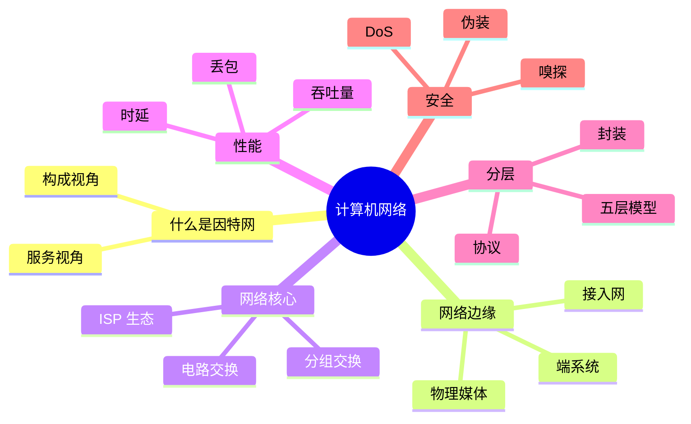
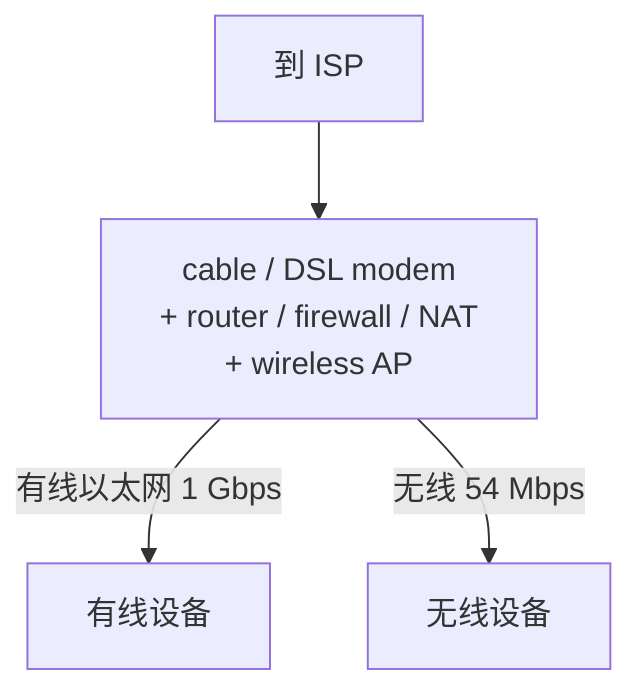
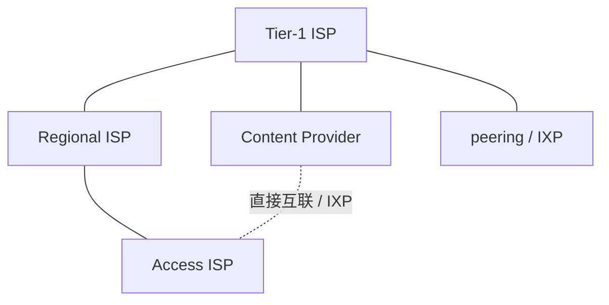
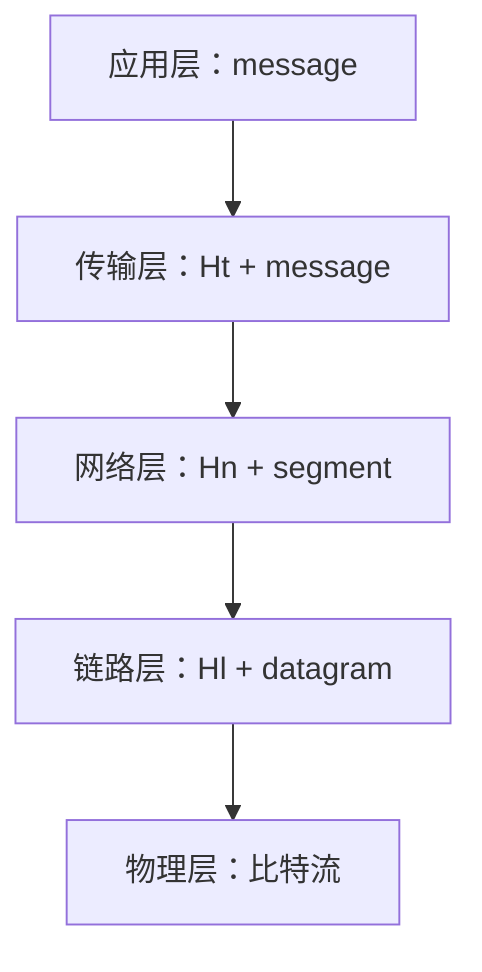
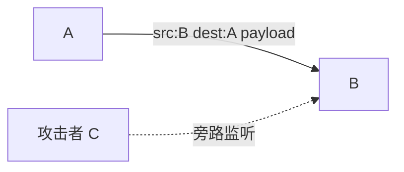
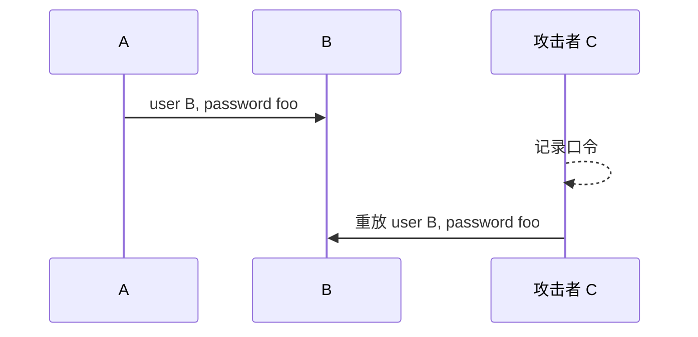

> - 教材：Kurose & Ross, *Computer Networking: A Top-Down Approach*, 8th Edition, Chapter 1
> - 课件：Chapter1_2026.ppt
> - 本章地位：建立"网络是什么、由什么组成、如何衡量好坏、如何组织"的整体框架，后续各章都是对某一层的展开。

---

## 0. 本章知识地图

贯穿全章的两个基本问题：

- **功能性问题**：可达性（选路、转发）、正确性（可靠性控制）
- **性能问题**：吞吐量、时延、丢包率

---

## 1.1 什么是因特网

同一张"因特网"可以从两个完全不同的角度描述，两种定义在本课程中都会用到。

### 1.1.1 定义一：从"具体构成"看

> **因特网是由一群遵循 TCP/IP 协议的 ISP，按照松散的层次结构组织而成的"网络的网络"。**

组成要素：

| 组成 | 说明 | 例子 |
|---|---|---|
| 端系统（end system）/ 主机（host） | 运行应用程序的设备 | 桌面机、服务器、笔记本、手持设备 |
| 通信链路（communication link） | 连接设备的物理媒体，主要指标是**传输速率**，也称**带宽（bandwidth）** | 光纤、铜线、电磁波 |
| 交换设备（switch） | 转发**分组（packet）** | 路由器（router）、交换机（switch） |
| ISP | 由交换设备和通信链路组成的网络，为终端提供因特网接入 | 本地 ISP、地区 ISP、全球 ISP |
| 协议（protocol） | 规定设备之间通信需要遵循的规则 | TCP、IP、HTTP…… |

关于 ISP 的三个要点：

1. ISP 分层次：本地 ISP（接入用户）→ 地区 ISP → 全球 ISP。
2. 每个 ISP 在运营和管理上是**自治**的，彼此**不存在从属关系**。
3. "松散层次"意味着上层 ISP 通常为下层 ISP 提供转接（transit）服务，但这不是强制行政关系。

关于协议：

- 协议规定：终端↔终端、终端↔交换设备、交换设备↔交换设备之间如何通信。
- 因特网协议标准由 **IETF**（Internet Engineering Task Force）管理，以 **RFC xxx** 文档形式发布。
- 最核心的两个协议是 **TCP 和 IP**，因特网协议族统称 **TCP/IP 协议族**。

由此得到因特网的三个特点：

- 因特网是"**网络的网络**"；
- 因特网**不存在严格的层次结构**；
- 因特网**没有统一的管理机构**（只有协调组织，如 IETF、ICANN）。

### 1.1.2 定义二：从"功能/服务"看

> **因特网是为分布式应用提供通信服务的基础设施。**

类比传统通信系统：

| 系统 | 服务接口 |
|---|---|
| 电话系统 | 拨号、振铃 |
| 邮政系统 | 邮筒、信箱 |
| 因特网 | 一组用于在因特网上发送/接收数据的**应用编程接口（API）**，即套接字接口 |

这个定义指导我们如何设计**服务接口**：向上层应用提供"有序可靠的数据交付"或"不可靠的数据交付"等服务。

### 1.1.3 什么是协议

协议（protocol）定义了三件事：

1. 通信实体之间交换的**报文格式**；
2. 报文的**次序与语义**（各字段的含义）；
3. 在发送/接收报文、或其它事件发生后应采取的**动作**。

课件用人类对话类比：

| 说话者 | 内容 | 对应的网络行为 |
| --- | --- | --- |
| 人 | Hi | TCP 连接请求 |
| 对方 | Got the time? | TCP 连接响应 |
| 人 | 2:00 | HTTP GET 请求 |
| 对方 | `<file>` | 返回网页文件 |

**记忆口诀：协议 = 语法（格式）+ 语义（含义）+ 时序（何时做什么）。**

学习计算机网络，本质上就是理解网络协议的构成、原理以及如何工作。

### 1.1.4 两种定义的作用（课件小结）

| 定义 | 指导作用 |
|---|---|
| 定义一（网络的网络） | 指导通信功能的实现：ISP 内部如何通信、ISP 之间如何通信 |
| 定义二（服务基础设施） | 指导服务接口的定义：可靠/不可靠的数据交付服务 |

本课程同时使用这两种定义，介绍因特网服务接口以及端到端通信的实现。

---

## 1.2 网络边缘（Network Edge）

网络结构可以粗略分为三块：

- **端系统**：运行应用的终端；
- **接入网**：将端系统连接到其边缘路由器的物理链路；
- **网络核心**：由路由器和通信链路组成的网状网络。

接入网要回答的两个核心问题（课件反复强调）：

1. **带宽是多少？**
2. **共享还是专用？**（共享意味着多用户竞争，峰值时性能下降）

### 1.2.1 住宅接入：DSL（数字用户线）

由电话公司提供，复用已有的电话线（**每户一条专用线**）。

- 电话线被划分为 3 个**不重叠的频带**：电话信道、上行信道、下行信道（频分复用）。
- **DSL modem**：把电脑的数字信号调制到上行频带；把下行频带信号解调为数字信号。
- **Splitter（分离器）**：用户侧合并/分离话音与数据。
- **DSLAM（DSL Access Multiplexer）**：ISP 侧汇聚/分离多条 DSL 线路，一般数百至上千个家庭共享一个 DSLAM。

速率（课件数值）：

- 上行：最高 3.5 Mbps ~ 16 Mbps
- 下行：最高 24 Mbps ~ 52 Mbps
- 实际速率取决于**距离、线路规格、电气干扰**

特点：**用户独享**接入线路（到 DSLAM 的这段），但 DSLAM 之后是共享的。

### 1.2.2 住宅接入：电缆网络（HFC）

由有线电视公司提供，复用已有的有线电视基础设施。

- **HFC（Hybrid Fiber Coax，混合光纤同轴）**：光纤网 + 同轴电缆网。
- 数据和电视信号在**同一条电缆**中传输（不同频段）。
- 接入网组成：cable modem、splitter、电缆、光纤、**CMTS**（Cable Modem Termination System，电缆调制解调器端接系统，位于头端 cable headend）。
- 速率：下行最高 40 Mbps ~ 1.2 Gbps；上行最高 30 Mbps ~ 100 Mbps。
- **几百 ~ 几千户家庭共用一条电缆** → **共享介质**，高峰时段相互竞争。

### 1.2.3 家庭网络

典型家庭网络设备（常集成在一个盒子里）：

注意：家用路由器通常同时承担 modem 之后的路由、防火墙、NAT、无线接入点等功能。

### 1.2.4 企业接入：以太网 + WiFi

用于公司、学校以及终端较多的家庭：

- **以太网**：100 Mbps、1 Gbps、10 Gbps；
- **WiFi**：11 Mbps、54 Mbps、450 Mbps；
- 设备：Ethernet switch（以太网交换机）、institutional router（机构路由器）、institutional link（机构到 ISP 的链路）。

企业网通常是**有线为主、无线补充**，交换机把内部主机汇聚后经机构路由器接入 ISP。

### 1.2.5 无线接入

**无线局域网 WLAN（WiFi）**

- 由公司或个人提供**基站（接入点 AP）**，把移动终端连到有线网络；
- 终端与 AP 相距几十米内；AP 通常连在有线网络上；
- 速率：11 Mbps、54 Mbps、450 Mbps；
- **共享**信道。

**广域无线接入（蜂窝）**

- 由移动通信公司提供，使用蜂窝电话网络；
- 基站覆盖半径可达数万米；
- 速率（共享信道）：
  - 4G：下行 100 Mbps，上行 20 Mbps
  - 5G：下行 20 Gbps，上行 10 Gbps

### 1.2.6 物理媒体（传输媒体）

设备之间通过物理媒体相连；物理媒体两端各需要一对收/发设备。**一条路径上，每对设备之间的物理媒体可以不同。**

两大类：

- **导引型媒体（guided media）**：信号沿固体媒体传播，如铜线、光纤；
- **非导引型媒体（unguided media）**：信号在空间自由传播，如电磁波。

| 媒体 | 结构/特点 | 速率 |
|---|---|---|
| 双绞线（twisted pair） | 两条绝缘铜导线绞合，5 类线 / 6 类线 | 5 类：100 Mbps ~ 1 Gbps；6 类：10 Gbps |
| 同轴电缆（coaxial cable） | 铜芯 + 网状屏蔽层构成同心导电体；每条电缆划分多个频段 | 每频段几百 Mbps |
| 光纤（fiber optic） | 引导光脉冲的玻璃纤维；低误码、长距离、抗电磁干扰 | 几十 ~ 几百 Gbps |
| 电磁波（无线） | 蓝牙 ~10 m / 24 Mbps；红外室内短距 / 16 Mbps；WiFi 几十米 / 几百 Mbps；陆地微波 45 Mbps；卫星 45 Mbps；可见光 1–2 km / 50 Gbps | 见左 |

> **易错点**：带宽（bandwidth）在这一章有两个含义——通信链路的**传输速率**（bps），以及频带宽度（Hz）。课件语境下通常指前者。

---

## 1.3 网络核心（Network Core）

> 网络核心 = 由路由器和链路形成的网状网络。
> 任务：把数据包从**发送侧边缘路由器**传送到**接收侧边缘路由器**。
> 基本问题：数据包如何高效传递？——分组传输延迟小、网络吞吐量高。

在通信网络中移动数据的两种基本方法：

| 方式 | 资源分配 | 典型网络 |
|---|---|---|
| 电路交换（circuit switching） | **独占**信道，预留资源 | 电话网 |
| 分组交换（packet switching） | **共用**信道，按需分配 | 计算机网络 |

### 1.3.1 分组交换

过程：

1. 主机把要传输的数据**分段**，并组装成一系列**分组（packet）**；
2. 交换设备从一条链路接收分组，再发送到另一条链路（**交换**）；
3. **存储转发（store-and-forward）**：交换设备必须收到**完整的分组**后，才能开始转发。

**思考：为什么不能边收边发？**

- 需要先收到完整分组才能做**差错检测**（checksum）和读取首部、查转发表；
- 链路的**序列化**本身就是把整个分组逐比特推上链路，未收完无法开始下一段；
- 存储转发也便于在输出端口排队、做流量管理。

#### 存储转发带来的序列化延迟

定义：

- `L` = 一个分组的比特数（bits）
- `R` = 链路传输速率（bps）

把一个分组全部推送到一条链路上，耗时：

$$d_{\text{trans}} = \frac{L}{R}$$

**计算规律（重点）**：

| 场景 | 总时间（忽略传播/处理/排队） |
|---|---|
| 1 个分组经过 2 条链路 | `2L/R` |
| 3 个分组经过 2 条链路 | `4L/R` |
| P 个分组经过 N 条链路 | `(P + N − 1) · L/R` |

推导（P 个分组、N 条链路）：

- 第 1 个分组需要经过 N 段链路，耗时 `N·L/R`；
- 之后每多一个分组，只额外增加最后一段链路的 `L/R`（流水线效应），共 `(P−1)·L/R`；
- 合计 `N·L/R + (P−1)·L/R = (P+N−1)·L/R`。

结论：**当 P 远大于 N 时，存储转发不会引入过多的额外延迟**（额外开销约为 `(N−1)L/R`）。

#### 排队延迟与丢包

- **排队延迟**：分组在输出链路的缓存（队列）中等待发送。
- **丢包**：若输出链路缓存已满，溢出的分组被**丢弃**。
- 当大量分组集中到达（突发流量）时，排队延迟和丢包较严重。

课件例子：R = 100 Mb/s 的链路后面接 R = 1.5 Mb/s 的链路，前者到达速率远大于后者，队列迅速增长。

#### 网络核心的两个重要功能：转发 vs 选路

| 功能 | 英文 | 说明 | 时间尺度 |
|---|---|---|---|
| 转发 | forwarding | 交换设备按照**转发表**，把分组移动到相应的输出链路 | 每个分组到达时（局部动作） |
| 选路 | routing | 交换设备确定不同目的地的转发端口，**生成转发表** | 周期性运行路由算法（全局动作） |

转发表示例：

| 目的地址前缀 | 输出链路 |
| --- | --- |
| 0100 | 3 |
| 0101 | 2 |
| 0111 | 2 |
| 1001 | 1 |

分组首部中的目的地址与表项匹配，决定从哪个端口转发。

### 1.3.2 电路交换

电话网采用电路交换：

1. 通话前完成两部电话机之间的**电路接续**（建立连接）；
2. 通话期间**独占**这条电路；
3. 通话结束后**释放**整条电路。

本质：**预留资源 + 独占资源**。

#### 概念区分：链路 vs 电路

- **链路（link）**：物理媒体，也称信道（channel）；可以通过某种方式划分为若干条独立的**子信道**。
- **电路（circuit）**：物理媒体中的**一条子信道**。

#### 多路复用

- **FDM（频分复用）**：把频带划分为若干子频带，每个用户固定占用一个频带；
- **TDM（时分复用）**：把时间划分为若干时隙，每个用户固定占用一个时隙。

| 复用方式 | 切分维度 | 用户占用方式 |
| --- | --- | --- |
| FDM（频分复用） | 频率轴 | 各占一段频率，持续使用 |
| TDM（时分复用） | 时间轴 | 轮流占用整个频带的一个时隙 |

#### 例题：电路交换的文件传输时间

> 条件：文件 640,000 bits；所有链路 1.536 Mbps；每条链路使用 TDM，24 slots/sec；建立端到端电路需 500 ms。求总时间。

解答：

$$
\begin{aligned}
\text{每条电路的数据速率} &= \frac{1.536\ \text{Mbps}}{24} = 64\ \text{kbps} \\
\text{传输数据时间} &= \frac{640{,}000\ \text{bit}}{64{,}000\ \text{bps}} = 10\ \text{s} \\
\text{总时间} &= 0.5\ \text{s} + 10\ \text{s} = 10.5\ \text{s}
\end{aligned}
$$

> 注意：这里的 "24 slots/sec" 表示每秒 24 个时隙，每个用户每轮占 1 个时隙，故每个用户获得 1/24 的链路容量。

### 1.3.3 为什么采用分组交换？（分组交换 vs 电路交换）

#### 优势一：统计复用，支持更多用户

课件例子：

- 链路 1 Gb/s；
- 每个用户活跃时用 100 Mb/s，活跃时间占 10%；
- **电路交换**：固定分配，最多支持 10 个用户（10 × 100 Mb/s = 1 Gb/s）；
- **分组交换**：按需分配，35 个用户时"同时活跃用户数 > 10"的概率小于 **0.0004**，因此仍能很好服务。

即：**同样的链路容量，分组交换允许支持更多的用户**（利用突发性、统计复用）。

#### 优势二：轻负载时更快

- 只有 1 个活跃用户、要发 1000 个 1 Mb 的分组：
  - 电路交换：该用户只分到 100 Mb/s → 需要 **10 s**；
  - 分组交换：该用户可用满 1 Gb/s → 需要 **1 s**。

#### 分组交换的优缺点

| 优点 | 缺点 |
|---|---|
| 资源利用率高 | 可能产生**排队延迟和丢包**，需要协议解决 |
| 实现简单（不需要建立电路） | 无法提供带宽/时延保证，音视频等应用的需求尚未完全解决 |
| 适合**突发流量** | — |

#### 为什么因特网选择分组交换？

- 传统因特网应用（电子邮件、文件传输、Web）具有**突发通信**特点；
- 分组交换的统计复用非常契合这种流量模式；
- 课件强调：**"在因特网中使用分组交换而不是电路交换，是一个重大的决定"**，要理解其背后的考虑（利）以及带来的问题（弊），如何解决这些问题正是各层协议的主要内容。

### 1.3.4 网络的网络：因特网如何把 ISP 连起来

问题：给定数百万个接入 ISP，如何把它们互连？

**方案演进（重要思路：从不可扩展到可扩展）**

1. **全连接**：每两个接入 ISP 直接相连。
   - 连接数 `O(N²)`，**不可扩展**。
2. **连接到一个全球 ISP（global transit ISP）**：
   - 所有接入 ISP 接到一个全球 ISP；
   - 客户 ISP 与提供商 ISP 之间存在**经济协议**（付费转接）。
   - 问题：单点、缺乏竞争。
3. **出现多个全球 ISP**：
   - 如果全球 ISP 是可行生意，就会出现竞争者 ISP A、B、C；
   - 它们之间必须互连。
4. **IXP 与对等链路（peering link）**：
   - **IXP（Internet Exchange Point，因特网交换点）**：多个 ISP 共同**对等**的地方；
   - **peering link**：ISP 之间平等互连、通常互不付费的链路。
5. **地区 ISP（regional ISP）出现**：
   - 地区网络把接入网连接到全球 ISP，形成多层结构。
6. **内容提供商网络（content provider network）**：
   - Google、Microsoft、Akamai、Netflix 等自建网络，把服务/内容**尽量靠近终端用户**；
   - 常**绕过**第一层 ISP 和地区 ISP，直接与接入 ISP 或 IXP 互联。

**因特网生态系统中的术语（必记）**：

| 术语 | 含义 |
|---|---|
| 接入 ISP | 直接为家庭/企业提供接入 |
| 地区 ISP | 汇聚接入 ISP，向上连接第一层 ISP |
| 第一层 ISP（tier-1） | 全国/全球覆盖，彼此对等，不向任何人付费转接 |
| 对等链路（peering link） | 两个 ISP 平等交换流量，通常不结算 |
| IXP | 多个 ISP 共同对等的交换点 |
| PoP（Point of Presence，存在点） | 低层 ISP 接入高层 ISP 的物理位置 |
| 多宿（multi-homing） | 一个低层 ISP 同时接入多个高层 ISP，提高可靠性 |
| 内容提供商网络 | 自建私有网络，把内容推向边缘，常绕过 tier-1 |

**今天的因特网结构**：

中心是少量高度互联的大型网络：tier-1 商业 ISP + 内容提供商网络。

> 课件给出了 Sprint（2019）的 tier-1 网络地图：包含到客户网络的链路、到对等网络的链路、到其它 PoP 的链路。

### 1.3.5 小结：三层视角

| 部分 | 作用 | 关注点 |
|---|---|---|
| 端系统 | 调用因特网服务接口，实现分布式应用；通信过程对其不可见 | 应用 |
| 接入网 | 因特网到用户的"最后一公里"，把各类终端接入因特网 | 物理媒体、信号传输技术 |
| 网络核心 | 高效、准确地把分组投递到目的地 | 选路、转发、拥塞控制 |

---

## 1.4 衡量网络性能的主要指标

三个指标：

1. **时延（delay）**：分组从源终端到达目的终端的时间；
2. **丢包率（loss rate）**：未成功交付到目的终端的分组比例；
3. **吞吐量（throughput）**：单位时间内网络成功交付的数据量。

### 1.4.1 分组时延的四个来源

分组从 A 经路由器到 B，经过四个环节：

| 分量 | 符号 | 含义 | 典型量级/决定因素 |
|---|---|---|---|
| 节点处理时延 | `d_proc` | 检查比特错误、确定输出链路 | 几微秒或更低 |
| 排队时延 | `d_queue` | 在输出缓存中等待传输 | 差异极大，取决于链路负载 |
| 传输时延 | `d_trans` | 把分组推上链路的时间 = `L/R` | 微秒 ~ 毫秒，主要取决于链路速率 |
| 传播时延 | `d_prop` | 信号在物理媒体中传播 = `d/s` | 几微秒 ~ 几百毫秒，主要取决于链路长度 |

其中：

- `L` = 分组长度（bits）
- `R` = 链路带宽（bps）
- `d` = 物理链路长度（m）
- `s` = 媒体中的传播速度，约 `2×10^8 m/s`

**节点总时延**：

$$
d_{\text{nodal}} = d_{\text{proc}} + d_{\text{queue}} + d_{\text{trans}} + d_{\text{prop}}
\approx d_{\text{queue}} + \frac{L}{R} + \frac{d}{s}
$$

> **重要提醒**：`s`（传播速度）和 `R`（链路速率）是完全不同的量！
> - `L/R` 是"把数据推出去"的时间；
> - `d/s` 是"信号在路上跑"的时间。
> 二者可以相差很大，例如卫星链路传播时延几百毫秒，但链路速率可能很高。

### 1.4.2 排队时延与流量强度

令：

- `a` = 平均分组到达率（packets/sec）
- `L` = 分组长度（bits）
- `R` = 链路带宽（bps）

**流量强度（traffic intensity）**：

$$\text{流量强度} = \frac{La}{R}$$

规律：

| 流量强度 | 平均排队时延 |
|---|---|
| `La/R ≈ 0` | 很小 |
| `La/R → 1` | 急剧增大 |
| `La/R > 1` | 到达的"工作量"超过服务能力，平均时延趋于**无穷** |

> 设计原则：**流量强度必须小于 1**，且通常要留有余量，否则少量突发就会造成严重排队。

### 1.4.3 丢包

- 输出队列容量**有限**；队列满时，新到达的分组被丢弃。
- 队列长度是重要参数：
  - 队列太**短**：丢包率增大；
  - 队列太**长**：排队时延增大（还可能因超时造成**间接丢包**）。

> "间接丢包"指分组在队列中等待过久，导致上层（如 TCP）超时重传，原分组即使最终到达也可能被丢弃。

### 1.4.4 端到端时延

$$
d_{\text{end-end}} = \sum_{\text{路径上所有节点}} \left(d_{\text{proc}} + d_{\text{queue}} + d_{\text{trans}} + d_{\text{prop}}\right)
$$

应用对时延的敏感度：

| 敏感度 | 应用 |
|---|---|
| 高度敏感 | 实时交互应用：网络电话、视频会议 |
| 中度敏感 | 在线交互应用：网页浏览 |
| 不敏感 | 电子邮件、文件传输 |

探测端到端时延的工具：**Ping**（往返时延）、**Traceroute**（逐跳时延）。

### 1.4.5 端到端吞吐量

- **瞬时吞吐量**：给定时刻的传输速率；
- **平均吞吐量**：较长时间内的传输速率。

服务器 → 客户端的简单模型：

- 若 `Rs < Rc`：平均端到端吞吐量 = `Rs`
- 若 `Rs > Rc`：平均端到端吞吐量 = `Rc`
- 一般地：

$$\text{throughput} = \min(R_s,\ R_c)$$

**瓶颈链路（bottleneck link）**的带宽限制了端到端吞吐量。

更一般的因特网场景：10 条连接（较公平地）共享骨干瓶颈链路 R：

$$\text{throughput} = \min\left(R_c,\ R_s,\ \frac{R}{10}\right)$$

结论：端到端吞吐量既与**瓶颈链路速率**有关，也与**链路上的负载（共享用户数）**有关。

### 1.4.6 三个指标的共同点

> **时延、丢包率、吞吐量三个指标，均与负载有关。**
> 如何通过调节负载来获得这些指标的平衡，是因特网的重要研究内容之一。

---

## 1.5 协议分层与服务模型

### 1.5.1 为什么需要分层

网络系统非常复杂：主机、路由器、各种媒体链路、应用、协议……

**分层思想**：把系统按功能划分成一系列**水平层次**，每一层实现一个功能（服务）。

层次间关系：

- 每一层的功能实现都要**依赖其下层**提供的服务；
- 每一层向**上层**提供服务；
- 不同系统的**同一层**称为**对等实体（peer）**，它们执行该层协议。

**分层的好处**：

1. 显式层次结构易于确定系统各部分及其相互关系；
2. **模块化**简化维护和升级；
3. 改变某层服务的**实现方式**，对其它层是**透明的**。

课件用"航空旅行"类比：

> **航空旅行类比**：票务 → 行李 → 登机口 → 跑道起降 → 航线飞行。
>
> 每一层只关心本层服务，依赖下一层完成物理运送。

### 1.5.2 因特网协议栈（五层）

| 层 | 英文 | 服务/传输单元 | 功能 | 典型协议 |
|---|---|---|---|---|
| 应用层 | application | 报文 message | 在**应用程序之间**传输应用特定的报文 | HTTP, SMTP, FTP, DNS |
| 传输层 | transport | 报文段 segment | 在**进程（应用）的网络接口之间**传输报文段 | TCP, UDP |
| 网络层 | network | 分组 packet / 数据报 datagram | 在**源主机和目的主机（终端—终端）**之间传输分组 | IP, 路由协议 |
| 链路层 | link | 帧 frame | 在**相邻设备之间**传输帧 | Ethernet, PPP, WiFi |
| 物理层 | physical | 比特 bit | 在**物理媒体**上传输比特 | — |

> 记忆：**应用报文、传输报文段、网络分组、链路帧、物理比特**。

### 1.5.3 OSI 七层参考模型

OSI 在应用层与传输层之间多了两层：

- **表示层（presentation）**：让应用能够解释数据的含义，如加密、压缩、机器相关的约定；
- **会话层（session）**：同步、检查点、数据交换的恢复。

因特网协议栈**没有**这两层：

- 如果应用需要这些服务，**必须在应用层实现**；
- 这也体现了因特网"端到端、尽量简单"的设计哲学。

### 1.5.4 网络功能的分布式实现

整个计算机网络课程围绕以下内容展开：

> **某一层提供什么服务、需要哪些功能、如何实现这些功能。**

重点：**如何实现某一层上的网络功能**——通过该层**对等实体之间的协同计算**实现。

协同计算要求功能实体之间能够交换信息，需要解决：

1. **信息交互的载体是什么**：各层上的报文；
2. **信息交互的约定**：报文格式及语义规定（协议）；
3. **报文传输的方式**：**封装与解封装**。

### 1.5.5 封装与解封装

发送方自上而下逐层加首部，接收方自下而上逐层去首部：

接收方自下而上逐层去掉首部，恢复出原始报文。

中间设备：

- **路由器**：处理到**网络层**，解封装到 IP 分组，转发后重新封装到链路层；
- **交换机**：处理到**链路层**，根据帧首部转发。

每一层的首部携带该层协议处理所需的信息（地址、序号、校验和等），载荷是上层交下来的整个报文。

### 1.5.6 分层小结（必背）

- 网络按功能划分层次，每层实现一个功能；
- **不同系统的同一层**：对等实体执行该层协议；
- **相同系统的上下层**：调用服务 / 提供服务，封装 / 解封装分组；
- **不同系统的不同层**：**不直接通信**。

---

## 1.6 网络面临的安全威胁

因特网最初设计时**没有考虑安全**：

> 原始愿景："a group of mutually trusting users attached to a transparent network"（一群互相信任的用户连接在一个透明网络上）。

今天的因特网每天都有各种安全事件，网络安全已成为中心主题。

威胁分两大类：

### 1.6.1 针对基础设施的攻击

**恶意软件（malware）**

- 病毒（virus）、蠕虫（worm）等入侵计算机设备；
- 蠕虫可自我复制并自动传播，无需用户交互。

**拒绝服务攻击（DoS, Denial of Service）**

- 目标：耗尽主机或网络带宽资源，使合法用户得不到服务；
- 步骤：
  1. 选择目标；
  2. 利用恶意软件攻陷网络中的大量主机，形成**僵尸网络（botnet）**，被控主机称为"肉鸡/僵尸机器"；
  3. 从僵尸主机向目标发送大量数据包。
- 分布式版本称 **DDoS**（Distributed DoS）。

### 1.6.2 针对信息的攻击

**嗅探（sniffing）**

- 监听网络中传输的数据包，获取其中信息（如密码）；
- 共享介质（如无线、早期以太网）上尤其容易；
- Wireshark 是免费嗅探器。

**伪装（masquerade）**

- **IP 欺骗（IP spoofing）**：发送带虚假源地址的数据包，冒充他人；
- **重放攻击（replay attack）**：先嗅探敏感信息（如用户名口令），之后重新注入网络，以假冒该用户。

> 本课程第 8 章会系统讲解密码学、认证、SSL/TLS、防火墙、IDS 等。

---

## 1.7 因特网发展历史（了解）

| 阶段 | 关键事件 |
|---|---|
| 1961–1972：分组交换原理 | 1961 Kleinrock 排队论证明分组交换有效；1964 Baran 军用分组交换；1967 ARPAnet 构想；1969 第一个 ARPAnet 节点运行；1972 ARPAnet 公开演示、NCP 首个主机—主机协议、第一个电子邮件程序、15 个节点 |
| 1972–1980：网络互连 | 1970 ALOHAnet（夏威夷卫星网）；1974 Cerf & Kahn 网络互连架构；1976 Xerox PARC 以太网；1970s 末 DECnet/SNA/XNA 等专有架构；1979 ARPAnet 200 节点 |
| 1980–1990：新协议 | 1982 SMTP；1983 TCP/IP 部署、DNS 定义；1985 FTP；1988 TCP 拥塞控制；CSnet、BITnet、NSFnet、Minitel；10 万台主机 |
| 1990s：商业化与 Web | ARPAnet 退役；1991 NSF 解除 NSFnet 商业限制（1995 退役）；Web：HTML/HTTP（Berners-Lee）；1994 Mosaic → Netscape；90 年代末 Web 商业化；即时通信、P2P 文件共享；5000 万主机、1 亿+ 用户；骨干 Gbps |
| 2000s | 宽带接入普及、高速无线、社交网络（Facebook ~10 亿用户）；服务商自建网络；云计算（Amazon EC2） |
| 2008– | 移动互联网（3G 标准、iPhone 3G、App Store）；物联网（2009，智慧地球/感知中国）；5G |

**Cerf & Kahn 的互联网设计原则（影响至今）**：

- **minimalism, autonomy**：互连网络不需要内部修改；
- **best effort service model**：尽力而为服务；
- **stateless routers**：无状态路由器；
- **decentralized control**：分散控制。

这四条原则定义了今天的因特网架构，也解释了为什么网络层只提供"尽力而为"服务。

---

## 1.8 本章小结

计算机网络关注三类问题：

1. **功能性问题**：可达性（选路、转发）、正确性（可靠性控制）；
2. **性能问题**：吞吐量、时延、丢包率；
3. **安全性问题**：基础设施安全、信息安全。

两个重点理解：

- **分组交换**：存储转发机制；设计考虑（利：统计复用、简单、适合突发）与引入的问题（弊：排队、丢包、无带宽保证）；
- **网络分层架构**：服务、功能、接口、协议、封装。

> 课件原话："在因特网中使用分组交换而不是电路交换，是一个重大的决定。需要理解这个决定背后的考虑，以及这些决定可能带来的问题，如何解决这些问题则是协议的主要内容。"

---

## 1.9 公式与数值速查

| 量 | 公式/数值 |
|---|---|
| 传输（序列化）时延 | $d_{\text{trans}} = L/R$ |
| 传播时延 | $d_{\text{prop}} = d/s$，其中 $s \approx 2\times10^8\ \text{m/s}$ |
| 节点总时延 | $d_{\text{nodal}} = d_{\text{proc}} + d_{\text{queue}} + L/R + d/s$ |
| 流量强度 | $\dfrac{La}{R}$（必须 < 1） |
| P 个分组、N 条链路 | $(P+N-1)\cdot L/R$ |
| 端到端吞吐量（两段） | $\min(R_s, R_c)$ |
| 共享瓶颈 | $\min(R_c, R_s, R/N)$ |
| 电路交换例题 | 1.536 Mbps ÷ 24 = 64 kbps；640 kbit ÷ 64 kbps = 10 s；+0.5 s = 10.5 s |
| DSL | 上行 3.5–16 Mbps，下行 24–52 Mbps，**专用** |
| Cable HFC | 下行 40 Mbps–1.2 Gbps，上行 30–100 Mbps，**共享** |
| 4G / 5G | 4G 下行 100 Mbps / 上行 20 Mbps；5G 下行 20 Gbps / 上行 10 Gbps |

---

## 1.10 易错点与思考题

1. **传输时延 ≠ 传播时延**。前者是 `L/R`（把比特推上链路），后者是 `d/s`（信号在介质中跑）。卫星链路传播时延大但速率可以很高。
2. **"带宽"的两种含义**：链路速率（bps）与频带宽度（Hz），本章多指前者。
3. **存储转发的额外延迟**是 `(N−1)L/R`，不是 `N·L/R` 的简单倍数；P 很大时可忽略。
4. **流量强度 > 1 时时延趋于无穷**，不是"线性增大"。
5. **电路交换是"预留+独占"**，分组交换是"按需+统计复用"；前者适合恒定速率业务，后者适合突发业务。
6. **路由器工作到网络层，交换机工作到链路层**——分层设备处理深度不同。
7. **因特网协议栈没有表示层和会话层**，相关功能需在应用层实现。
8. **两种因特网定义**分别指导"通信实现"和"服务接口设计"，不要混为一谈。
9. **DoS 与 DDoS**：后者是分布式（僵尸网络）版本。
10. **IXP 是"对等"场所，PoP 是"接入点"**，二者概念不同。

**课件布置的习题**：9, 10, 13, 21, 22, 25, 31, 33（以任课教师最终要求为准）。
