> - 教材：Kurose & Ross, *Computer Networking: A Top-Down Approach*, 8th Edition, Chapter 2
> - 课件：Chapter2_2026-2.ppt
> - 核心问题：网络应用如何组织？进程如何标识与通信？典型应用协议（HTTP / SMTP / DNS / P2P / CDN）如何工作？

---

## 0. 本章知识地图

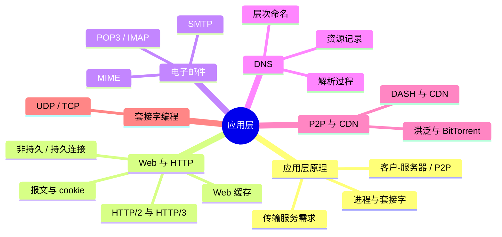


**贯穿全章的一条主线**：创建一个网络应用 = 选架构 + 选传输服务 + 定端口 + 定义应用层协议 + 写客户/服务器程序。

---

## 2.1 应用层原理

### 2.1.1 创建一个网络应用

核心：编写一个**分布式程序**，使其可以：

- 运行在**不同的端系统**上；
- 通过**网络相互通信**。

例如：Web 服务器软件与浏览器软件。

关键设计决定：**应用程序只运行在终端上**。

- 应用程序员**不需要**为网络核心设备（路由器、交换机）编写程序；
- 极大地方便了网络应用的开发和快速部署；
- 这也是因特网"智能终端、简单网络"（端到端原则）的体现。

### 2.1.2 网络应用架构

> 网络应用架构规定了在各个端系统上**组织应用程序**的方法。

两种主流架构：

#### 客户-服务器架构（Client-Server）

- **服务器**：
  - 一台**总是在线**的主机，运行服务器程序；
  - 具有**永久的、众所周知的地址**（域名/IP + 熟知端口）。
- **客户**：
  - 用户终端上运行客户程序，**需要时**与服务器通信、请求服务；
  - 使用**动态地址**，通常**不会总是在线**。
- **客户只与服务器通信，客户之间不通信。**

任务分配：

- 复杂计算和管理任务交给高档机器（服务器）；
- 需要频繁与用户打交道的任务交给前端较简单的客户机。

特点：通常是**基础设施密集**的应用——服务提供商需要服务器集群、高速网络、全球数据中心，投入巨大。

#### P2P 架构（Peer-to-Peer）

- **没有总是在线的服务器主机**（去中心化）；
- 任意一对端系统（**对等方，peer**）可以直接通信；
- 对等方多为用户自己的计算机，使用**动态地址**，**间歇地**连接（动态性）；
- 每个对等方**既可请求服务，也可提供服务**（平等性）。

P2P 的三个特征：

| 特征 | 含义 |
|---|---|
| 去中心化 | 数据传输不依赖专用服务器，资源在用户终端间直接共享 |
| 动态性 | 节点可随时加入或退出，不影响应用整体运行 |
| 平等性 | 每个节点同时承担客户和服务器角色 |

典型 P2P 应用：BitTorrent、迅雷（文件共享）、Skype（语音，已关停）、PPTV（视频直播点播）。

#### 两种架构比较

| | 客户-服务器 | P2P |
|---|---|---|
| 资源分布 | **集中**：资源只在固定终端上提供 | **分散**：任何终端都可提供资源 |
| 优点 | 资源发现简单 | 易于扩容、均衡网络流量 |
| 缺点 | 集中式计算：服务端扩容压力、流量不均衡、响应延迟长 | 资源发现困难；版权、安全性等社会问题 |

**思考（课件）**：

- 为什么传统应用采用 C/S？——资源和服务集中在少量机构手中，在众所周知的地方提供服务是自然选择。
- 为什么出现 P2P？——用户手里资源越来越多，希望分享，而 C/S 不支持这类共享。

### 2.1.3 进程通信

- **进程**：主机上运行的程序；
- 分布式应用中，不同终端上的进程需要通信：
  - 同一主机内：由操作系统提供**进程间通信机制**；
  - 不同主机上：通过**交换报文**通信。
- 一次确定的通信会话中，总能标识：
  - **客户进程**：主动发起请求的进程；
  - **服务器进程**：接收请求的进程。

### 2.1.4 套接字（Socket）

> 套接字是**应用层与传输层的接口**，也是应用程序调用网络服务的 **API**。

类比：应用程序与网络之间有一扇"门"：

- 发送报文：发送进程把报文推到门外，运输设施（因特网）把它送到接收进程门口；
- 接收报文：接收进程打开门即可收到。

设计考虑：应用程序只需**调用**网络服务，不需知道服务实现细节。

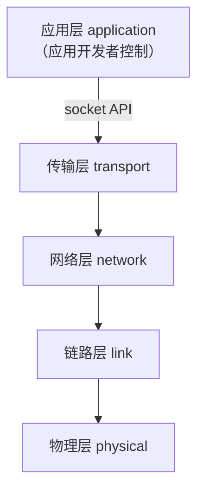


### 2.1.5 进程编址

每个进程需要标识，以便其它进程找到它。

- 能否用主机地址标识进程？**不能**——同一主机上可能运行许多进程。
- **端口号**：用于区分同一主机上的不同进程。
- **进程标识 = 主机地址 + 端口号**。

端口号：

- 16 比特（0–65535）；
- **众所周知的端口号（0–1023）**分配给服务器，成为服务的标识；
- 例：Web 服务器 80，邮件服务器 25。

### 2.1.6 应用需要什么样的传输服务

四类需求：

| 需求 | 说明 | 敏感应用 | 不敏感应用 |
|---|---|---|---|
| **数据完整性（data integrity）** | 是否允许丢失 | 文件传输、电子邮件 | 音视频可容忍一定丢失 |
| **时延（timing）** | 是否有延迟保证 | 网络电话、交互游戏 | 邮件传输 |
| **吞吐量（throughput）** | 是否需要最低带宽保证 | 多媒体 | 弹性应用（elastic） |
| **安全性（security）** | 加密、完整性 | 各类 | — |

**常见应用的传输服务需求（课件表）**：

| 应用 | 数据丢失 | 吞吐量 | 时间敏感 |
|---|---|---|---|
| 文件传输 | 不能丢失 | 弹性 | 不 |
| 电子邮件 | 不能丢失 | 弹性 | 不 |
| Web 文档 | 不能丢失 | 弹性（几 kbps） | 中等敏感 |
| 实时音视频 | 容忍丢失 | 音频几 kbps–1 Mbps；视频 10 kbps–5 Mbps | 是，100 ms |
| 流式存储音视频 | 容忍丢失 | 同上 | 是，几秒 |
| 交互式游戏 | 容忍丢失 | 几 kbps–10 kbps | 是，100 ms |
| 即时通信 | 不能丢失 | 弹性 | 是，不是（视内容） |

### 2.1.7 因特网提供的传输服务

| | TCP | UDP |
|---|---|---|
| 连接 | **面向连接**（建立连接，保证传输顺序） | 无连接 |
| 可靠传输 | **可靠**，不出错、不丢失 | 不保证 |
| 流量控制 | **有**（不压垮接收进程） | 无 |
| 拥塞控制 | **有**（网络超载时抑制发送） | 无 |
| 及时性 | 不提供 | 不提供 |
| 最低带宽保证 | 不提供 | 不提供 |
| 安全性 | 不提供 | 不提供 |

> 因特网只提供 **TCP 和 UDP 两种传输服务**。
> UDP 只提供"最低限度"的服务：通过因特网收发报文。

常见应用使用的传输协议：

| 应用 | 传输协议 |
|---|---|
| 文件传输 | TCP |
| 电子邮件 | TCP |
| Web 文档 | TCP |
| 流式存储音视频 | TCP（基于 HTTP） |
| 实时音视频 | UDP 或 TCP |
| 交互式游戏 | UDP 或 TCP |

### 2.1.8 应用层协议

应用层协议定义：

1. **报文类型**：如 request、response；
2. **报文语法**：报文中的字段及其描述；
3. **报文语义**：各字段中信息的含义；
4. **发送/响应报文应遵循的规则**（时序）。

分类：

- **公共域协议（open protocol）**：在 RFC 中定义，允许互操作，如 HTTP、SMTP；
- **专用协议（proprietary）**：如 Skype（私有协议）。

### 2.1.9 创建网络应用的步骤（小结）

1. 选择网络应用架构：客户-服务器 or P2P；
2. 选择传输服务：TCP or UDP；
3. 确定端口号；
4. 定义应用层协议；
5. 编写客户程序和服务器程序（调用套接字接口）。

> 注意：**应用层协议只是网络应用的一部分**；网络应用还包括客户程序、服务器程序等。

---

## 2.2 Web 与 HTTP

### 2.2.1 Web 应用画像

| 项目 | 内容 |
|---|---|
| 应用层资源 | 网页（web pages） |
| 架构 | 客户-服务器 |
| 客户 | 浏览器 |
| 服务器 | Web 服务器 |
| 传输服务 | TCP |
| 端口号 | 80 |
| 应用层协议 | HTTP（HyperText Transfer Protocol） |

### 2.2.2 基本术语

- **Web 页（page）**由若干**对象（object）**组成；
- **对象**简单说就是文件：HTML 文件、图像、Java 小程序、音频文件等；
- 每个对象通过一个 **URL（Uniform Resource Locator）**获取：

| 组成部分 | 示例 | 含义 |
| --- | --- | --- |
| 协议 | `http` | 访问方式 |
| 主机名 | `www.someschool.edu` | 服务器地址 |
| 路径 | `/someDept/pic.gif` | 对象在服务器上的位置 |


- **HTML（HyperText Markup Language）**：描述页面内容和显示方式的格式语言；
- Web 页通常包含**一个 HTML 基本文件**和**若干引用对象**，每个引用对象在文档中用 URL 给出。

**超文本（Hypertext）**：

- 包含**超链接**的文件；
- 超链接允许从当前位置直接跳转到其它位置或其它文档；
- 一种通过超链接把不同空间的文档组织成网状文本的信息组织方式。

> 理解 HTTP 只需知道：网页 = HTML 基本文件 + 若干引用对象（URL 表示）；对象保存在 Web 服务器；浏览器的任务是取回所有对象并展示。

### 2.2.3 HTTP 概述

- Web 采用客户-服务器模式：
  - 客户（浏览器）：请求、接收、显示 Web 对象；
  - 服务器：应客户请求发送对象。
- HTTP 定义浏览器与 Web 服务器之间的通信规则。
- 版本：
  - HTTP/1.0（RFC 1945）
  - HTTP/1.1（RFC 2068 / 7230）
  - HTTP/2（RFC 7540，2015 标准化）
  - HTTP/3（草案，基于 QUIC）

**HTTP 使用 TCP**：

1. 客户发起到服务器主机 **80 端口**的 TCP 连接（客户端创建套接字）；
2. 服务器接受连接（服务器端创建套接字）；
3. 双方通过套接字交换 HTTP 报文；
4. 关闭 TCP 连接。

**HTTP 是"无状态的"（stateless）**：

- 服务器不保存任何有关客户请求的信息；
- 原因：维护状态很复杂——需要保存历史状态；若服务器/客户崩溃，双方对状态的看法可能不一致，需要协调。

### 2.2.4 非持久连接与持久连接

| | 非持久 HTTP | 持久 HTTP |
|---|---|---|
| 一个 TCP 连接 | 最多发送**一个对象** | 可发送**多个对象** |
| 版本 | HTTP/1.0 | HTTP/1.1 缺省 |

#### 非持久 HTTP 的过程

假设访问 `http://www.someSchool.edu/someDepartment/home.index`（HTML 文件 + 10 个 JPEG）：

1. HTTP 客户在 80 端口建立到服务器的 TCP 连接；
2. 客户把 HTTP 请求报文（含 URL）写入套接字；
3. 服务器接收请求，构造包含对象的响应报文，写入套接字；
4. 服务器**关闭 TCP 连接**；
5. 客户接收 HTML，解析出 10 个 JPEG 引用；
6. 对**每个** JPEG 对象重复步骤 1–5。

#### 响应时间计算（重点）

**RTT（Round-Trip Time）**：一个小分组从客户发送到服务器再返回客户的时间。

- 建立 TCP 连接：**1 RTT**；
- 发送 HTTP 请求到收到响应的前几个字节：**1 RTT**；
- 传输文件的时间：另计（通常忽略）。

因此：

- 请求**一个对象** ≈ **2 RTT**（忽略对象传输时间）；
- 请求一个包含 **11 个对象**（1 个 HTML + 10 个 JPEG）的完整网页 ≈ **22 RTT**；
- 每个对象还要额外消耗操作系统资源（新建 TCP 连接）。

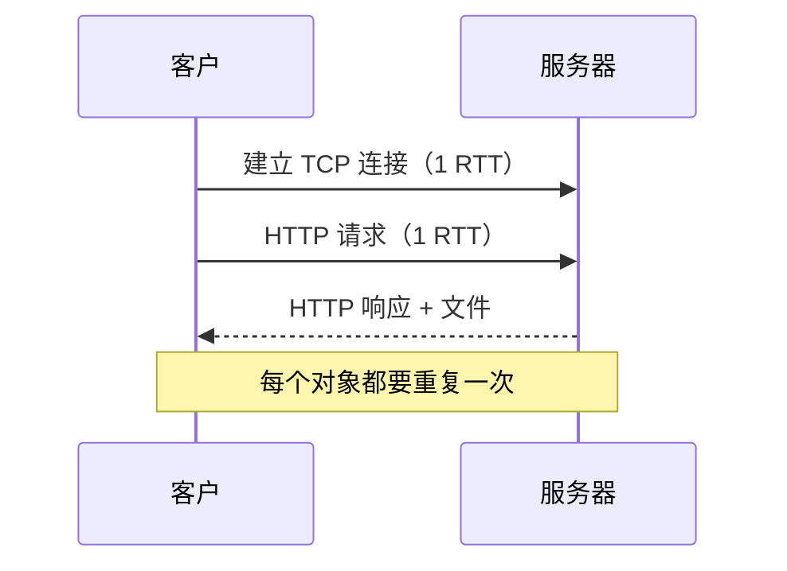


#### 持久 HTTP

非持久 HTTP 的问题：

1. 获取每个对象需要 **2 RTT**；
2. 每个 TCP 连接消耗操作系统资源；
3. 浏览器需要打开多个 TCP 连接来获取一个网页。

持久 HTTP：服务器发送响应后**保持连接**，后续 HTTP 报文可在同一连接上传输。

**无流水线（non-pipelined）**：

- 客户收到前一个响应后才发送新请求；
- 每个对象 **1 RTT**；
- 请求上述网页：1 RTT（建连）+ 1 RTT（HTML）+ 10 RTT（10 个对象）= **12 RTT**。

**流水线（pipelined）**：

- HTTP/1.1 缺省使用；
- 客户每解析到一个引用对象就**立即**发送请求；
- 可在一个 RTT 内请求所有引用对象；
- 请求上述网页 ≈ **3 RTT**（建连 1 + HTML 1 + 所有对象 1）。

| 方式 | 11 个对象的网页耗时 |
|---|---|
| 非持久 HTTP | 22 RTT |
| 持久 + 无流水线 | 12 RTT |
| 持久 + 流水线 | ≈ 3 RTT |

### 2.2.5 HTTP 报文格式

两类报文：

- **请求报文**：客户 → 服务器；
- **响应报文**：服务器 → 客户。

HTTP 报文由 **ASCII 文本**构成。

#### 请求报文

```
GET /somedir/page.html HTTP/1.1     ← 请求行（方法、URL、版本）
Host: www.someschool.edu            ┐
User-agent: Mozilla/4.0             │ 首部行
Connection: close                   │
Accept-language: fr                 ┘
                                    ← 空行（额外的回车换行，表示报头结束）
（可选的报文体）
```

结构：

- **请求行**：方法 + URL + HTTP 版本；
- **首部行**：`Header: value`；
- **空行**（CRLF）；
- **报文体**（可选）。

#### 上传表单输入的两种方式

- **POST 方法**：表单内容放在**报文体**中上传；
- **GET 方法（URL 方式）**：输入内容放在请求行的 **URL 字段**中：

```
www.somesite.com/animalsearch?monkeys&banana
```

#### HTTP 方法

| 方法 | 版本 | 含义 |
|---|---|---|
| GET | 1.0/1.1 | 请求对象 |
| POST | 1.0/1.1 | 提交表单数据（在实体中） |
| HEAD | 1.0/1.1 | 要求服务器**不返回对象**，只返回报文头（实体为空），常用于故障跟踪 |
| PUT | 1.1 | 把报文实体中的文件上传到 URL 指定的路径（目录） |
| DELETE | 1.1 | 删除 URL 指示的文件 |

#### 响应报文

```
HTTP/1.1 200 OK                    ← 状态行（版本、状态码、短语）
Connection: close                  ┐
Date: Thu, 06 Aug 1998 12:00:15 GMT│
Server: Apache/1.3.0 (Unix)        │ 首部行
Last-Modified: Mon, 22 Jun 1998 …  │
Content-Length: 6821               │
Content-Type: text/html            ┘
                                   ← 空行
data data data data data ...       ← 实体（如请求的 HTML 文件）
```

#### 常见状态码

| 状态码 | 短语 | 含义 |
|---|---|---|
| 200 | OK | 请求成功，对象在报文体中 |
| 301 | Moved Permanently | 对象已永久移动，新位置在 `Location:` 首部 |
| 400 | Bad Request | 服务器无法理解请求报文 |
| 404 | Not Found | 服务器上找不到请求的文档 |
| 505 | HTTP Version Not Supported | 不支持该 HTTP 版本 |

### 2.2.6 Cookie：在无状态协议上保存状态

许多大型 Web 网站使用 cookie。**四个组成部分**：

1. HTTP **响应**报文中的 `Set-cookie:` 首部行；
2. HTTP **请求**报文中的 `Cookie:` 首部行；
3. 保存在用户主机上的 **cookie 文件**，由浏览器管理；
4. Web 网站的**后端数据库**。

工作过程（Susan 首次访问某电商网站）：

1. 请求到达 → 服务器创建 ID（如 1678），并在后端数据库建表项；
2. 响应中带上 `Set-cookie: 1678`；
3. 浏览器把 (服务器, 1678) 写入本地 cookie 文件；
4. 一周后再访问，请求携带 `Cookie: 1678`；
5. 服务器据此识别用户，执行个性化动作。


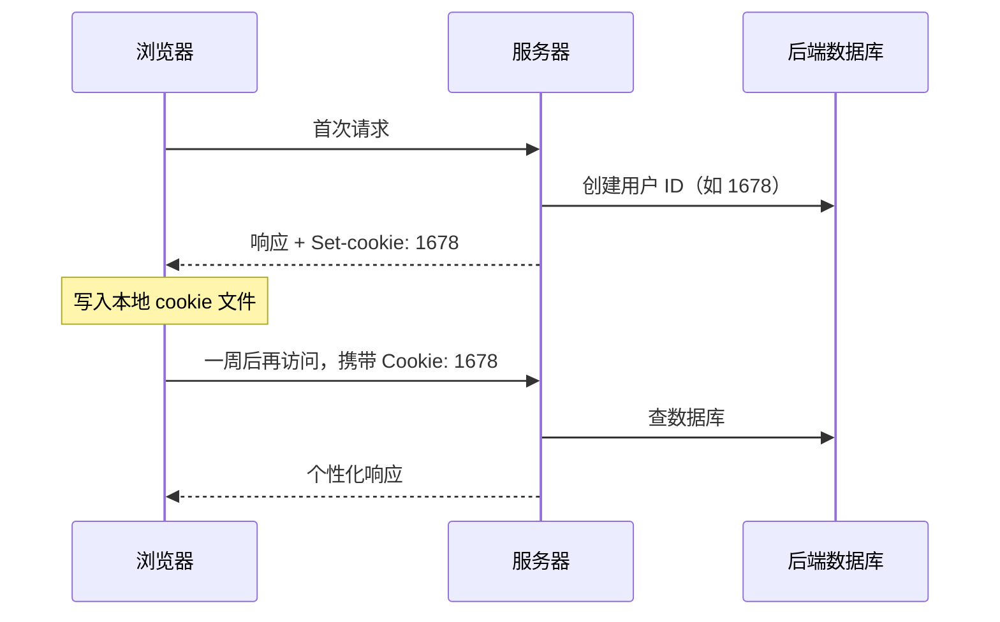


**cookie 能做什么**：

- 用户认证/授权（authorization）；
- 购物车（shopping carts）；
- 个性化推荐；
- 用户行为跟踪。

**隐私问题**：

- Cookie 允许网站收集用户大量信息、分析行为，甚至卖给第三方。

**状态保存在哪里？**

- **服务端**：信息保存在后端数据库，只把 ID 返回客户；
- **客户端**：信息发回客户端，保存在 cookie 文件中，随请求发送。

### 2.2.7 Web 缓存（代理服务器）

> **Web 缓存 / 代理服务器**：代表原始服务器满足 HTTP 请求的网络实体，保存最近请求过的对象的拷贝。

工作方式：

- 用户设置浏览器：所有 HTTP 请求首先发往 Web 缓存；
- 若对象在缓存中（**命中**）：直接返回；
- 若不在（**未命中**）：缓存向原始服务器获取，缓存在本地，再返回给客户。

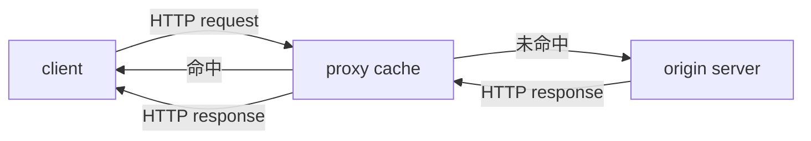


**缓存如何知道原始服务器？**

- HTTP 请求头中的 `Host:` 首部行指出了原始服务器。

**Web 缓存的双重身份**：

- 对浏览器来说是**服务器**；
- 对原始服务器来说是**客户**。

通常由 ISP 提供；多级 ISP 可能形成多级 Web 缓存。

**为什么使用 Web 缓存？**

1. 减轻原始服务器及周边网络的压力；
2. 减少客户请求的响应时间（代理通常离客户更近）；
3. 减少机构接入链路上的流量，从而减少费用。

#### 缓存例题（课件经典）

条件：

- 平均对象长度 = 1 Mb；
- 浏览器到原始服务器的平均请求速率 = 15 次/秒；
- 接入路由器到原始服务器的 RTT = 2 s；
- 机构 LAN = 100 Mbps；接入链路 = 15 Mbps。

无缓存时：

$$
\begin{aligned}
\text{LAN 利用率} &= \frac{15 \times 1\ \text{Mb/s}}{100\ \text{Mbps}} = 15\% \\
\text{接入链路利用率} &= \frac{15 \times 1\ \text{Mb/s}}{15\ \text{Mbps}} = 100\% \\
\text{总时延} &= 2\ \text{s} + \text{分钟级} + \text{毫秒级}
\end{aligned}
$$


**方案一：把接入链路升级到 100 Mbps**

$$
\begin{aligned}
\text{LAN 利用率} &= 15\%,\qquad \text{接入链路利用率} = 15\% \\
\text{总时延} &= 2\ \text{s} + \text{毫秒} + \text{毫秒}
\end{aligned}
$$


缺点：**链路升级代价高昂**。

**方案二：安装 Web 缓存（假设命中率 0.4）**

$$
\begin{aligned}
&40\%\ \text{请求由缓存直接满足} \\
&60\%\ \text{请求仍需访问原始服务器} \\
&\text{接入链路利用率} = 60\%,\qquad \text{接入链路时延} \approx 10\ \text{ms} \\
&\text{平均总时延} = 0.6 \times 2.01\ \text{s} + 0.4 \times \text{ms} \approx 1.2\ \text{s}
\end{aligned}
$$


结论：**缓存方案比升级链路时延更低、成本更小**。

### 2.2.8 条件 GET（Conditional GET）

问题：代理如何判断缓存对象是否最新？

方法：缓存发送的 GET 请求包含：

请求首部行：`If-modified-since: <date>`。


服务器处理：

- 对象**无更新**：响应 `HTTP/1.0 304 Not Modified`，**不包含对象**；
- 对象**有更新**：响应 `HTTP/1.0 200 OK` + 对象数据。

日期来源：

- 之前响应中的 `Last-Modified:` 首部行；
- 缓存把它拷贝到 `If-modified-since:` 首部行。

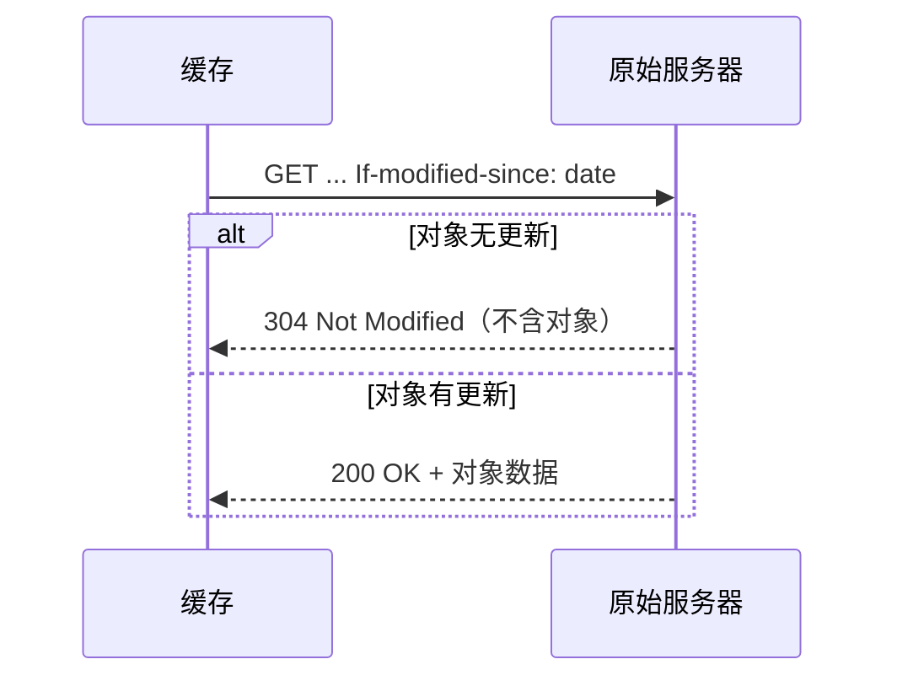


### 2.2.9 HTTP/2

HTTP/1.1 的问题：**队头阻塞（Head-of-Line blocking，HOL）**。

- 一条 TCP 连接传输一个网页；
- 客户流水式发送对象请求，服务器按**先来先服务**顺序发送响应；
- 大对象（如视频）排在前面时，后面的小对象经历很长排队延迟；
- 浏览器可同时打开多条 TCP 连接（最多约 6 条），但每条连接上仍必须**按序**处理。

HTTP/2（2015 标准化）的改进：

- **仍使用一条 TCP 连接**，但通过**调整响应发送顺序**缓解队头阻塞；
- 服务器把对象划分成**帧（frame）**，交替发送不同对象的帧；
- 客户可指定对象**优先级**，服务器按优先级发送；
- 服务器可**不等请求**，主动把网页中的对象推送给客户（服务器解析 HTML 可得到全部对象 URL）。

| 版本 | 发送方式 | 结果 |
| --- | --- | --- |
| HTTP/1.1 | 按请求顺序依次发送 O1 O2 O3 O4 | 大对象 O1 阻塞后面的对象 |
| HTTP/2 | 把对象切成帧，交替发送（O2 O4 O1 O3 …） | 小对象优先到达，平均延迟降低 |


> 课件注：HTTP/2 的改进类似"最短作业优先（shortest job first）"，可降低平均延迟。

### 2.2.10 HTTP/3

HTTP/2 仍存在的问题：

- 使用 TCP，**丢包恢复时会暂停所有对象传输**（TCP 层的队头阻塞）；
- TCP 连接本身**没有安全保护**。

HTTP/3：

- 使用新型传输层服务 **QUIC**（基于 UDP）；
- 保留 HTTP/2 的许多特征（如交替发送对象报文）；
- 增加**针对每个对象的差错控制和拥塞控制**；
- 增加**内容加密**等。

### 2.2.11 理解 HTTP 与 Web 技术的发展脉络（思考题）

- 为什么 HTTP 最初设计为**非持久、无状态**？——简单、服务器无需维护状态；
- 为什么引入**持久连接**？——减少建连开销和 RTT；
- 为什么引入 **cookie**？它带来什么问题？——在无状态协议上保存状态；隐私问题；
- 为什么引入 **Web 缓存**？带来什么问题、如何解决？——降低延迟/流量；一致性用条件 GET 解决；
- 为什么引入 **HTTP/2**？——解决应用层队头阻塞；
- 为什么引入 **HTTP/3**？——解决 TCP 层队头阻塞并提供加密。

---

## 2.3 电子邮件

### 2.3.1 电子邮件应用画像

| 项目 | 内容 |
|---|---|
| 传输对象 | 邮件 |
| 架构 | 客户-服务器 |
| 传输服务 | TCP |
| 邮件传输协议 | **SMTP**（端口 25） |
| 邮件访问协议 | **POP3**（110）、**IMAP**（143）、HTTP |
| 交互方式 | 命令/响应 |

### 2.3.2 电子邮件系统的组成

最初由三部分组成：**用户代理、邮件服务器、简单邮件传输协议**。

现代系统四部分：**用户代理、邮件服务器、SMTP、邮件访问协议（POP3/IMAP/HTTP）**。


**用户代理（User Agent）**：

- 编辑、阅读、回复邮件；
- 把要外发的邮件发送到用户的邮件服务器；
- 从用户邮箱中取邮件；
- 例子：Outlook、elm、Mozilla、Thunderbird。

**邮件服务器**：

- **用户信箱（user mailbox）**：存放到来的邮件；
- **发送报文队列（outgoing message queue）**：存放要发送出去的邮件；
- **报文传输代理（MTA）**：系统守护进程，负责在邮件服务器之间传输邮件，并把收到的邮件放入用户信箱。

**电子信箱**：

- 计算机上的一个存储区域（如磁盘文件）；
- 每个信箱分配唯一电子邮件地址：`mailbox@computer`；
  - 前者标识用户信箱；
  - 后者是信箱所在邮件服务器的名字。

### 2.3.3 SMTP（Simple Mail Transfer Protocol）

- 邮件服务器之间采用**客户-服务器模式**：
  - 客户：发送邮件的 MTA；
  - 服务器：接收邮件的 MTA。
- 使用 **TCP**，服务器端口 **25**；
- 发送方与接收方邮件服务器之间**直接传输**；
- **命令/响应**交互：
  - 命令：ASCII 文本；
  - 响应：状态码 + 短语；
- 报文**只能包含简单 ASCII 文本**（7 位 ASCII，最初仅为英文邮件设计）。

#### 邮件发送场景（Alice → Bob）

1. Alice 用 UA 编辑邮件，发给 `bob@someschool.edu`；
2. Alice 的 UA 用 **SMTP** 把邮件发给她的邮件服务器；
3. 邮件进入发送队列；
4. Alice 的邮件服务器与 Bob 的邮件服务器建立 TCP 连接，发送邮件；
5. Bob 的邮件服务器把邮件放入 Bob 的信箱；
6. Bob 调用 UA 阅读邮件（通过邮件访问协议）。

#### 邮件传送阶段

**（1）连接与握手**：

- MTA 客户与 MTA 服务器在端口 25 建立 TCP 连接；
- 服务器发送服务就绪；
- 客户发送 `HELO` 命令，用域名标识自己（自报家门）；
- 服务器响应。

**（2）邮件传输**：

- 以命令/响应方式传输（`MAIL FROM`、`RCPT TO`、`DATA` 等）；
- 一个方向的邮件传输结束后，**可以在另一个方向上传输邮件**（SMTP 特有）。

**（3）结束传输**：

- 客户发送 `QUIT`；
- 服务器响应；
- 释放 TCP 连接。

#### SMTP vs HTTP

| | SMTP | HTTP |
|---|---|---|
| 持久连接 | **使用**（一条 TCP 连接可传多封邮件） | HTTP/1.1 起使用（一条连接可传多个对象） |
| 报文内容 | 只允许简单 ASCII 文本 | 无此限制 |
| 方向 | **推（push）** | **拉（pull）** |
| 交互 | 命令/响应 | 请求/响应 |

### 2.3.4 邮件报文格式

RFC 822 规定：

```
From: alice@crepes.fr          ┐
To: bob@hamburger.edu          │ 首部（header）
Subject: Picture of yummy crepe│
                               ┘
（空行）
邮件正文（body，只能使用简单 ASCII 字符）
```

- 首部行：`To:`、`From:`、`Subject:` 等；
- 空行分隔首部与实体；
- **实体只能使用简单 ASCII 字符**。

### 2.3.5 MIME：传输非 ASCII 内容

问题：现代邮件需要传输其它语系文字，甚至图片等非文本信息。

- 非 ASCII 数据在发送前必须转换成**简单 ASCII 文本**；
- 非 ASCII 报文大多有特殊数据类型，需要特殊阅读器（如 JPEG 解压软件）；
- 需要**扩展报文的数据类型**。

解决方案：**MIME（Multipurpose Internet Mail Extensions，多用途因特网邮件扩展）**。

- 扩展 RFC 822，允许实体具有不同数据类型；
- 规定非 ASCII 信息传输时的**统一编码形式**；
- 扩充首部行，最重要的是：
  - `Content-Transfer-Encoding`：实体采用的传输编码形式；
  - `Content-Type`：实体的数据类型及子类型。

MIME 报文示例：

```
From: alice@crepes.fr
To: bob@hamburger.edu
Subject: Picture of yummy crepe.
MIME-Version: 1.0
Content-Transfer-Encoding: base64
Content-Type: image/jpeg

base64 encoded data .....
.........................
......base64 encoded data
```

#### Base64 编码

把二进制字节序列转换成由简单 ASCII 字符构成的文本：

- 每 **24 比特**数据划分为 **4 个 6 比特**单元；
- 每个 6 比特单元编码成一个 ASCII 字符：
  - 0–25 → `A`–`Z`
  - 26–51 → `a`–`z`
  - 52–61 → `0`–`9`
  - 62 → `+`，63 → `/`
- 最后一组只有 8 比特或 16 比特时，分别加 `==` 或 `=` 后缀；
- 回车和换行可忽略，可插在任何地方。

$3 	ext{字节} = 24 	ext{bit} = 4 	imes 6 	ext{bit} 
ightarrow 4 	ext{个 ASCII 字符}$


#### quoted-printable 编码

适用于**绝大部分是 ASCII** 的报文：

- 每个 ASCII 字符保持不变；
- 非 ASCII 字符（>127）：把其十六进制表示用两个 ASCII 字符标记，前面冠以 `=`。

例如：字节 `0xE4` → `=E4`。

### 2.3.6 邮件访问协议

问题：

- 能否把用户信箱放在本地终端？**不能**——用户终端不可能一直在线；
- 能否用 SMTP 从服务器取邮件？**不能**——SMTP 是**推**协议，只能把邮件推到邮件服务器。

解决方案：设计专门的**邮件访问协议**。

**两阶段交付**：

1. **邮件投递**：邮件从发信方投递到收信人的**永久信箱**（SMTP）；
2. **邮件访问**：收信人从永久信箱**拉取**邮件（POP3/IMAP/HTTP）。

带永久信箱的计算机需运行两个服务器程序：

- **SMTP 服务器**：收发邮件，把收到的邮件放入用户信箱；
- **邮件访问服务器**：允许用户从信箱中提取邮件。

| 协议 | 端口 | 特点 |
|---|---|---|
| **POP3**（Post Office Protocol） | TCP 110（明文）/ 995（加密） | 邮件从服务器**下载至本地**保存 |
| **IMAP**（Internet Mail Access Protocol） | TCP 143（明文）/ 993（加密） | 邮件**始终保存在服务器**，用户用文件夹管理 |
| **HTTP** | 80/443 | 基于 Web 的邮件访问（Webmail） |

**基于 Web 的邮件（如 Gmail）**：

- 用户代理为普通浏览器；
- 发送邮件：浏览器用 HTTP 把邮件发给邮件服务器；
- 获取邮件：浏览器用 HTTP 从信箱取邮件；
- **邮件服务器之间仍用 SMTP** 传输报文。

### 2.3.7 电子邮件小结

- 系统组成：用户代理、邮件服务器、SMTP、邮件访问协议（4 部分）；
- SMTP：TCP、端口 25、**推**协议、命令/响应、信体只能简单 ASCII；
- MIME：允许非 ASCII 内容，规定传输编码、扩展数据类型；
- 两阶段交付：**投递**（push，SMTP）+ **访问**（pull，POP3/IMAP/HTTP）。

---

## 2.4 DNS（Domain Name System）

### 2.4.1 为什么需要 DNS

因特网主机需要两种标识：

- **IP 地址**（32 bit）——由机器使用；
- **名字**（如 `www.yahoo.com`）——由人使用，便于记忆。

问题：如何提供**主机名 → IP 地址**的映射？

> **DNS 是因特网的目录服务**：把主机名映射到 IP 地址。

DNS 的实现特点：

- 是一个**应用层服务**（由其它网络应用使用）；
- **客户-服务器模式**；
- 主要使用 **UDP**，有时使用 **TCP**，端口号 **53**；
- 请求/响应报文交互。

### 2.4.2 DNS 提供的服务

| 服务 | 说明 |
|---|---|
| **主机名 → IP 地址** | 核心功能 |
| **主机别名（host aliasing）** | 主机除规范名外可有一个或多个别名（易记），如 `www.ustc.edu.cn`；DNS 提供别名→规范名映射 |
| **邮件服务器别名（mail server aliasing）** | 允许用域名作为邮件服务器别名，如 `xxx@ustc.edu.cn` |
| **负载分配（load distribution）** | 一个规范主机名可对应**一组 IP 地址**，把请求分配到一群功能相同的服务器 |

### 2.4.3 DNS 工作机理

应用程序（如浏览器）解析主机名的过程：

1. 应用调用本地例程（**解析器，resolver**），主机名作为参数；
2. 解析器向**本地 DNS 服务器**发送查询报文；
3. 本地 DNS 服务器向相关 DNS 服务器查询，获得 IP；
4. 解析器收到含 IP 的响应；
5. 解析器把 IP 返回给调用者。

> 对应用程序而言，DNS 是一个提供**直接转换服务**的黑盒子；但内部是由全球大量 DNS 服务器协作的分布式系统。

### 2.4.4 为什么 DNS 是分布式数据库

集中式 DNS 的问题：

1. **单点失效**；
2. **流量集中**：单个服务器需处理全部查询；
3. **响应时间长**：远距离的集中式数据库；
4. **维护庞大数据库**。

结论：**Doesn't scale!** 必须分布式。

### 2.4.5 名字空间与域名

**名字空间（namespace）**：因特网主机名字的集合，同时给出命名主机的方法。

- 概念上因特网被划分成 **200 多个顶级域**；
- 每个顶级域可继续划分子域，依次类推；
- 主机名采用**分层命名**。

**域（domain）**：名字树中，以任何一个节点为根的**子树**。

**标记（label）**：树上每个节点有一个标记（最多 63 字符），树根的标记是空字符串。

**域名（domain name）**：从该域开始**向上直到树根**的标记序列，标记之间用句点隔开（类似国外邮政地址写法）。

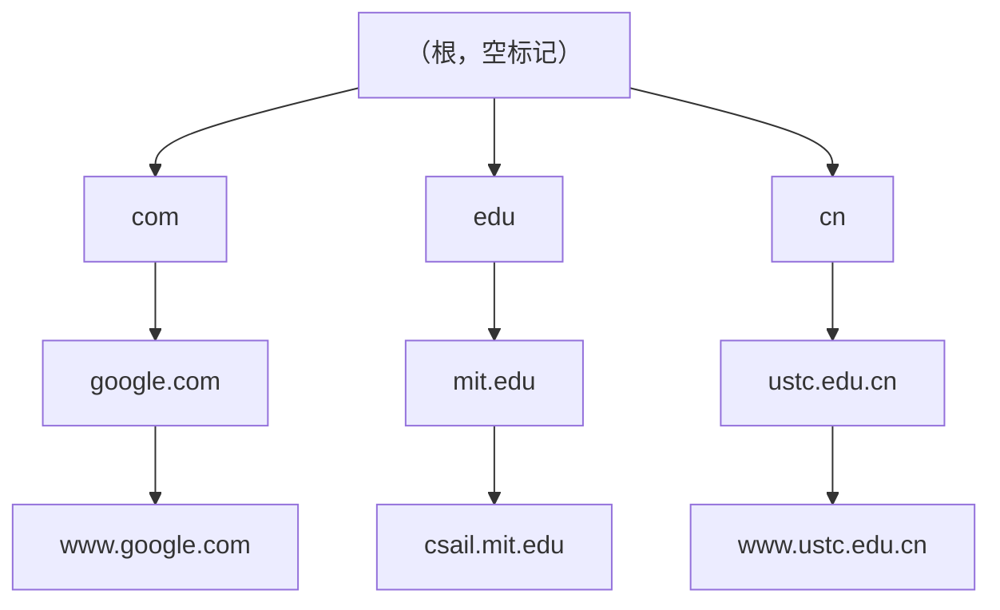


- 域名的**任一后缀也是一个域**；
- 同一机构内的主机具有相同的域名后缀；
- 每个节点只需保证**其孩子节点的标记不重名**。

**顶级域（TLD）三类**：

| 类型 | 说明 | 例子 |
|---|---|---|
| **组织域** | 由美国国内及一些国际组织使用 | com、org、net、edu、gov |
| **国家域** | 二字符国家代码，每个国家一个 | cn、uk、jp、de |
| **反向域** | 顶级域名 `arpa`，用于 IP → 域名的反向解析（溯源） | `in-addr.arpa` |

**反向解析**：

- IP 地址 `132.34.45.121` 表示为 `121.45.34.132.in-addr.arpa`；
- 以该字符串作为参数调用解析器；
- 电信运营商用自己的 DNS 服务器提供反向解析。

### 2.4.6 域名服务器的组织层次

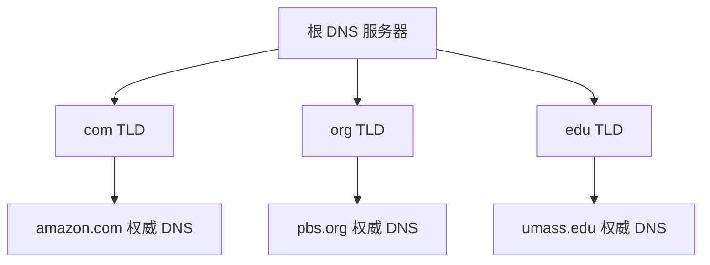


解析 `www.amazon.com` 的层次查询：

1. 查询**根服务器** → 得到 `com` 域 DNS 服务器地址；
2. 查询 **com TLD 服务器** → 得到 `amazon.com` 域 DNS 服务器地址；
3. 查询 **amazon.com 权威服务器** → 得到 `www.amazon.com` 的 IP。

**根域名服务器**：

- 全球有 **13 个根服务器**（每个是一个服务器集群，通过 anycast 分布在全球多地）；
- 知道所有**顶级域服务器**的 IP 地址。

**顶级域（TLD）服务器**：

- 每个 TLD 服务器负责一个顶级域；
- 知道其所有**二级子域**的域名服务器地址。

**权威 DNS 服务器（authoritative）**：

- 机构的 DNS 服务器，提供机构内部服务器的名字映射；
- 通常有一个**主域名服务器** + 一个或多个**辅助域名服务器**；
- 可由机构自己维护，也可委托 ISP 维护。

**本地 DNS 服务器（local DNS server）**：

- **严格来说不属于** DNS 服务器的层次结构；
- 每个 ISP 都有一台，也称"默认 DNS 服务器"；
- 解析器的查询报文实际上发送给它；
- 它起**代理**作用：把查询转发到层次结构中，并把结果返回解析器。

### 2.4.7 递归查询与迭代查询

例：`cis.poly.edu` 上的主机查询 `gaia.cs.umass.edu` 的 IP。

**迭代查询（iterative）**：

> 收到查询的服务器把**下一个需要查询的服务器地址**返回给查询者。
> "我不知道这个名字，但你可以去问这台服务器。"

过程：

1. 主机 → 本地 DNS：查询 `gaia.cs.umass.edu`；
2. 本地 DNS → 根：根返回 `.edu` TLD 服务器地址；
3. 本地 DNS → `.edu` TLD：返回 `umass.edu` 权威服务器地址；
4. 本地 DNS → `umass.edu` 权威：返回 IP；
5. 本地 DNS → 主机：返回 IP。

**递归查询（recursive）**：

> 被查询的服务器**代替查询者**继续查询，直到得到最终答案再返回。
> 把名字解析的负担放在被联系的服务器上。

**实际过程：递归 + 迭代结合**：

- **解析器 → 本地 DNS**：**递归**查询；
- **本地 DNS → 根/TLD/权威**：**迭代**查询。

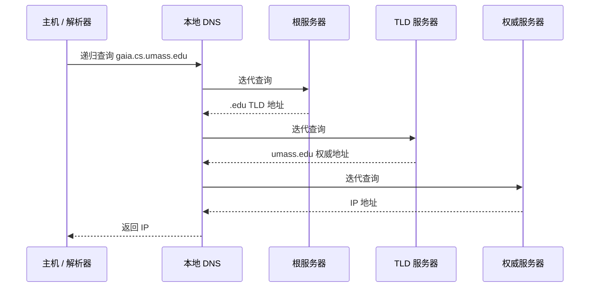


> 本地 DNS 服务器的存在，使 DNS 对解析器来说是一个黑盒子。

### 2.4.8 DNS Zone 与物理服务器层次

- **DNS zone**：整个 DNS 名字空间被划分为一些**不重叠的区域**，每个 zone 包含域名树的一部分；
- 管理上，每个 zone 代表一个**权威域的边界**。

**物理服务器的层次 ≠ 域名空间的逻辑层次**：

- 一个物理服务器保存的信息可能涉及域名空间的若干层；
- 它也可以把域划分为若干子域，把其中一些**委托**给其它服务器。

### 2.4.9 DNS 缓存

- 每当收到一个响应，DNS 服务器把映射信息**缓存在本地**；
- 后续查询**首先使用缓存**；
- 缓存项在一定时间后**丢弃**（TTL）；
- 特别地，本地 DNS 服务器通常缓存 **TLD 服务器的 IP**，因而很少访问根服务器。

> 缓存提高性能，但会带来**一致性**问题（缓存过期），因此需要 TTL。

### 2.4.10 DNS 资源记录（RR）

DNS 更准确的说法：**存储资源记录（RR）的分布式数据库**。

格式：

$left(	ext{name}, 	ext{type}, 	ext{ttl}, 	ext{value}
ight)$


| 类型 | Name | Value | 含义 |
|---|---|---|---|
| **A** | 主机名 | IP 地址 | 主机名 → IPv4 地址 |
| **NS** | 域（如 foo.com） | 该域权威 DNS 服务器的主机名 | 域的名字服务器 |
| **CNAME** | 别名 | 规范名 | 别名 → 规范主机名 |
| **MX** | 域（如 foo.com） | 该域邮件服务器名字 | 邮件交换记录 |

### 2.4.11 往 DNS 中插入资源记录（例子）

新公司 "Network Utopia" 注册域名 `networkutopia.com`：

1. 向 DNS 注册机构注册域名；
2. 提供权威 DNS 服务器（主、辅）的名字和 IP；
3. 注册机构在 **com TLD 服务器**中插入两条记录：

- `(networkutopia.com, dns1.networkutopia.com, NS)`
- `(dns1.networkutopia.com, 212.212.212.1, A)`


4. 建立权威 DNS 服务器：
   - `www.networkutopia.com` 的 **CNAME** 记录 + 对应 Web 服务器的 **A** 记录；
   - `networkutopia.com` 的 **MX** 记录 + 对应邮件服务器的 **A** 记录。

### 2.4.12 DNS 协议与报文

DNS 定义**查询**和**响应**两种报文，**格式相同**。

报文结构：

| 部分 | 内容 |
| --- | --- |
| 报头 header | identification（16 bit）、flags（查询/响应、期望递归、支持递归、权威回答） |
| 问题部分 questions | 查询的 name、type |
| 回答部分 answers | 查询返回的 RR |
| 权威部分 authority | 权威服务器的记录 |
| 附加部分 additional | 可能有用的附加信息 |


报头字段：

- `identification`：16 比特，查询与响应使用同一编号；
- `flags`：
  - query or reply；
  - recursion desired（q）；
  - recursion available（r）；
  - reply is authoritative。

### 2.4.13 DNS 的传输层选择

- 主要使用 **UDP**，有时使用 **TCP**，熟知端口都是 **53**；
- 响应报文 **< 512 字节**：使用 UDP；
- 响应报文 **> 512 字节**：使用 TCP；
- 解析器事先不知道响应长度时：
  1. 先使用 UDP；
  2. 若响应超过 512 字节，服务器**截断**报文，置 DNS 报头 **TC 标志 = 1**；
  3. 解析程序打开 TCP 连接，重复请求，得到完整响应。

**思考：为什么 DNS 主要使用 UDP？**

- 查询/响应通常很小，一次往返即可完成；
- 无连接，**避免 TCP 建连的 RTT 开销**；
- DNS 服务器需承受海量查询，UDP 开销小、无状态、易扩展；
- 应用层可自行实现超时重传。

### 2.4.14 DNS 的安全问题

历史上重大断网事件，很多由根服务器/DNS 受攻击引起：

- **2016 年 10 月 22 日**：美国主要 DNS 服务商 **Dyn** 遭遇史上最严重 DDoS 攻击，大半个美国用户集体断网；
- **重定向攻击**：
  - **DNS 缓存投毒**：伪造 DNS 响应，篡改域名解析结果；
  - **DNS 劫持**：拦截域名查询请求，返回虚假 IP（访问假网站），或使请求失去响应；
- **利用 DNS 实施 DDoS**：僵尸网络常利用 DNS 与 C&C 服务器通信；
- **国家安全问题**："谁控制了根服务器，谁就控制了互联网"；
  - 我国没有 IPv4 根服务器，但建设了 IPv6 根服务器。

### 2.4.15 DNS 小结

- 提供**层次结构**的主机命名方法；
- 实现由 DNS 服务器构成的**分布式数据库**；
- 提供查询域名数据库的**应用层协议**；
- 域名服务器有逻辑层次和物理层次（二者不同）；
- DNS 服务的调用：向本地 DNS 代理的一次 **RPC 调用**；
- 查询方式：**递归 + 迭代**；
- 传输：主要 UDP，也可 TCP，端口均 53；
- 缓存提高性能。

---

## 2.5 P2P 应用

### 2.5.1 P2P 文件共享示例

Alice 在笔记本上运行 P2P 客户应用：

1. 通过 ISP 接入因特网，请求歌曲 "Hey Jude"；
2. P2P 客户显示拥有该歌曲拷贝的**对等方列表**；
3. Alice 选择其中一个对等方（如 Bob）；
4. 文件从 Bob 的 PC 下载到 Alice 的笔记本；
5. 同时，其他用户也可能从 Alice 的笔记本下载。

> Alice 的 P2P 应用既是**客户**，又是**临时服务器**。

### 2.5.2 集中式目录：Napster

第一个 P2P 文件共享服务 Napster 的设计：

1. 每个对等方连接**集中式目录服务器**，告知：
   - 自己的 IP 地址；
   - 可共享的内容。
2. Alice 查询歌曲 "Hey Jude"；
3. Alice 从 Bob 下载文件。

问题：

- **单点失效**；
- 目录服务器成为**性能瓶颈**；
- 因版权问题易成为**诉讼对象**；
- 本质：**文件传输去中心化，但内容定位高度集中化**。

### 2.5.3 查询洪泛：Gnutella

特点：

- **完全分布**，没有集中式服务器；
- 公共域协议；
- 有多种 Gnutella 客户软件。

**覆盖网络（overlay network）**：

- 若对等方 X 与 Y 之间存在一条 **TCP 连接**，称它们之间存在一条**边**；
- 所有活跃对等方及其边构成一个覆盖网络；
- 边是**虚拟链路**；
- 一个对等方通常有 **< 10 个**覆盖网邻居。

**对等方加入**：

1. 新加入的 Alice 需要发现其它对等方：使用客户软件自带的**候选对等方列表**；
2. Alice 依次与候选列表中的对等方尝试建立 TCP 连接；
3. **洪泛（flooding）**：
   - Alice 向每个覆盖网邻居发送 **Ping** 报文；
   - 每个邻居向它的邻居转发 Ping……；
   - 收到 Ping 的对等方向 Alice 发送 **Pong**；
   - Alice 收到许多 Pong，从而建立更多 TCP 连接。

**协议消息**：

- **Query**：查询方在已有 TCP 连接上发送；收到消息的对等方向其邻居**转发**；
- **QueryHit**：有内容的对等方向查询方返回；
- **文件传输**：使用 **HTTP**。

**可扩展性**：

- 采用**有限范围的洪泛（limited-scope flooding）**；
- 洪泛的跳数受限（TTL），避免网络被查询淹没。

### 2.5.4 层次结构的覆盖网

介于集中式目录和查询洪泛之间：

- 每个对等方或是**超级节点（supernode / group leader）**，或是从属于某个超级节点的**普通节点**；
- 每个普通节点与其超级节点建立 TCP 连接；
- 某些超级节点之间建立 TCP 连接；
- 超级节点知道其所有从属节点的共享内容列表。

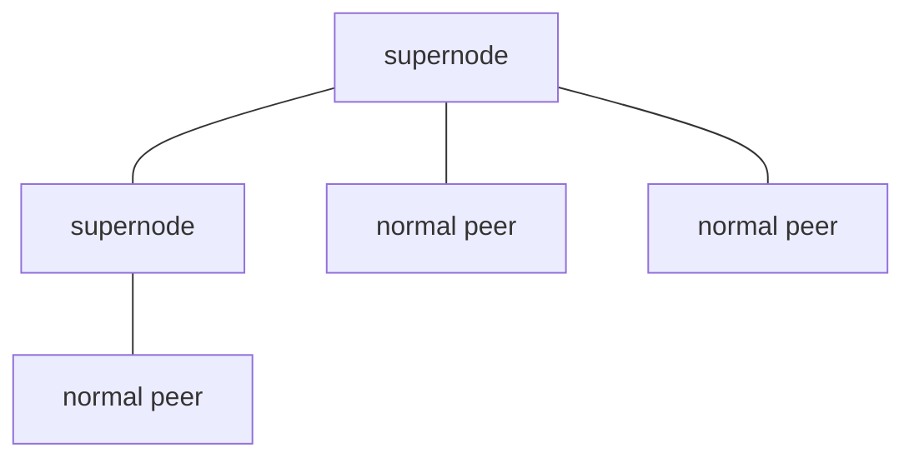


### 2.5.5 文件分发时间：客户-服务器 vs P2P

问题：把大小为 `F` 的文件分发给 `N` 个终端，需要多少时间？

参数：

- `us`：服务器上传带宽；
- `ui`：第 i 个终端的上传带宽；
- `di`：第 i 个终端的下载带宽；
- 假设所有瓶颈都在接入链路，且带宽全部用于分发文件。

**客户-服务器架构**：

- 服务器必须发送 N 个拷贝：`NF / us`；
- 第 i 个客户下载耗时：`F / di`；
- 因此：

$$d_{\text{cs}} \ge \max\left\{\frac{NF}{u_s},\ \frac{F}{\min(d_i)}\right\}$$


- 对较大 N，分发时间随 **N 线性增长**。

**P2P 架构**：

- 服务器至少发送一个拷贝：`F/us`；
- 第 i 个客户至少下载：`F/di`；
- 总共 `NF` bits 必须在网络中上传，网络总上传带宽为 `us + Σui`：

$$d_{\text{P2P}} \ge \max\left\{\frac{F}{u_s},\ \frac{F}{\min(d_i)},\ \frac{NF}{u_s+\sum u_i}\right\}$$


- 分发时间**不会随 N 线性增长**。

**比较（课件假设）**：

- 每个客户上传带宽均为 `u`，`F/u = 1 hour`，`us = 10u`，`dmin > us`（下载不是瓶颈）；
- 客户-服务器：分发时间随 N 线性增大；
- P2P：最小分发时间总是小于客户-服务器；对任意 N，最小分发时间**总是小于 1 小时**。

### 2.5.6 BitTorrent

**基本概念**：

- **Torrent（洪流）**：参与某个特定文件分发的对等方集合；
- **Tracker（跟踪器）**：跟踪洪流中的对等方；
- 文件被划分为 **256 KB** 的**块（chunk）**。

**加入洪流**：

1. 向 tracker 注册，获得一个**对等方列表**；
2. 尝试向列表中的对等方建立 TCP 连接。

**下载块（Pulling Chunks）**：

- 任意时刻，不同对等方拥有不同的块子集；
- 周期性询问每个邻居其拥有的块集合；
- 向邻居请求自己缺少的块：
  - **最稀罕优先（rarest first）**：优先请求在邻居中**拷贝数量最少**的块。

**上传块（Sending Chunks）：tit-for-tat（一报还一报）**：

- Alice 选择当前**向她发送数据最快的 4 个邻居**，响应他们的块请求；
- 每隔 **10 秒**重新评估这 4 个邻居；
- 每隔 **30 秒**随机选择另一个对等方（如 Bob）响应其请求（**乐观 unchoke**）；
  - Alice 可能成为向 Bob 上载最快的 4 个邻居之一；
  - 之后 Bob 很可能选择响应 Alice 的请求。

> tit-for-tat 激励对等方贡献上传带宽，避免"只下载不上传"的搭便车行为。

---

## 2.6 视频流式传输与内容分发网络（CDN）

### 2.6.1 背景与挑战

- 视频已成为因特网流量的主体：
  - **2020 年，Netflix、YouTube、Amazon Prime 等流式视频消耗了 80% 的住宅 ISP 流量**。
- **挑战一**：如何支持 10 亿用户？——单台视频服务器肯定不行。
- **挑战二**：网络环境异构——用户接收能力不同（有线/无线、高/低带宽）。
- 解决方案：**内容分发网络 CDN**。

### 2.6.2 视频的基本概念

- 视频是**以恒定速率播放的图像序列**，如 24 帧/秒；
- 数字图像是**像素阵列**，每个像素用一些比特表示；
- 图像编码利用**帧内冗余**和**帧间冗余**减少比特数：
  - **空间冗余（帧内）**：如一片相同颜色，只发送"颜色值 + 重复次数"；
  - **时间冗余（帧间）**：只发送与前一帧的**差异**，而不是完整帧。

### 2.6.3 视频编码速率

| 类型 | 特点 |
|---|---|
| **CBR（Constant Bit Rate）** | 编码器输出速率固定；编码效率低——简单帧浪费码率，复杂帧码率不够 |
| **VBR（Variable Bit Rate）** | 编码器输出速率可变；编码效率高 |

视频编码标准：

| 标准 | 典型速率 |
|---|---|
| MPEG 1（CD-ROM） | 1.5 Mbps |
| MPEG 2（DVD） | 3–6 Mbps |
| MPEG 4（常用于 Internet） | 64 kbps–12 Mbps |

### 2.6.4 流式存储视频的简单实现

- 视频作为普通文件保存在 **HTTP 服务器**中；
- 服务器与客户建立 TCP 连接，发送文件；
- 视频应用周期性从应用缓存取帧、解码、展示；
- 用户"边接收、边播放"。

问题：**所有客户使用相同的编码速率，但不同客户的网络环境不同**。

### 2.6.5 DASH（Dynamic, Adaptive Streaming over HTTP）

适应异构网络环境的视频编码/传输方案。

**服务器**：

- 把视频文件划分为多个**块**；
- 每个块以**不同码率**编码和存储（多个版本）；
- **元文件（manifest）**为不同块提供 URL。

**客户**：

- 周期性测量到服务器的网络带宽；
- 查询元文件，每次请求一个块；
- 选择当前带宽可支持的**最大码率**；
- 不同时刻可选择不同码率的块。

客户端"智能地"决定：

1. **什么时候请求块**（避免缓存不足或溢出）；
2. **请求什么码率的块**（获得当前最好的视频质量）；
3. **向谁请求块**（离客户最近或带宽最高的节点）。

### 2.6.6 如何向大量用户流式传输内容

**方法 1：使用一个巨型服务器（不可行）**

- 单点故障；
- 服务器瓶颈、网络拥塞点；
- 远端用户传输距离长，跨多个 ISP，带宽低；
- 同一条链路上传输多个视频拷贝，浪费带宽。

**方法 2：地理上分布的多个站点（CDN）**

两种部署策略：

| 策略 | 说明 | 例子 |
|---|---|---|
| **Enter deep（深入）** | 把 CDN 服务器深入部署到大量**接入网**中，靠近用户 | 2015 年 Akamai 在 120 多个国家部署了 **240,000 个**服务器 |
| **Bring home（带回家）** | 把少量（几十个）较大集群部署在靠近接入网的 **PoP** 中 | Limelight 采用此法 |

### 2.6.7 CDN 工作原理

- 在多个 CDN 站点存储内容的**拷贝**；
- 用户向内容提供商请求内容，获得**元文件（manifest file）**；
- 用户从**最近的 CDN 站点**获取内容拷贝；
- 网络拥塞时，可向其它网络条件较好的站点请求。

### 2.6.8 CDN 内容访问：DNS 重定向的例子

Bob 请求视频 `http://video.netcinema.com/6Y7B23V`，视频实际保存在 `http://KingCDN.com/...`：

1. Bob 从 `netcinema.com` 网站得到视频 URL；
2. Bob 的**本地 DNS 服务器**解析 `video.netcinema.com`；
3. `netcinema` 的**权威 DNS** 返回该 URL 的**别名**（指向 KingCDN）；
4. 本地 DNS 继续查询 **KingCDN 的权威 DNS**；
5. 得到存有该视频的 **KingCDN 服务器 IP**；
6. Bob 通过 **HTTP** 从 KingCDN 服务器请求视频。

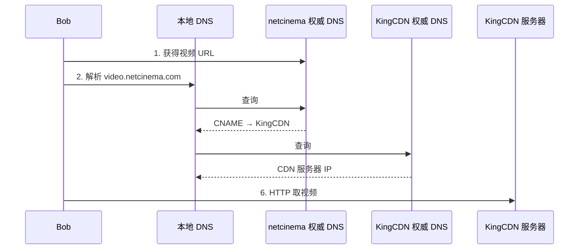


> 关键思想：**用 DNS 把用户"引导"到地理上/网络上最近的 CDN 节点**。

### 2.6.9 Netflix 案例

- Netflix 在 **Amazon 云**上建立视频网站（注册、计费等）；
- 自建 **CDN**；
- 把多个版本的视频上传到 CDN 服务器；
- Bob 浏览视频 → 返回 **manifest 文件** → 按 **DASH** 流式传输。

---

## 2.7 套接字编程

### 2.7.1 套接字 API

- 1981 年在 **BSD UNIX 4.1** 中引入，此后成为编写因特网程序的**标准接口**；
- 应用需显式地**创建、使用、释放**套接字；
- 采用客户-服务器模式；
- 提供两种传输服务：
  - **不可靠数据报服务**：UDP；
  - **可靠字节流服务**：TCP。

### 2.7.2 应用示例

客户从键盘读入一行字符 → 发送给服务器 → 服务器转成大写 → 返回客户 → 客户显示。

### 2.7.3 UDP 套接字编程

**服务器（Python）**：

```python
from socket import *
serverPort = 12000
serverSocket = socket(AF_INET, SOCK_DGRAM)   # 创建 UDP 套接字
serverSocket.bind(('', serverPort))          # 绑定本地端口
print("The server is ready to receive")
while True:
    message, clientAddress = serverSocket.recvfrom(2048)  # 收报文，得到客户地址
    modifiedMessage = message.decode().upper()
    serverSocket.sendto(modifiedMessage.encode(), clientAddress)  # 回送
```

**客户（Python）**：

```python
from socket import *
serverName = 'hostname'
serverPort = 12000
clientSocket = socket(AF_INET, SOCK_DGRAM)   # 创建 UDP 套接字
message = input('Input lowercase sentence:')
clientSocket.sendto(message.encode(), (serverName, serverPort))  # 必须给目的地址
modifiedMessage, serverAddress = clientSocket.recvfrom(2048)
print(modifiedMessage.decode())
clientSocket.close()
```

**要点**：

- UDP 无连接，**每个报文都要给出目的地址**；
- 服务器用**一个进程、一个套接字**服务所有客户；
- 一次请求—响应完成一次服务；
- `recvfrom` 同时返回数据和对方地址。

### 2.7.4 TCP 套接字编程

TCP 连接可想象为**一对套接字之间的封闭管道**：

- 发送端 TCP 把字节序列从管道一端送入；
- 接收端 TCP 从另一端取出；
- 字节**不丢失、保持顺序**。

**服务器（Python）**：

```python
from socket import *
serverPort = 12000
serverSocket = socket(AF_INET, SOCK_STREAM)   # 创建 TCP 欢迎套接字
serverSocket.bind(('', serverPort))
serverSocket.listen(1)                        # 开始监听
print('The server is ready to receive')
while True:
    connectionSocket, addr = serverSocket.accept()   # 等待连接，返回新套接字
    sentence = connectionSocket.recv(1024)
    capitalizedSentence = sentence.upper()
    connectionSocket.send(capitalizedSentence)
    connectionSocket.close()                  # 关闭连接套接字，但欢迎套接字仍打开
```

**客户（Python）**：

```python
from socket import *
serverName = 'servername'
serverPort = 12000
clientSocket = socket(AF_INET, SOCK_STREAM)   # 创建 TCP 套接字
clientSocket.connect((serverName, serverPort))# 建立连接
sentence = input('Input lowercase sentence:')
clientSocket.send(sentence.encode())
modifiedSentence = clientSocket.recv(1024)
print('From Server:', modifiedSentence.decode())
clientSocket.close()
```

**服务器使用多个套接字服务客户**：

1. 服务器进程在**欢迎套接字（welcome socket）**上等待连接请求；
2. 客户创建**客户套接字**，与欢迎套接字通信（TCP 发送连接请求）；
3. 服务器接受连接，创建一个**连接套接字（connection socket）**和一个**新的服务器进程**（或线程），与客户通信；
4. 服务器进程回到欢迎套接字继续等待；
5. 客户服务结束后，服务器销毁进程，关闭连接套接字。

> 这样服务器可以**同时服务多个客户**。

### 2.7.5 UDP 与 TCP 套接字对比

| | UDP | TCP |
|---|---|---|
| 服务类型 | 报文传输服务 | 字节流传输服务 |
| 连接 | 无连接，没有管道 | 建立连接，形成管道 |
| 发送时地址 | 每个报文必须给出**远程进程地址** | 只需写入套接字，**不需**指出远程地址 |
| 服务器套接字 | **一个**套接字服务所有客户 | **欢迎套接字 + 每个客户一个连接套接字** |
| 服务器进程 | 一个进程服务所有客户 | 每个客户一个新进程/线程 |
| 服务时长 | 一次请求—响应 | 可长时间通信 |

---

## 2.8 本章小结

- **应用架构**：client-server、P2P；
- **应用服务需求**：reliability、bandwidth、delay、security；
- **因特网传输服务模型**：TCP（面向连接、可靠）、UDP（不可靠、数据报）；
- 应用典型采用**请求/响应**交互：客户请求信息或服务，服务器用数据或状态码响应；
- **报文格式**：报头（元数据）+ 实体（数据）；
- **套接字编程**：TCP、UDP。

### 必记端口号

| 协议 | 端口 |
|---|---|
| HTTP | 80（HTTPS 443） |
| SMTP | 25 |
| POP3 | 110（加密 995） |
| IMAP | 143（加密 993） |
| DNS | 53（UDP/TCP） |

---

## 2.9 公式与数值速查

| 项目 | 公式/结论 |
|---|---|
| 非持久 HTTP 单对象 | 2 RTT |
| 非持久 HTTP 11 对象网页 | 22 RTT |
| 持久 + 无流水线 11 对象 | 12 RTT |
| 持久 + 流水线 11 对象 | ≈ 3 RTT |
| 缓存平均时延（例） | $0.6\times2.01\ \text{s} + 0.4\times\text{ms} \approx 1.2\ \text{s}$ |
| 客户-服务器分发时间 | $d_{\text{cs}} \ge \max\left\{\dfrac{NF}{u_s},\ \dfrac{F}{\min(d_i)}\right\}$ |
| P2P 分发时间 | $d_{\text{P2P}} \ge \max\left\{\dfrac{F}{u_s},\ \dfrac{F}{\min(d_i)},\ \dfrac{NF}{u_s+\sum u_i}\right\}$ |
| DNS 响应 ≤512 B | UDP |
| DNS 响应 >512 B | TCP（TC 标志置 1） |
| Base64 | $24\ \text{bit} \to 4\times6\ \text{bit} \to 4$ 字符；补 \`=\`/\`==\` |
| MIME 关键首部 | \`Content-Type\`、\`Content-Transfer-Encoding\` |

---

## 2.10 易错点与思考题

1. **HTTP 是无状态协议**；状态由 cookie + 后端数据库实现，而不是 HTTP 本身。
2. **非持久连接每个对象 2 RTT**；持久连接的关键收益是省去重复建连。
3. **HTTP/1.1 缺省持久连接**；流水线也是 1.1 的缺省行为（课件表述）。
4. **条件 GET 的 304 响应不包含对象**；`Last-Modified` 是服务器给的，`If-modified-since` 是缓存回传的。
5. **Web 缓存既是服务器又是客户**。
6. **SMTP 是 push，HTTP 是 pull**；取邮件不能用 SMTP。
7. **SMTP 只传 7 位 ASCII**，非 ASCII 内容需 MIME（Base64 / quoted-printable）。
8. **POP3 下载到本地，IMAP 邮件留在服务器**；Webmail 用 HTTP 访问，但服务器之间仍用 SMTP。
9. **DNS 主要用 UDP**，超过 512 字节才用 TCP；端口都是 53。
10. **本地 DNS 服务器不属于 DNS 层次结构**，它只是代理。
11. **实际解析是"解析器→本地 DNS 递归，本地 DNS→其它服务器迭代"**。
12. **DNS 缓存必须设 TTL**，否则会长期返回过期记录。
13. **RR 类型**：A（主机→IP）、NS（域→权威服务器）、CNAME（别名→规范名）、MX（域→邮件服务器）。
14. **P2P 分发时间不随 N 线性增长**；C/S 分发时间随 N 线性增长。
15. **BitTorrent 的"最稀罕优先"用于下载选择，"tit-for-tat"用于上传激励**。
16. **DASH 的块有多个码率版本**，客户端根据带宽自适应选择。
17. **CDN 通过 DNS（CNAME）把用户重定向到最近节点**。
18. **TCP 服务器的欢迎套接字不关闭**；每个客户对应一个连接套接字。

**课件布置的习题**：1, 3, 7, 8, 9；实验：HTTP、DNS（以任课教师最终要求为准）。
