> - 教材：Kurose & Ross, *Computer Networking: A Top-Down Approach*, 8th Edition, Chapter 3
> - 课件：Chapter3_2026.ppt
> - 本章地位：全课程重点与难点。核心是"在不可靠的网络层之上，如何为进程提供可靠/高效的端到端通信"。

---

## 0. 本章知识地图

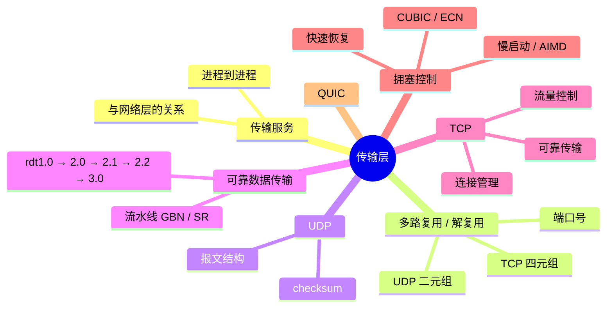


**一条主线**：服务承诺 → 需要哪些功能 → 功能如何体现在**首部字段**和**协议机制**中。

---

## 3.1 传输层服务

### 3.1.1 两种"逻辑通信"

| 视角 | 提供的逻辑通信 |
|---|---|
| 应用层看传输层 | **进程到进程**：源进程向本地套接字写入数据，目的进程在本地套接字即可收到，仿佛直接相连 |
| 传输层看网络层 | **主机到主机**：发送方传输层把报文交给本地网络层接口，接收方传输层从本地网络层接口收到报文 |

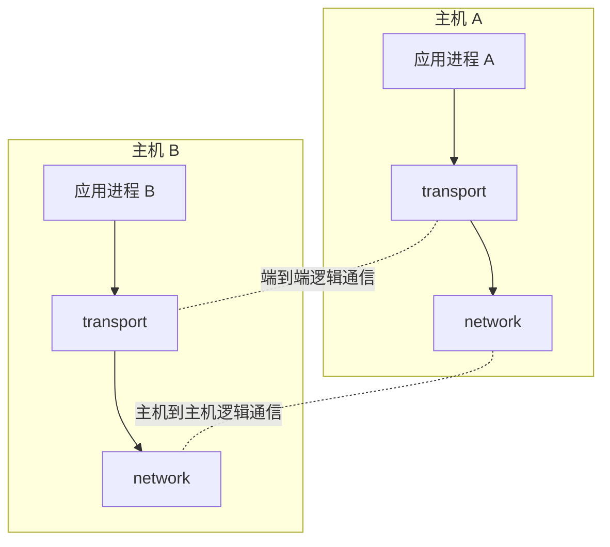


### 3.1.2 传输层与网络层的关系

- **网络层**：提供**主机之间**的逻辑通信；
- **传输层**：提供**进程之间**的逻辑通信；
- 传输层**依赖并增强**网络层服务。

**家庭类比（课件）**：

| 概念 | 类比 |
|---|---|
| 进程 | 孩子 |
| 应用报文 | 信 |
| 传输层 | Ann 和 Bill（负责收集/分发信件，提供"人→人"服务） |
| 主机 | 住宅 |
| 网络层 | 邮政系统（提供"门→门"服务） |

### 3.1.3 因特网的传输服务与网络服务

网络层（IP）提供**尽力而为（best-effort）**服务：

- 尽最大努力在主机间交付分组，但**不提供任何承诺**；
- 不保证交付、不保证按序、不保证数据完整、不保证延迟、不保证带宽。

因此：

| 传输层**不能**提供 | 传输层**可以**提供 |
|---|---|
| 延迟保证 | 可靠、按序交付（TCP） |
| 带宽保证 | 不可靠、不保序交付（UDP） |

> 传输层只能在网络层"尽力而为"的基础上做增强，无法凭空创造网络层不提供的时延/带宽保证。

---

## 3.2 多路复用与解复用

### 3.2.1 基本概念

- **多路复用（multiplexing，发送端）**：传输层从多个套接字收集数据，交给网络层发送；
- **解复用（demultiplexing，接收端）**：传输层根据报文段中的标识，把数据交付到正确的套接字。

> 传输层的基本服务：把"主机到主机"的交付**扩展为"进程到进程"**的交付，靠的就是多路复用/解复用。

类比寄信：

- 每个收信人有一个信箱（唯一标识）；
- 信封上写收信人地址；
- 邮局据此投递。

对应到网络：

- 每个套接字分配唯一标识；
- 报文段中包含接收套接字的标识；
- 接收方传输层据此交付。

### 3.2.2 端口号

- 端口号是**套接字标识的一部分**；
- 每个套接字在本地关联一个端口号；
- 端口号是 **16 比特**数（0–65535）；
- **0–1023** 由公共域协议使用，称**众所周知的端口号**。

报文段中有两个端口字段：

- **源端口号**：与发送进程关联的本地端口号；
- **目的端口号**：与接收进程关联的本地端口号。

| 字段 | 长度 | 作用 |
| --- | --- | --- |
| source port | 16 bit | 源端口号 |
| dest port | 16 bit | 目的端口号 |
| 其它首部字段 + 数据 | 可变 | 传输层载荷 |


### 3.2.3 端口号的分配

| 方式 | 例子 | 使用方 |
|---|---|---|
| 自动分配 | `new DatagramSocket()` 不指定端口，OS 从 1024–65535 分配 | **客户端**通常如此 |
| 指定端口 | `new DatagramSocket(53)` | **服务器**（公共域协议用众所周知端口） |

### 3.2.4 UDP 解复用

- UDP 套接字由 **`<目的 IP 地址, 目的端口号>` 二元组**标识；
- 接收方检查报文中的目的端口号，交付给具有该端口号的套接字；
- **与 `<源 IP, 源端口>` 无关**：只要目的二元组相同，就交给同一个套接字；
- 报文中的源地址/端口被接收进程用来**回送响应**。

例：

服务器创建套接字：`DatagramSocket serverSocket = new DatagramSocket(6428);`


所有目的端口为 6428 的 UDP 报文都交付给服务器的同一个套接字。

### 3.2.5 TCP 解复用

TCP 服务器在端口 x 创建**欢迎套接字**；每接受一个客户连接，就创建一个**连接套接字**。

- **连接套接字由四元组标识**：

$$\left\langle \text{源 IP},\ \text{目的 IP},\ \text{源端口},\ \text{目的端口} \right\rangle$$


- 每个连接套接字**只接收具有该四元组的报文段**；
- 不同客户对应服务器上不同的连接套接字。

例：

- 主机 A（IP=A）端口 9157 → 服务器 B 端口 80
- 主机 C（IP=C）端口 5775 → 服务器 B 端口 80
- 主机 C（IP=C）端口 9157 → 服务器 B 端口 80


服务器上的三个连接套接字：

$$
\langle A,B,9157,80\rangle,\qquad
\langle C,B,5775,80\rangle,\qquad
\langle C,B,9157,80\rangle
$$


> 注意：即使源端口相同（如 C 的 9157 与 A 的 9157），只要源 IP 不同，仍是不同连接。

### 3.2.6 小结

| | UDP 套接字 | TCP 连接套接字 |
|---|---|---|
| 标识 | `<IP, 端口>` 二元组 | `<源 IP, 目的 IP, 源端口, 目的端口>` 四元组 |
| 服务器套接字数量 | **一个**套接字服务所有客户 | 欢迎套接字 + **每个客户一个**连接套接字 |
| 服务方式 | 无连接、逐报文 | 面向连接、长时间通信 |

> 报文交付是最基础的传输层服务：基于主机—主机通信实现进程—进程通信，通过多路复用/解复用实现。

---

## 3.3 无连接传输：UDP

### 3.3.1 UDP 提供的服务

网络层提供 best-effort：

- 尽最大努力交付到目的主机；
- 不保证可靠性和顺序；
- 不保证带宽和延迟。

UDP 在此基础上提供：

- **进程到进程的报文交付**；
- **报文完整性检查（可选）**：检测并丢弃出错的报文。

UDP 需要实现的功能：

1. **多路复用与解复用**；
2. **报文检错**。

### 3.3.2 UDP 报文结构

UDP 首部 **8 字节**，4 个字段：

```
 0                   16                  31
┌──────────────────┬──────────────────┐
│  source port #   │   dest port #    │
├──────────────────┼──────────────────┤
│     length       │    checksum      │
├──────────────────┴──────────────────┤
│          application data            │
│              (payload)               │
└──────────────────────────────────────┘
```

| 字段 | 作用 |
|---|---|
| 源端口号 / 目的端口号 | 多路复用/解复用 |
| 长度（length） | 报文总长度（字节数，含首部） |
| 检查和（checksum） | 检测报文错误 |

> UDP 首部只有 8 字节，开销小、处理简单。

### 3.3.3 UDP 检查和（checksum）

**发送方**：

1. 把报文看成由 **16 比特整数**组成的序列；
2. 对这些整数求和（**反码求和**，进位回卷）；
3. 将结果的**反码**放入 checksum 字段。

**接收方**：

1. 对收到的报文做同样的计算（**包括 checksum 字段**）；
2. 若结果为 `0xFFFF`，认为无错误；否则有错误。

**反码求和规则**：

- 按 16 位无符号数相加；
- 若最高位产生进位，把进位**加回最低位**（wraparound carry）；
- 最后取反得到 checksum。

**简单例子**：

$$
\begin{aligned}
0x7A21 + 0x8B54 &= 0x10575 \\
\text{回卷：}\ 0x0575 + 0x0001 &= 0x0576 \\
\text{checksum} = \sim 0x0576 &= 0xFA89 \\
\text{接收方：}\ 0x7A21 + 0x8B54 + 0xFA89 &= 0x1FFFE \\
\text{回卷：}\ 0xFFFE + 1 &= 0xFFFF \quad \text{（无错）}
\end{aligned}
$$


**UDP 检查和的计算范围**：

- 包括 **伪首部（pseudo-header）+ UDP 首部 + 载荷** 三部分；
- 伪首部包含源 IP、目的 IP、协议号、UDP 长度等，用于检测"误交付"（IP 层地址错误）；
- **检查和是可选的**：若不计算，该字段填 0（IPv4 允许；IPv6 中 UDP checksum 通常强制）。

> 只做检错，**不做纠错**；出错报文直接丢弃，是否重传由应用决定。

### 3.3.4 为什么需要 UDP？

| 优点 | 说明 |
|---|---|
| 尽快发送 | **无建立连接的延迟** |
| 不限速 | 不进行拥塞控制和流量控制 |
| 开销小 | 首部仅 8 字节 |
| 简单 | 协议处理简单，端系统资源占用少 |

**UDP 适合的应用**：

- 容忍丢包但对延迟敏感：流媒体、实时音视频、游戏；
- 以单次请求/响应为主：DNS；
- 需要应用层自己实现可靠传输时。

> 若应用要求基于 UDP 的可靠传输，**由应用层实现可靠性**（如 QUIC）。

---

## 3.4 可靠数据传输原理（本章核心）

### 3.4.1 可靠传输的服务抽象

> 数据通过一条**理想信道**传输：不会有比特损坏或丢失，并按照发送顺序被接收。

**不可靠信道的特性决定了可靠数据传输协议的复杂性。**

可靠传输在链路层、传输层、甚至应用层都需要；其一般性原理适用于所有层次。

### 3.4.2 接口原语

| 原语 | 调用者 | 作用 |
|---|---|---|
| `rdt_send(data)` | 上层实体 | 把要发送的数据交给 rdt |
| `udt_send(packet)` | rdt | 把分组交给下层协议实体（不可靠信道） |
| `rdt_rcv(packet)` | 下层实体 | 分组到达接收端时调用 |
| `deliver_data(data)` | rdt | 把数据交付给上层实体 |

### 3.4.3 增量式设计方法

- 用**有限状态机（FSM）**描述发送方和接收方；
- 从理想信道开始，逐步增加信道的不确定性；
- 只考虑**单向数据传输**，但控制信息可以双向传输（ACK/NAK）。

依次考虑：

1. **理想信道**：不出错、不丢包、保序；
2. **可能比特错误，但不丢包**；
3. **可能比特错误，也可能丢包**（还可能重排序）。

**学习重点**：

- 每一种措施**因为什么**而提出？
- 引入这个措施会**产生什么问题**？
- 如何解决新问题？

---

### 3.4.4 rdt1.0：理想信道

假设：

- 下层信道完全可靠：无比特错误、无分组丢失；
- 发送能力 ≤ 接收能力（不会来不及接收）。

FSM：发送方、接收方各只有**一个状态**。

- 发送方：收到上层数据 → 封装成分组 → 送入信道；
- 接收方：从信道收到分组 → 取出数据 → 交给上层。

```
发送方：Wait for call from above
        rdt_send(data) → packet = make_pkt(data); udt_send(packet)

接收方：Wait for call from below
        rdt_rcv(packet) → extract(packet, data); deliver_data(data)
```

> 没有任何额外机制——因为信道本身可靠。

---

### 3.4.5 rdt2.0：可能产生比特错误

假设：分组中的比特可能翻转，但**不会丢包**。

检测错误：**检错码（如 checksum）**。

恢复错误：

- **肯定确认（ACK）**：接收方告诉发送方"收到正确"；
- **否定确认（NAK）**：接收方告诉发送方"收到有错"；
- **重传**：发送方收到 NAK 后重发出错的分组。

相比 rdt1.0，新增三种机制：

1. 接收方**检错**；
2. 接收方**反馈**（ACK/NAK）；
3. 发送方**重传**。

发送方 FSM 增加"**等待反馈**"状态：

- 发送分组后等待 ACK/NAK；
- 收到 ACK → 回到等待上层调用；
- 收到 NAK → 重发分组。

接收方：

- 收到正确分组 → 交付数据，发 ACK；
- 收到出错分组 → 发 NAK。

**rdt2.0 的致命缺陷**：

> 如果 **ACK/NAK 本身出错**怎么办？发送方不清楚接收方到底发生了什么！

常见处理：发送方收到**出错的确认**后，**重传该分组**（假设分组也出错了）。

新问题：可能在接收端产生**冗余分组（重复分组）**。

解决方法：

- 发送方给每个分组加**序号**；
- 接收方根据序号检测冗余分组并丢弃（不交付上层）。

**序号需要多长？**

- 如果"前一个分组确认成功后才发下一个"（停-等），只需 **1 比特**（0/1 交替）。

---

### 3.4.6 rdt2.1：处理出错的 ACK/NAK

在 rdt2.0 基础上：

- 分组加入 **1 比特序号**；
- 发送方收到**出错的反馈**或 **NAK** 时，重发当前分组；
- 接收方增加一个状态，用于**区分新分组和冗余分组**。

**发送方**（两个状态：等待 0 的上层调用 / 等待 1 的上层调用）：

| 事件 | 动作 |
|---|---|
| 上层调用 | 构造 `make_pkt(seq, data, checksum)`，发送 |
| 收到 ACK（正确） | 转移到下一个状态 |
| 收到 NAK | 重发当前分组 |
| 收到出错的 ACK/NAK | 重发当前分组 |

**接收方**：

| 事件 | 动作 |
|---|---|
| 收到出错的（corrupt）分组 | 发 NAK |
| 收到正确的**新**分组 | 交付数据，发 ACK，转移状态 |
| 收到正确的**冗余**分组 | 发 ACK，**不交付** |

> 接收方需要记住"当前期待哪个序号"，从而区分新分组和重复分组。

---

### 3.4.7 rdt2.2：不使用 NAK 的协议

与 rdt2.1 功能相同，但**只使用 ACK**：

- 让 **ACK 携带所确认分组的序号**；
- 接收方**只对正确接收的分组**发送 ACK；
- 对于出错的分组，接收方**重发最近一次的 ACK**。

规则：

**发送方**：

- 收到**期待序号的 ACK** → 发送下一个分组；
- 其它情况（出错的 ACK、非期待序号的 ACK）→ **重发当前分组**。

**接收方**：

- 收到**期待序号 #n 的分组** → 发送 **ACK n**，交付数据；
- 其它情况（出错的分组、非期待序号的分组）→ **重发最近的 ACK**。

三种情形：

| 情形 | 过程 |
| --- | --- |
| (a) 无错误 | pkt0 → ACK0 → pkt1 → ACK1 |
| (b) 分组出错 | 收到 error pkt0 → 重发最近一次 ACK1 → 发送方重发 pkt0 |
| (c) ACK 出错 | 发送方收到出错的 ACK0 → 重发 pkt0；接收方收到重复 pkt0 → 重发 ACK1 |


> 用"带序号的 ACK + 重发最近 ACK"替代了 NAK，功能等价。

---

### 3.4.8 Rdt 2.x 小结

| 版本 | 信道假设 | 新增机制 |
|---|---|---|
| rdt2.0 | 可能比特错误 | 检错、ACK/NAK、重传 |
| rdt2.1 | 反馈也可能出错 | 1 比特序号、处理出错的 ACK/NAK |
| rdt2.2 | 同上 | 取消 NAK，ACK 携带序号 |

与 rdt1.0 相比，rdt2.2 增加了：

- 分组**检错**；
- **1 比特分组序号**；
- **带序号的 ACK** 反馈；
- 收到出错/非期待序号分组时，**重传最近一次分组/ACK**。

---

### 3.4.9 rdt3.0：可能比特错误 + 丢包

新增假设：下层信道可能**丢包**（数据分组或 ACK 都可能丢）。

需要两个新机制：

1. **检测丢包**：
   - 发送方在"合理的"时间内未收到 ACK，就认为丢包；
   - 需要**定时器（timer）**。
2. **从丢包中恢复**：
   - 发送方**重发当前分组**。

新问题：

- ACK 丢失、或超时设置过短导致的重发，会在接收端产生**冗余分组**；
- 用**分组序号**解决（与 rdt2.2 相同）。

**发送方 FSM 的关键变化**：

| 事件 | 动作 |
|---|---|
| 发送分组 | 启动定时器 |
| 收到期待的 ACK | **终止定时器**，转移状态 |
| 收到非期待的 ACK | **不做处理**（为什么？见下） |
| 定时器超时 | 重发分组，重启定时器 |

**为什么收到非期待序号的 ACK 不处理？**

有两种可能：

1. **定时器提前超时**：发送方重发了分组，随后收到旧 ACK；此时状态已推进，旧 ACK 无意义；
2. **数据分组出错**：接收方检测到错误，发送的是"最近一次的 ACK"，不是发送方期待的序号。

发送方**难以区分**这两种情况，因此对非期待序号的 ACK 一律不处理；第 2 种情况下，等定时器超时后重发。

**接收方的变化**：

- 数据分组丢失：接收方**感知不到**，FSM 无影响；
- ACK 丢失 / 过早超时：发送方重发 → 接收方收到**重复分组** → 利用序号检测，**重发前一次 ACK**。

> **rdt2.2 的接收方 FSM 不加修改就可以用于 rdt3.0 的接收方。**

**rdt3.0 的各种时间线场景（必须会画）**：

| 情形 | 过程 |
| --- | --- |
| (a) 正常 | pkt0 → ACK0 → pkt1 → ACK1 |
| (b) 分组丢失 | pkt1 丢失 → 超时 → 重发 pkt1 → ACK1 |
| (c) ACK 丢失 | pkt1 → ACK1 丢失 → 超时 → 重发 pkt1 → 接收方重发 ACK1 |
| (d) 过早超时 | pkt1 → ACK1 迟到 → 超时重发 pkt1 → 收到重复 ACK1（忽略） |


---

### 3.4.10 rdt3.0 的性能：停-等协议

rdt3.0 是**停-等（stop-and-wait）**协议：

- 发送一个分组，等待 ACK，再发下一个；
- 同一时刻只有一个分组在途。

**发送方利用率**：

$$U_{\text{sender}} = \frac{L/R}{\text{RTT} + L/R}$$


例：

- 链路 1 Gbps，RTT = 30 ms，分组 1 KB = 8 kbit；
- `L/R = 8 kbit / 10^9 bps = 8 μs`；
- `U = 8 μs / (30 ms + 8 μs) ≈ 0.00027`（约 0.027%）；
- 吞吐量 ≈ 1 KB / 30 ms ≈ **33 kB/s**（在 1 Gbps 链路上！）。

> **rdt3.0 是一个正确的协议，但性能不佳！网络协议限制了物理资源的利用。**
> 根本原因：停-等导致发送方大部分时间在等待 RTT。

---

### 3.4.11 流水线（pipelining）

解决思路：**允许发送方有多个已发送、未确认的分组**。

- **停-等**：send pkt0 → wait ACK0 → send pkt1 → wait ACK1 …
- **流水线**：send pkt0, pkt1, pkt2 → 陆续收到 ACK → 持续发送


效果：利用率可提高数倍（课件例子：提高 3 倍）。

带来的新问题：

1. **序号范围必须扩大**（停-等只需 1 比特）；
2. 发送端和接收端可能需要**缓存多个分组**；
3. 出错后的恢复策略需要设计。

两种基本流水线协议：

- **Go-Back-N（GBN，回退 N 步）**
- **Selective Repeat（SR，选择重传）**

---

### 3.4.12 Go-Back-N（GBN）

#### 发送方规则

- 最多允许 **N 个已发送、未确认**的分组（**发送窗口**）；
- 对**最早的已发送、未确认分组**（基序号 base）使用**一个定时器**；
- 若定时器超时：从**基序号**开始，**顺序重发其后的所有分组**；
- 收到 ACK q：更新基序号为 q+1（窗口滑动）；
- 收到出错的 ACK：**不做处理**（可由后续更大的累积 ACK 覆盖；否则超时重传）。

#### 接收方规则

- **只接收预期序号的分组**；
- 每收到一个分组，都发送一个**带序号的 ACK**；
- 对于**未按顺序**到来的分组：**丢弃**，并**重发最近一次的 ACK**；
- 使用**累积确认（cumulative ACK）**：
  > 若 ACK 包含序号 q，表示"序号至 q 的分组均正确收到"。

#### 序号空间划分

发送方看到的序号空间（由序号长度 k 决定）：

```
[ 已确认 ] [ 已发送未确认 | 未发送可用 ] [ 不可用 ]
              ←── 发送窗口 N ──→
              base        nextseqnum
```

- **发送窗口** = 已发送未确认 + 未发送可用，共 N 个序号；
- 两个重要变量：**基序号 base**、**下一个序号 nextseqnum**；
- 发送窗口满（`nextseqnum == base + N`）时，拒绝上层的新数据。

#### GBN 工作过程（课件时间线）

N = 4，发送 pkt0–pkt3，**pkt2 丢失**：

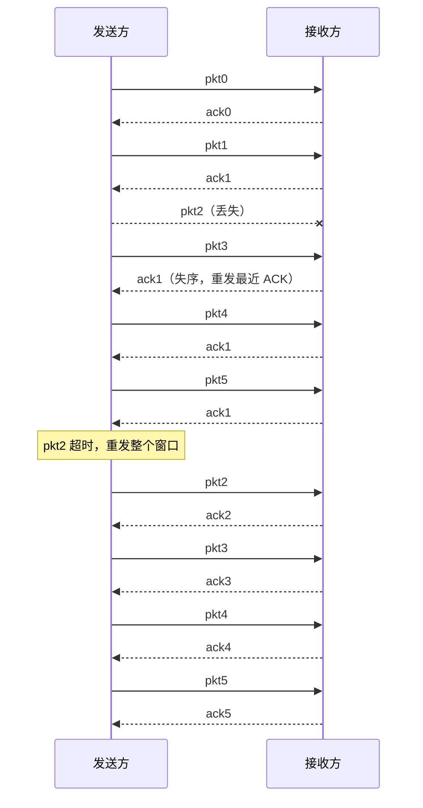


要点：

- 接收方**不缓存**失序分组（pkt3/4/5 被丢弃）；
- 超时后**重发整个窗口**，代价较大；
- 重复 ACK 被发送方忽略。

#### GBN 发送方 FSM 要点

| 事件 | 动作 |
|---|---|
| 上层调用 `rdt_send(data)` | 若 `nextseqnum < base+N`：构造并发送；若窗口原为空，启动定时器；`nextseqnum++`；否则拒绝 |
| 收到正确 ACK | `base = getacknum(rcvpkt)+1`；窗口空则停定时器，否则重启定时器 |
| 收到出错 ACK | 忽略 |
| 超时 | 重发窗口中 `base` 到 `nextseqnum-1` 的所有分组，重启定时器 |

#### GBN 特点

- **接收端简单，发送端复杂**；
- 出错后需要**较多重传**；
- 适合接收端缓存小、误码率低的场景。

---

### 3.4.13 选择重传（Selective Repeat, SR）

要点：

- 发送方**仅重传它认为出错（未收到 ACK）的分组**，避免不必要的重传；
- 为此：
  1. 接收端需**缓存失序**的分组；
  2. 接收端需对每个正确收到的分组**单独确认**（选择确认，**不使用累积确认**）；
  3. 发送的**每个分组需要一个定时器**，以便单独重发。

#### 工作过程

N = 4，pkt2 丢失，pkt3/4/5 被缓存：

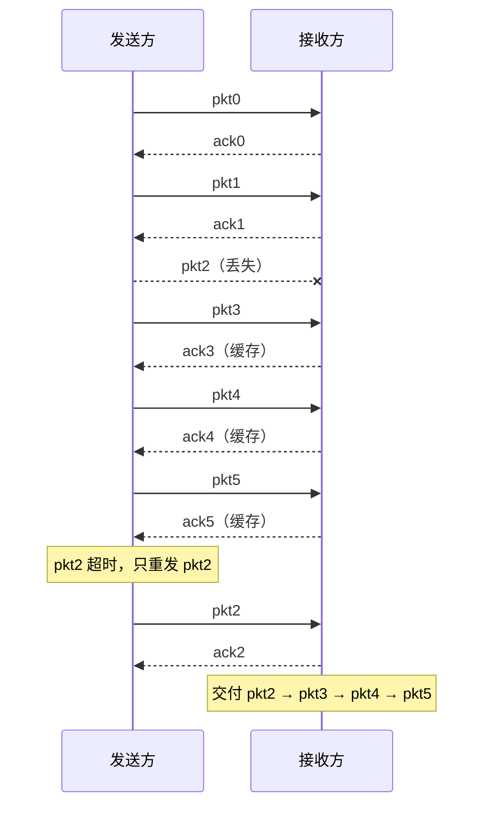


#### 发送方规则

| 事件 | 动作 |
|---|---|
| 上层数据到来，窗口未满 | 发送分组，启动该分组的定时器 |
| 定时器 n 超时 | **只重传分组 n**，重启定时器 |
| 收到窗口内的 ACK(n) | 标记 n 已确认；若 n = base，滑动窗口到最小未确认序号或下一个序号 |
| 其它 | 忽略 |

#### 接收方规则

| 事件 | 动作 |
|---|---|
| 收到接收窗口内的分组 n | 发送 ACK(n)；若失序则**缓存** |
| n = 接收窗口基序号 | 交付从 n 开始的连续分组；滑动接收窗口 |
| 收到 `[rcvbase-N, rcvbase-1]` 内的分组 n | **发送 ACK(n)**（见下） |
| 其它 | 忽略 |

> **为什么对 `[rcvbase-N, rcvbase-1]` 内的分组也要发 ACK？**
> 如果接收方已经滑动窗口，但对应的 ACK 全部丢失，发送方会超时重发旧分组。若接收方完全不理睬，发送方的窗口将无法推进，传输停滞。因此需要重发 ACK n 帮助发送方推进窗口。

#### SR 的困境：窗口大小与序号空间

问题：接收端**无法区分**"新分组"和"重传的旧分组"，若窗口过大、序号回绕。

课件例子：序号空间 `[0,3]`，窗口大小 = 3。

```
(a) 正常：发送 pkt0,pkt1,pkt2 → 全部正确收到 → ACK 全部正确收到
(b) 出错：
    发送方发的 pkt0,pkt1,pkt2 的 ACK 全部丢失
    发送方超时，重发 pkt0
    接收方此时窗口已滑到 [3,0,1]（期待 3）
    → 收到 pkt0，误认为是新分组并接收！
```

**结论**：

> 发送窗口大小 N 与序号空间大小必须满足：**N ≤ 序号空间 / 2**。
> 即若序号用 k 比特（空间 `2^k`），则 `N ≤ 2^(k-1)`。

推导（课件）：

- 发送方发送满窗口 `[0, N-1]`；
- 接收方全部正确收到、发 ACK、窗口滑到 `[N, 2N-1]`；
- 但 N 个 ACK 全部丢失，发送方超时重发这 N 个分组；
- 为避免接收方把重发分组误当新分组，窗口 `[0,N-1]` 与 `[N,2N-1]` **不能重叠**；
- 因此 `2N ≤ 序号空间`，即 `N ≤ 序号空间/2`。

#### SR 特点

- 接收端：落在接收窗口中的分组都接收，**每个单独确认**；允许乱序接收，但**按序交付**；
- 发送端：窗口不满可发新分组；**每个已发送分组一个定时器**；超时只重发对应分组；
- 优点：出错后**重传代价小**；
- 缺点：发送端定时器多、接收端缓存大、**实现复杂**。

---

### 3.4.14 GBN vs SR 对比

| | GBN | SR |
|---|---|---|
| 接收方缓存 | 不缓存失序分组 | **缓存**失序分组 |
| 确认方式 | **累积确认** | **单独确认**（选择确认） |
| 发送方定时器 | 只对 base 一个 | **每个分组一个** |
| 超时重传 | 重发整个窗口 | **只重发未确认的分组** |
| 接收窗口 | 大小为 1（只收期待序号） | 大小 N |
| 发送窗口 N 限制 | `N ≤ 2^k − 1` | `N ≤ 2^(k−1)` |
| 特点 | 接收简单、发送复杂、重传多 | 重传少、缓存大、实现复杂 |

---

### 3.4.15 遗留假设：分组重排序与序号重用

更真实的下层信道可能：

- 产生比特错误；
- 丢包；
- **重排序**：后发的分组可能早于先发的到达（当连接两端的信道是一个网络时可能发生）。

新问题：

> 一个**很老的分组**可能到达接收端，且其序号刚好落在**当前接收窗口**内（序号重用引起）。

解决方法：

- 假设分组在网络中的"存活"时间不超过某个固定值；
- 使用**很长的序号**，确保**序号回绕时间**超过该固定值（如 TCP 用 32 位序号）。

---

## 3.5 面向连接的传输：TCP

### 3.5.1 TCP 概述

TCP 需要的机制：

1. **建立连接**：通信双方为本次通信建立状态（套接字、缓存、变量等）；
2. **流水式发送报文段**：可靠数据传输；
3. **流量控制**：调整发送速率，不使接收方缓存溢出；
4. **拥塞控制**：调整发送速率，不使网络过载。

**TCP 服务模型**：

- 连接一对通信进程的、**理想的字节流管道**；
- **点到点**：涉及一对通信进程（不支持组播）；
- **全双工**：可同时双向传输数据；
- **可靠、有序的字节流**：
  - 不保留**报文边界**（应用写入的"消息"可能被拆分/合并）。

### 3.5.2 TCP 报文段结构

TCP 首部最短 **20 字节**，最长 60 字节（含选项）。

```
 0                   16                  31
┌──────────────────┬──────────────────┐
│  source port #   │   dest port #    │
├──────────────────┴──────────────────┤
│          sequence number             │
├──────────────────────────────────────┤
│       acknowledgement number         │
├────┬─────┬─────┬─────────────────────┤
│head│     │C E  │   receive window    │
│len │flags│W R  │                     │
├────┴─────┴─────┼─────────────────────┤
│    checksum    │   urgent pointer    │
├────────────────┴─────────────────────┤
│         options (variable)           │
├──────────────────────────────────────┤
│         application data             │
└──────────────────────────────────────┘
```

| 字段 | 作用 |
|---|---|
| 源端口 / 目的端口 | 多路复用/解复用 |
| **序号（sequence number）** | 报文段中**第一个数据字节**在字节流中的序号（**按字节编号，不是按报文段**） |
| **确认序号（acknowledgement number）** | **期望从对方接收的下一个字节**的序号（累积确认） |
| 首部长度（head len） | TCP 首部长度（以 4 字节为单位） |
| 标志位 | `URG, ACK, PSH, RST, SYN, FIN`，以及 `CWR, ECE`（拥塞通知） |
| **接收窗口（receive window）** | 流量控制：接收方愿意接收的字节数 |
| 检查和 | Internet checksum |
| 紧急指针 | URG 数据的位置 |
| 选项 | MSS、窗口比例因子、SACK 等 |

#### 重要选项

| 选项 | 作用 |
|---|---|
| **MSS（Maximum Segment Size）** | TCP 段中可携带的**最大数据字节数**；建立连接时各自声明；**缺省 536 字节** |
| **窗口比例因子（window scale）** | 协商后实际接收窗口 = `window size × 2^(window scale)`，突破 16 位窗口上限 |
| **SACK（Selective ACK）** | 允许接收端指出**缺失的数据字节**（非连续数据块边界），改进累积确认 |

#### 序号与确认序号：Telnet 例子

| 方向 | 报文 | 含义 |
| --- | --- | --- |
| A → B | Seq=42, ACK=79, data=C | A 发送字节 42，同时捎带确认 B 的 79 |
| B → A | Seq=79, ACK=43, data=C | B 回显，确认 A 的 42，期待 43 |
| A → B | Seq=43, ACK=80 | 确认 B 的 79，期待 80 |


要点：

- 序号是该报文段**第一个数据字节**的编号；
- 确认序号 = **期望的下一个字节**；
- ACK 可以**捎带（piggyback）**在数据报文段中；
- 接收方如何处理失序报文段：**TCP 规范未规定**，留给实现者（通常缓存）。

**发送方序号空间**：

```
 已确认 | 已发送未确认（in-flight） | 可用但未发送 | 不可用
        └──────── 窗口 N ────────┘
```

### 3.5.3 TCP 超时设置

**超时值的选择**：

- 太小 → 不必要的重传；
- 太大 → 丢包恢复太慢；
- 应**大于 RTT**，而 RTT 是**变化**的。

**SampleRTT**：测量从发出某个报文段到收到其确认的时间。

注意：

- TCP 对**接收到的数据**（字节）而不是对"携带数据的报文段"进行确认，因此确认有**二义性**；
- 重传报文段的 RTT 估计不准确。

**指数加权移动平均**：

$$\text{EstimatedRTT} = (1-\alpha)\cdot\text{EstimatedRTT} + \alpha\cdot\text{SampleRTT},\qquad \alpha = 0.125$$


**偏差估计**：

$$\text{DevRTT} = (1-\beta)\cdot\text{DevRTT} + \beta\cdot\left|\text{SampleRTT}-\text{EstimatedRTT}\right|,\qquad \beta = 0.25$$


**超时值**：

$$\text{TimeoutInterval} = \text{EstimatedRTT} + 4\cdot\text{DevRTT}$$


> 4 倍偏差提供"安全距离"，适应 RTT 的波动。

### 3.5.4 TCP 可靠数据传输

IP 层信道：分组可能**出错、丢失、重排序**。

TCP 在不可靠的 IP 服务上建立可靠传输，采用：

- 发送端**流水式**发送报文段；
- 接收端**累积确认**；
- 发送端**重传**恢复丢失报文段。

#### 简化模型中的 TCP 设计

只考虑单向数据、可靠传输机制：

| 角色 | 设计 |
|---|---|
| **接收方** | 累积确认：仅正确、按序收到后更新确认序号；出错/失序时重复前一次确认序号（**类似 GBN**）；**缓存失序报文段**（**类似 SR**） |
| **发送方** | 流水式发送；**只对最早未确认报文段使用一个定时器**（**类似 GBN**）；超时后**只重发最早未确认的那个报文段**（**类似 SR**，因为接收端缓存了失序段） |

因此：

> **TCP 的可靠传输机制是 GBN 和 SR 的混合体。**

#### 发送方处理的事件

| 事件 | 动作 |
|---|---|
| 收到应用数据 | 创建并发送报文段；若当前没有定时器在运行，启动定时器 |
| 超时 | 重传**包含最小序号的、未确认的**报文段；重启定时器 |
| 收到 ACK y | 若 `y > SendBase`：推进发送窗口（`SendBase = y`）；若还有未确认报文段则启动定时器，否则终止定时器 |

伪代码：

$$\text{NextSeqNum} = \text{InitialSeqNum},\qquad \text{SendBase} = \text{InitialSeqNum}$$


#### 重传场景（重点）

**场景一：ACK 丢失**

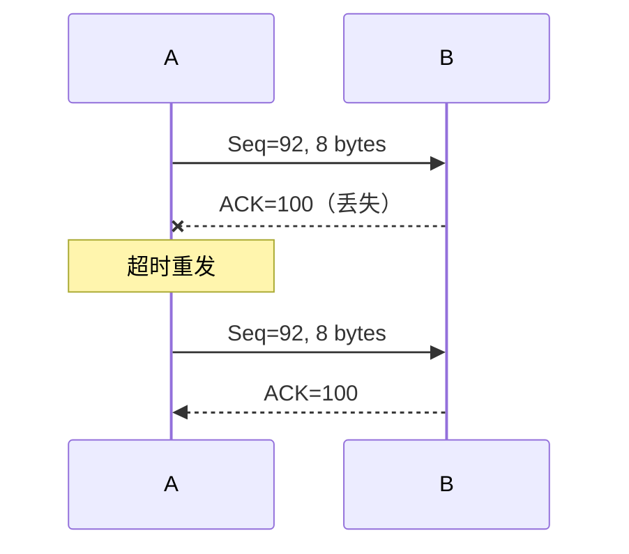


**场景二：过早超时**

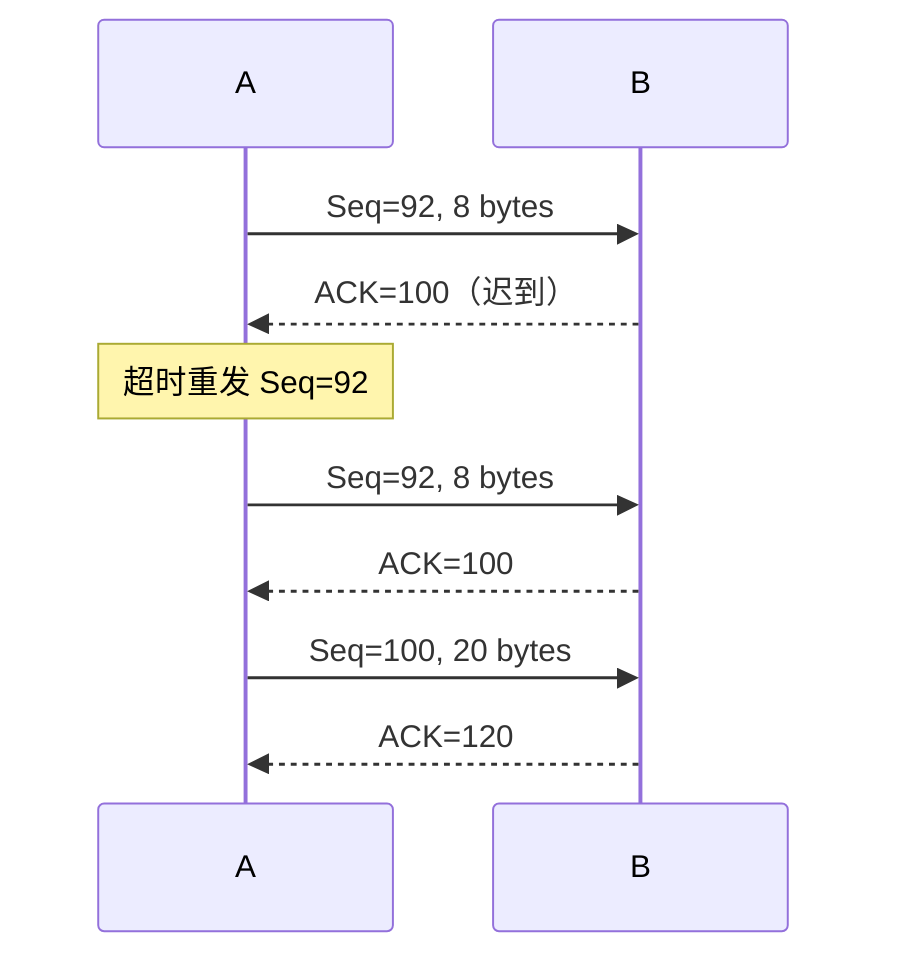


**场景三：累积确认避免重传**

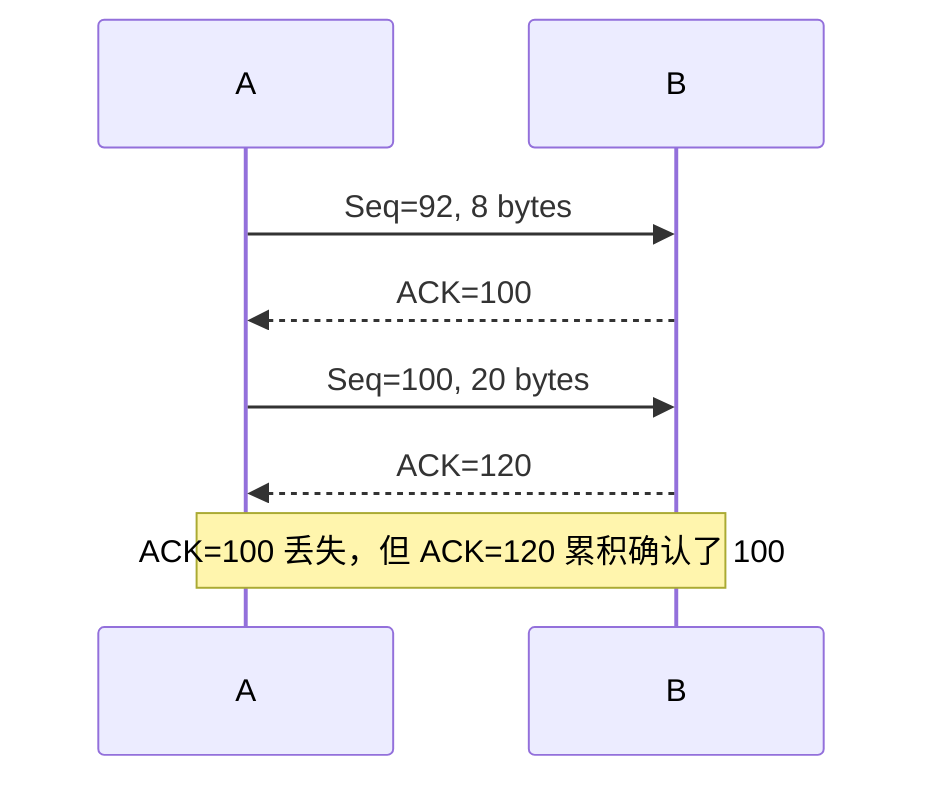


**TCP 减少重传的两个机制**：

1. **只使用一个定时器**：避免超时设置过小时重发大量报文段；
2. **流水式发送 + 累积确认**：避免重发某些"ACK 丢失"的报文段。

#### RTT 估计的二义性与 Karn 算法

问题：

- TCP 确认是对**数据字节**而非报文段的，存在**二义性**（无法确定 ACK 对应哪次发送）；
- 重传报文段的 RTT 估计**不准确**。

解决：

1. **不对重传的报文段测量 SampleRTT**（Karn 规则）；
2. **定时器补偿**：每重传一个报文段，超时值**加倍**；连续超时则**指数增长**（至上限）。

**Karn 算法**结合两者：

- 使用 `EstimatedRTT` 估计初始超时值；
- 发生超时，每次重传对定时器补偿，直到成功传输；
- 若收到上层应用数据、或某个报文段**没有重传就被确认**，则用最近的 `EstimatedRTT` 重新估计超时值。

#### TCP 接收端与推迟确认

理论上接收端只需区分两种情况：

- 收到**期待序号**的报文段 → 发送更新的确认序号；
- 其它情况 → 重复当前确认序号。

为减小通信量，TCP 允许**推迟确认（delayed ACK）**：

- 收到若干报文段后，发送一个累积确认；
- 缺点：推迟太久会导致不必要的重传；造成 RTT 估计不准确。

**TCP 规定**：

- 推迟确认时间**最多 500 ms**；
- 接收方**至少每隔一个报文段**使用正常方式确认。

**接收端处理规则**：

| 事件 | 动作 |
|---|---|
| 收到期待的报文段，且之前的都已确认 | **推迟**发送确认；500 ms 内无下一个报文段则发送 |
| 收到期待的报文段，且前一个被推迟确认 | **立即**发送确认（为了 RTT 估计） |
| 收到**失序**报文段（检测到序号间隙） | **立即**发送确认（为了快速重传），重复当前确认序号 |
| 收到部分/全部填充间隙的报文段 | 若始于间隙低端，**立即**发送确认（避免发送端超时），更新确认序号 |

#### 快速重传（Fast Retransmit）

问题：仅靠超时重发，丢包恢复太慢。

观察：

- 发送方通常连续发送许多报文段；
- 若某个报文段丢失，后续报文段到达会触发**重复 ACK**；
- 多数情况下 IP 按序交付，重复 ACK 极有可能因丢包产生。

规则：

> 当发送方收到对**同一序号的 3 次重复确认（triple duplicate ACK）**时，**立即重发**包含该序号的报文段，不必等定时器到期。

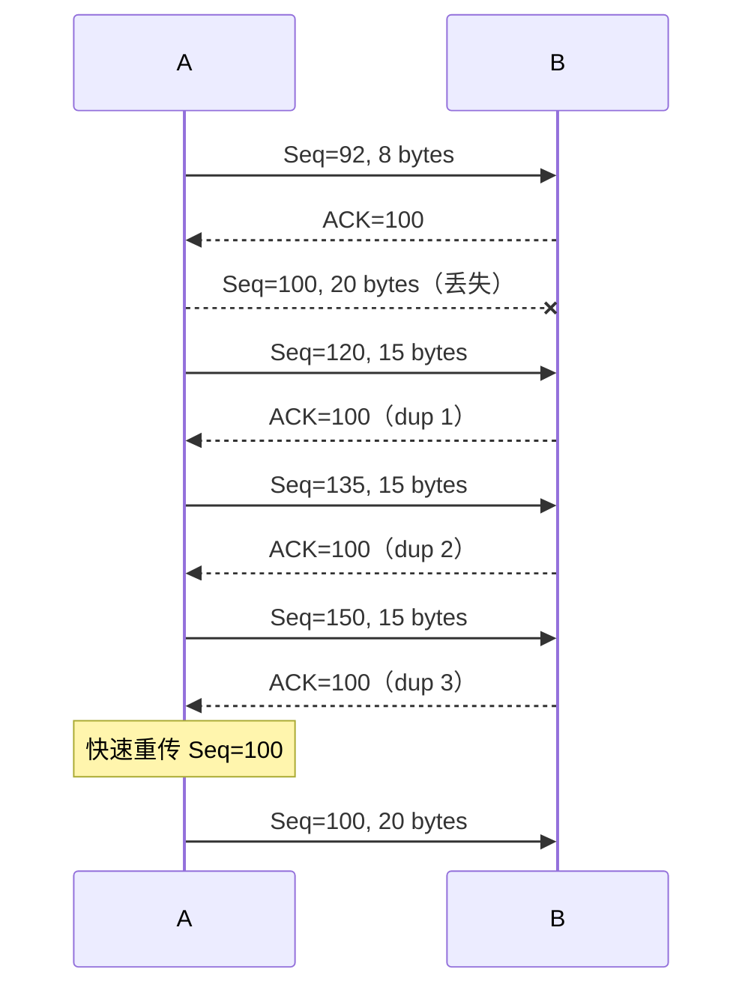


算法片段：

```
收到 ACK y:
    if y > SendBase:
        SendBase = y
        if unacked segments exist: start timer
    else:                       // 重复 ACK
        dupACKcount[y]++
        if dupACKcount[y] == 3:
            resend segment with seq y   // fast retransmit
```

#### TCP 可靠传输小结

- 流水式发送；
- 累积确认；
- **只对最早未确认报文段使用一个定时器**；
- 超时只重传包含最小序号的未确认报文段；
- 超时值 = RTT 估计 + 定时器补偿；
- 不对重传报文段测量 RTT；
- 不连续使用推迟确认；
- 收到 **3 次重复确认**立即快速重传。

> 以上措施可大量减少因 ACK 丢失、定时器过早超时引起的重传。

### 3.5.5 TCP 的流量控制

**目的**：发送端调节发送速率，**不使接收端缓存溢出**。

问题：

- 进入接收缓存的数据不一定被立即取走、取完；
- 应用消费数据慢时，接收缓存可能溢出。

#### 为什么 GBN/SR 不考虑流量控制？

- 它们假设正确、按序到达的分组被**立即交付**上层；
- 占用的缓冲区**立即释放**；
- 因此不会出现接收端缓存溢出。

#### 为什么 UDP 没有流量控制？

- UDP 不保证交付；
- 接收端把载荷放入缓存，应用每次读一个完整报文；
- 应用消费不够快时缓存溢出，报文被丢弃，**不违反 UDP 的服务承诺**。

#### 接收窗口（RcvWindow）

$$\text{RcvWindow} = \text{RcvBuffer} - \left(\text{LastByteRcvd} - \text{LastByteRead}\right)$$


- 接收缓存中的可用空间称**接收窗口**；
- 接收方把 `RcvWindow` 放在 TCP 首部中，向发送方**通告**可用空间；
- 发送方限制**已发送未确认的字节数**：

$$\text{LastByteSent} - \text{LastByteAcked} \le \text{RcvWindow}$$


#### 零窗口通告与零窗口探测

发送端收到 `RcvWindow = 0`（**零窗口通告**）时必须停止发送，然后：

1. 启动一个**定时器**；
2. 超时后发送一个**零窗口探测报文段**（序号为上一个段中最后一个字节的序号）；
3. 接收端在响应中通告当前接收窗口；
4. 若仍是零窗口，重新启动定时器。

> 零窗口探测的**唯一作用**是触发接收端发送响应，从而获知窗口是否已恢复。

#### 糊涂窗口综合症（Silly Window Syndrome）

当"数据发送很快、消费很慢"时，零窗口探测的简单实现会导致：

- 接收方不断发送**微小窗口通告**；
- 发送方不断发送**很小的报文段**；
- 大量带宽被浪费。

**接收方启发式策略**：

- 通告零窗口后，**仅当窗口显著增加**才发送更新通告；
- "显著增加" = 达到**缓存空间的一半**或**一个 MSS**，取两者较小值；
- 实现：窗口不满足条件时**推迟发送确认**（最多 500 ms，且至少每隔一个报文段正常确认）；满足条件时再通告新窗口。

**发送方启发式策略**：

- 应积聚足够多的数据再发送，防止太短的报文段；
- 问题：等待多久？太短则报文段小；太久则应用时延大；TCP 不知道应用未来是否还会产生数据。

**Nagle 算法**：

1. 新建连接上，应用数据到来时，组成一个 TCP 段发送（**哪怕只有 1 字节**）；
2. 在收到确认之前，后续数据放在发送缓存；
3. 当数据量达到一个 **MSS**，或**上一次传输的确认到来**（取较早者），把缓存数据发走。

优点：

- 适应网络延时、MSS 长度、应用速度的各种组合；
- 常规情况下不会降低吞吐量。

#### 流量控制总结

| 端 | 措施 |
|---|---|
| 接收端 | 显式窗口通告；窗口小时推迟确认；零窗口后仅在窗口显著增加时通告 |
| 发送端 | Nagle 算法确定发送时机；用接收窗口限制未确认字节数 |

### 3.5.6 TCP 连接管理

建立连接需要确定两件事：

1. 双方都**同意**建立连接（知晓对方想建立）；
2. **初始化连接参数**（序号、MSS 等）。

#### 为什么两次握手不够？

不可靠网络中可能发生：

- 包传输延迟变化很大；
- 存在重传的报文段；
- 存在报文重排序；
- 除了收到的包，看不到对方情况。

**两次握手的失败场景**：

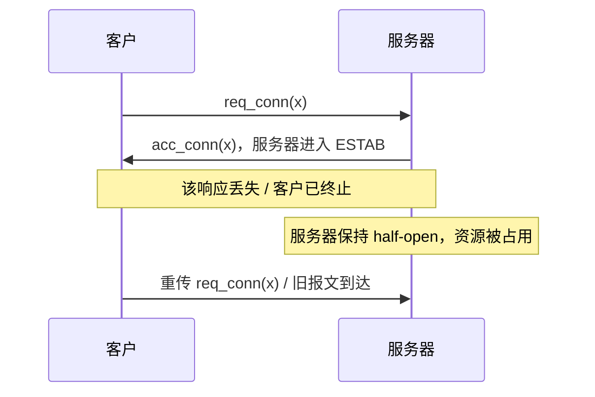


> 两次握手无法让服务器确认"客户确实收到了自己的确认"。

#### TCP 三次握手

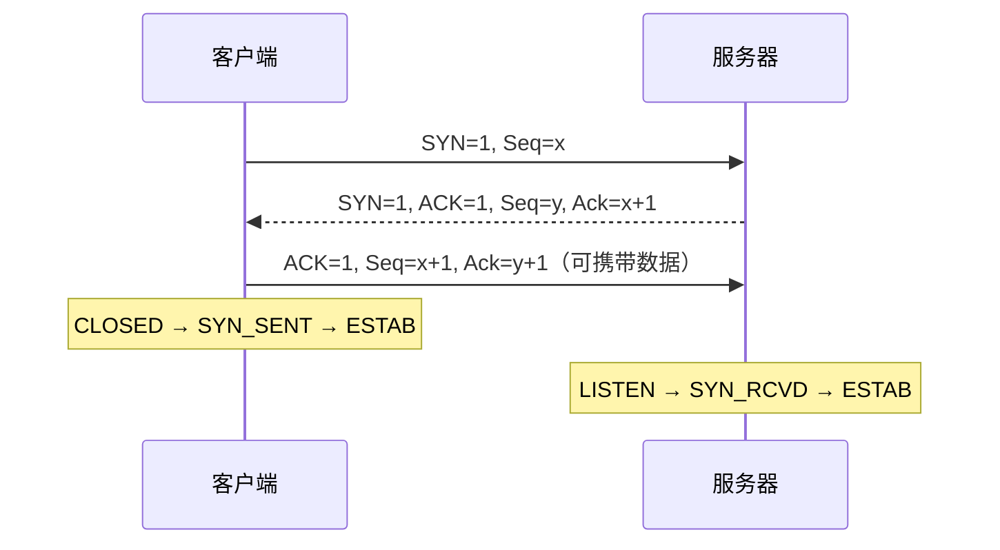


**三个步骤**：

| 步骤 | 报文 | 标志位 | 序号 | 内容 |
|---|---|---|---|---|
| 1 | SYN | SYN=1, ACK=0 | Seq = 客户起始序号 x | **不包含数据** |
| 2 | SYNACK | SYN=1, ACK=1 | Seq = 服务器起始序号 y；Ack = x+1 | **不包含数据**（服务器分配缓存/变量） |
| 3 | ACK | SYN=0, ACK=1 | Seq = x+1；Ack = y+1 | **可以包含数据**（客户端分配缓存/变量） |

> SYN 报文段会**消耗一个序号**，因此确认号是 x+1、y+1。

**状态转换**：

| 角色 | 状态序列 |
| --- | --- |
| 客户端 | CLOSED → SYN_SENT → ESTAB |
| 服务器 | LISTEN → SYN_RCVD → ESTAB |


#### 为什么起始序号不从 1 开始？

- 若每个新连接都从 1 开始，不同时间、同一对套接字之间的连接，握手报文段都一样；
- **旧连接上的报文段可能干扰新连接**（序号重叠）。

随机选取可以减小重叠概率，但**不能完全避免**。

**基于时钟的起始序号算法**：

1. 每台主机维护一个二进制计数器时钟，每隔 `ΔT` 加 1；
2. 新建连接时，取计数器**最低 32 位**作为起始序号；
3. 确保起始序号**随时间单调增长**；
4. 取较小的 `ΔT`，使起始序号增长速度超过连接上序号消耗速度；
5. 使用较长序号（32 位），确保**序号回绕时间远大于分组最长寿命**。

#### TCP 连接的关闭（四次挥手）

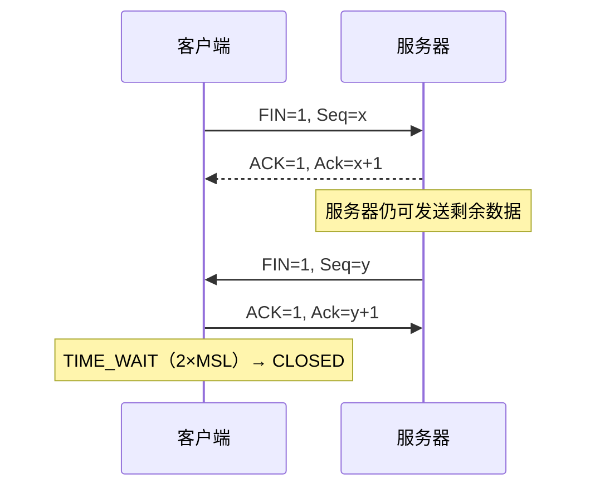


状态说明：

| 状态 | 含义 |
|---|---|
| `FIN_WAIT_1` | 已发送 FIN，等待对方 ACK |
| `FIN_WAIT_2` | 已收到对方 ACK，等待对方 FIN（**仍可接收**） |
| `CLOSE_WAIT` | 收到对方 FIN，本端仍可发送数据 |
| `LAST_ACK` | 本端已发送 FIN，等待最后 ACK |
| `TIME_WAIT` | 等待 **2×MSL（最大报文段寿命）**，确保旧报文消散、最后 ACK 可靠 |
| `CLOSED` | 连接关闭 |

> 第 2、3 个报文段（ACK 与 FIN）在服务器没有更多数据时**可以合并**，此时四次挥手可变为三次。

#### 客户/服务器 TCP 生命周期

| 角色 | 状态序列 |
| --- | --- |
| 客户端 | CLOSED → SYN_SENT → ESTAB → FIN_WAIT_1 → FIN_WAIT_2 → TIME_WAIT → CLOSED |
| 服务器 | CLOSED → LISTEN → SYN_RCVD → ESTAB → CLOSE_WAIT → LAST_ACK → CLOSED |


#### SYN 洪泛攻击（SYN Flood）

TCP 实现的弱点：

- 服务器收到 SYN 后，发送 SYNACK 并**分配资源**（建立**半开连接**）；
- 若未收到 ACK，服务器超时后重发 SYNACK；
- 等待一段时间（**SYN 超时**，典型 30–120 秒）后丢弃未完成连接。

攻击：

- 攻击者用**伪造的源 IP** 发送大量 SYN（后续不会有 ACK）；
- 服务器维护巨大的**半连接表**，耗尽资源；
- 无法处理正常客户的连接请求。

> 防御思路（扩展）：SYN cookies、缩短 SYN 超时、增加 backlog、SYN 代理等。

#### 端口扫描与 FIN 扫描

**TCP 端口扫描**：向目标端口发送 SYN：

| 响应 | 含义 |
|---|---|
| SYNACK | 端口有服务在运行 |
| RST | 端口没有服务 |
| 无响应 | 路径上有**防火墙**（丢弃外网 SYN） |

**FIN 扫描**：发送 FIN 报文段：

| 响应 | 含义 |
|---|---|
| ACK=1, RST=1 | 端口**没有**服务监听 |
| 无响应 | 端口**有**服务监听（按 RFC 973） |

缺点：部分系统实现不符合 RFC 973（如 Microsoft TCP 总是返回 ACK+RST），导致 FIN 扫描失效。

---

## 3.6 拥塞控制原理

### 3.6.1 拥塞的类比

| | 交通拥堵 | 网络拥塞 |
|---|---|---|
| 起因 | 大量汽车短时间进入路网，超出承载能力 | 大量分组短时间进入网络，超出处理能力 |
| 表现 | 通行能力下降、车速变慢甚至停滞 | 吞吐量下降、分组延迟增大 |
| 措施 | 减少车辆进入（交通管制） | 减少分组进入（拥塞控制） |

**流量控制 vs 拥塞控制**：

- **流量控制**：限制发送速度，使**不超过接收端处理能力**；
- **拥塞控制**：限制发送速度，使**不超过网络处理能力**。

### 3.6.2 拥塞的代价

拥塞发生在**路由器**中：对某条输出链路，当进入速率接近或超过链路带宽时发生拥塞。

**代价一：分组延迟增大**

- 即使假设缓存无限大、不考虑丢包；
- 当链路接近满载时，**排队延迟急剧增大**。

**代价二：吞吐量下降（场景一：缓存溢出导致重传）**

- 路由器输出缓存溢出，分组被丢弃；
- 发送端 TCP 重传被丢弃的包；
- 应用层输入 `λin = λout`，但传输层输入 `λ'in > λin`；
- 因重传**浪费**带宽，有效吞吐量下降。

**代价二（场景二：过早超时导致不必要重传）**

- 发送端定时器过早超时，产生**不必要的重传**；
- 包括必要和不必要的重传；
- 进一步浪费带宽。

**代价二（场景三：多跳路径上的容量浪费）**

- A–C 连接与 D–B 连接共享 R1；B–D 连接与 A–C 连接共享 R2；
- 当 B–D 流量很大时，可能瞬间填满 R2 缓冲区；
- A–C 通过 R2 的流量锐减，R1 上用于 A–C 的容量被**浪费**；
- 下游丢弃的包浪费了**上游的传输容量和缓存**。

### 3.6.3 拥塞的启示

- 下游被丢弃的包浪费了上游的传输容量和缓存空间；
- 负载接近链路容量时延迟增大；
- 不必要的重传进一步降低有效吞吐量；
- 丢包重传导致有效吞吐量下降；
- **吞吐量不可能超过链路容量**。

### 3.6.4 拥塞控制方法

| 方法 | 说明 | 例子 |
|---|---|---|
| **端到端拥塞控制** | 网络**不提供显式反馈**；端系统通过观察**丢包和延迟**推断拥塞，降低发送速率 | 较早的 TCP |
| **网络辅助的拥塞控制** | 拥塞路由器向发送端/接收端提供**直接反馈**（拥塞程度或发送速率指示） | TCP ECN、ATM、DECbit |

网络辅助反馈的两种方式：

- **前向反馈**：通过接收者（路由器标记 → 接收端 → 发送端）；
- **后向反馈**：直接网络反馈（路由器 → 发送端）。

---

## 3.7 TCP 拥塞控制

### 3.7.1 三个基本问题

TCP 使用**端到端**拥塞控制：

1. 发送方如何**感知**网络拥塞？
2. 发送方用什么**机制限制**发送速率？
3. 发送方采取什么**策略调节**发送速率？

### 3.7.2 感知拥塞：丢包事件

利用**丢包**感知拥塞（丢包或延迟过大，对发送端都表现为丢包）：

- **超时（timeout）**；
- **3 次重复 ACK（triple duplicate ACK）**。

### 3.7.3 限制发送速率：拥塞窗口

发送方维护**拥塞窗口（CongWin / cwnd）**，限制已发送未确认的数据量：

$$\text{LastByteSent} - \text{LastByteAcked} \le \text{CongWin}$$


粗略地：

$$\text{rate} = \frac{\text{CongWin}}{\text{RTT}}\quad(\text{Bytes/sec})$$


`CongWin` 应随所感知的网络拥塞程度而变化。

### 3.7.4 AIMD：加性增、乘性减

- **乘性减（Multiplicative Decrease）**：
  - 每检测到一个丢包事件，`CongWin` **减半**（迅速减小）；
  - 但不能小于 **1 MSS**。
- **加性增（Additive Increase）**：
  - 若没有丢包，每经过一个 RTT，`CongWin` **增大 1 MSS**（缓慢增大）；
  - 直到检测到丢包。

```
      CongWin
        │      /\        /\        /\
        │     /  \      /  \      /  \
        │    /    \    /    \    /    \
        │   /      \  /      \  /      \
        └──/────────\/────────\/────────► time
          AIMD 锯齿波：线性增长，丢包减半
```

> AIMD 使多条 TCP 连接趋向**公平**（见 3.7.7）。

### 3.7.5 慢启动（Slow Start）

连接刚建立时：

- `CongWin = 1 MSS`；
- 若按加性增，每隔一个 RTT 才加 1 MSS，太慢。

基本思想：

> 在新建连接上**指数增大** `CongWin`，直至检测到丢包（终止慢启动）。

实施：

- 每经过一个 RTT，`CongWin` **加倍**；
- 具体：**每收到一个 ACK，`CongWin` 增加 1 个 MSS**。

| RTT | CongWin | 发送段数 |
| --- | --- | --- |
| 1 | 1 MSS | 1 |
| 2 | 2 MSS | 2 |
| 3 | 4 MSS | 4 |
| 4 | 8 MSS | 8 |


特点：以很低速率开始，按**指数**增大发送速率。

### 3.7.6 区分丢包事件与 Threshold

不同丢包事件反映不同拥塞程度：

| 事件 | 含义 | 响应 |
|---|---|---|
| **3 个冗余 ACK** | 网络仍有交付能力（后续包能到达） | `CongWin` 降为**一半**，采用 AIMD / 快速恢复 |
| **超时** | 网络交付能力很差 | `CongWin = 1 MSS`，**慢启动**，直到上次丢包时 `CongWin` 的一半，再转 AIMD |

**Threshold（ssthresh）**：从慢启动转为拥塞避免的**分水岭**。

- 发生丢包时：`Threshold = CongWin / 2`；
- `CongWin < Threshold`：**慢启动**（指数增长）；
- `CongWin ≥ Threshold`：**拥塞避免 / AIMD**（线性增长）。

**具体实现**：

| 事件 | 响应 |
| --- | --- |
| 收到 3 次重复 ACK | $\text{Threshold} = \dfrac{\text{CongWin}}{2}$，$\text{CongWin} = \text{Threshold} + 3\times\text{MSS}$，进入快速恢复 |
| 超时 | $\text{Threshold} = \dfrac{\text{CongWin}}{2}$，$\text{CongWin} = 1\times\text{MSS}$，进入慢启动 |

> 为什么 +3 MSS？已有 3 个报文段到达接收端、离开网络，网络有能力再传 3 个；但累积确认无法推进 `LastByteAcked`，只能临时扩大窗口，允许再发 3 个报文段。


**慢启动何时结束？**

- 达到 `Threshold` 时，转为拥塞避免；
- 或检测到丢包。

### 3.7.7 拥塞控制状态机（Reno 版）

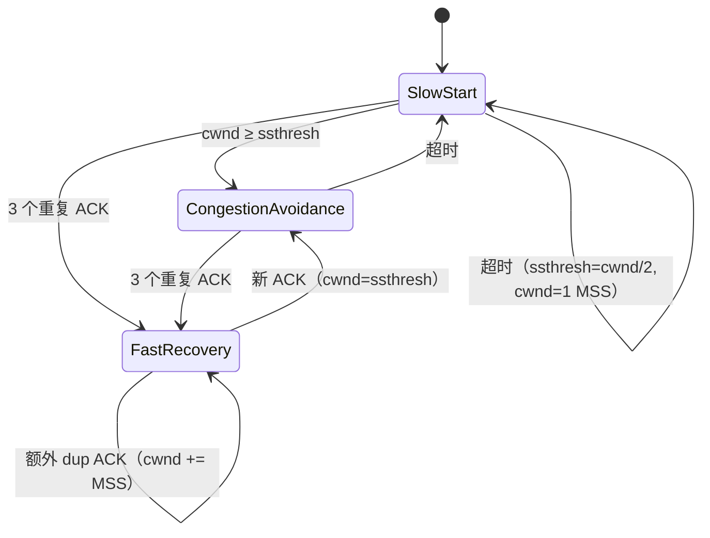


课件总结：

- `CongWin < Threshold`：**慢启动**，拥塞窗口**指数增长**；
- `CongWin ≥ Threshold`：**拥塞避免**，拥塞窗口**线性增长**；
- 收到 **3 个冗余 ACK**：`Threshold = CongWin/2`，`CongWin = Threshold + 3MSS`（**快速恢复**）；
- **超时**：`Threshold = CongWin/2`，`CongWin = 1 MSS`。

### 3.7.8 TCP 吞吐量的宏观描述

一个长期存活的 TCP 连接的平均吞吐量（忽略慢启动）：

设 `W` = 发生丢包时的 `CongWin`：

- 丢包前：`throughput = W / RTT`；
- 丢包后：`CongWin = W/2`，`throughput = W / (2·RTT)`；
- 假设 RTT 和 W 几乎不变，平均：

$$\text{Average throughput} = 0.75\cdot\frac{W}{\text{RTT}}$$


### 3.7.9 高速网络中的 TCP

例：1500 字节报文段，RTT = 100 ms，希望 10 Gbps 吞吐量。

- 平均拥塞窗口 `0.75W ≈ 83,333` 个报文段；
- 一条 TCP 连接的平均吞吐量与丢包率 `L` 的关系（课后习题）：

$$\text{throughput} \approx \frac{1.22\cdot\text{MSS}}{\text{RTT}\cdot\sqrt{L}}$$


- 要达到 10 Gbps，需要 `L ≈ 2×10^-10`（极低的丢包率）。

> 针对高速网络需要新的 TCP 拥塞控制算法。

### 3.7.10 TCP CUBIC

问题：在"探测"可用带宽方面，是否有比 AIMD 更好的方法？

直觉：

- 设 `Wmax` 为检测到拥塞时的发送速率；
- 拥塞时瓶颈链路状态也许没有很大变化；
- 减半后，可以**较快**接近 `Wmax`，然后**慢慢**逼近 `Wmax`。

CUBIC：

- 设不丢包时拥塞窗口再次到达 `Wmax` 的时刻为 `k`（可调参数）；
- 令拥塞窗口 `W` 的增长速度是 `(k − t)³` 的函数（`t` 为当前时间）；
- 相比 Reno 的线性增长，CUBIC 在高带宽长时延网络中吞吐量更高。

> **TCP CUBIC 是 Linux 的默认 TCP 版本**，大多数流行 Web 服务器也使用 CUBIC。

### 3.7.11 网络辅助拥塞控制：TCP ECN

**ECN（Explicit Congestion Notification，明确拥塞通告）** 涉及 TCP 和 IP 两个协议：

1. 路由器在 IP 报头中设置两个标志位（ECN=10 或 11），指示正在经历拥塞；
2. 携带拥塞标志的 IP 包到达接收端；
3. 接收端 TCP 在返回的 ACK 中设置 **ECE** 标志位，通知发送方；
4. 发送方收到后：
   - 将拥塞窗口**减半**；
   - 在发送的 TCP 段中设置 **CWR** 比特。

> ECN 的好处：**在丢包发生之前**就通知拥塞，避免不必要的重传。

### 3.7.12 TCP 的公平性

**公平性目标**：如果 K 条 TCP 连接共享带宽为 R 的瓶颈链路，每条连接应获得平均速率 `R/K`。

**为什么 AIMD 趋向公平？**

- 加性增：每条连接每个 RTT 增加相同量（斜率 1）；
- 乘性减：每条连接按比例减半；
- 两条参数相同的连接最终收敛到**等带宽份额**（图中 A→B→C 收敛）。

**公平性更复杂的情形**：

- 相互竞争的 TCP 连接若 **RTT、MSS 等参数不同**，不能保证公平；
- 应用可建立**多条并行 TCP 连接**，带宽在应用之间不公平：
  - 例：链路速率 R，已有 9 条连接；
  - 新应用建 1 条连接 → 获得 `R/10`；
  - 新应用建 11 条连接 → 获得 `R/2`！

**公平性与 UDP**：

- 多媒体应用通常不使用 TCP（不希望拥塞控制限制速率）；
- 宁愿使用 UDP：以恒定速率发送，哪怕少量丢包；
- UDP 缺少拥塞控制的问题：
  - 拥塞时感知不到、不降速；
  - 对 TCP **极不友好**，损害网络公平性（TCP 让出的带宽被 UDP 占据）；
- 给 UDP 加拥塞控制：**DCCP = UDP + 拥塞控制**。

---

## 3.8 传输层功能的演化

### 3.8.1 为什么需要演化

TCP 和 UDP 作为因特网传输层两大主力协议已应用 40 年，但不能完全适应所有场景：

| 场景 | 挑战 |
|---|---|
| 长肥管道（Long, fat pipes，大数据传输） | 大量分组在途；一次丢包就"关闭管道" |
| 无线网络 | 无线链路噪声、移动性导致丢包；TCP 误当作**拥塞丢包** |
| 长时延链路 | RTT 极长 |
| 数据中心网络 | 低延迟、高带宽、负载均衡 |
| 后台流量 | 低优先级、"背景"TCP 流 |

如果 UDP/TCP 都不能满足需要，应用设计者可以在**应用层构建自己的协议**，增强传输层服务——例如 **QUIC**。

### 3.8.2 QUIC（Quick UDP Internet Connections）

QUIC 是一种新型的**应用层协议**（基于 UDP）：

- 旨在提高安全 HTTP（HTTPS）的传输层服务性能；
- Google 已在面向公众的 Web 服务器、YouTube、Chrome、Google 搜索中部署。

**协议栈对比**：

| 层 | HTTP/2 over TCP | HTTP/3 |
| --- | --- | --- |
| 应用 | HTTP/2 | HTTP/2（精简） |
| 安全 | TLS | QUIC 内置加密 |
| 传输 | TCP | UDP |
| 网络 | IP | IP |


**QUIC 的特点**：

1. **面向连接**：
   - 使用**一次握手**建立安全连接；
   - 将 TCP 握手（传输层）与 TLS 握手（安全层）**合并为 1 次**，减少 RTT。
2. **多路复用数据流**：
   - Web 页中的每个对象对应一条**数据流（stream）**；
   - 为每条流**分别**提供可靠传输和安全传输；
   - 为所有流提供**共同的拥塞控制**；
   - 每个 QUIC 报文段使用 **UDP** 传输。
3. **并行、无队头阻塞**：
   - 一条流丢包只影响该流，不会阻塞其它流；
   - 而 HTTP/2 over TCP 中，TCP 丢包恢复会暂停所有对象传输。
4. **加密**：QUIC 内置加密（类似 TLS 1.3）。

| 协议栈 | 丢包影响 |
| --- | --- |
| HTTP/1.1 over TCP | TCP 丢包恢复时，所有对象都停 |
| HTTP/2 + QUIC | 每条流独立可靠传输，某条流出错不影响其它流 |


### 3.8.3 QUIC 小结

| 方面 | TCP + TLS + HTTP/2 | QUIC + HTTP/3 |
|---|---|---|
| 握手 | TCP 握手 + TLS 握手（2 次串行） | **1 次**握手 |
| 可靠性 | 整条 TCP 连接共享 | **每条流独立** |
| 队头阻塞 | TCP 层丢包阻塞所有流 | **无跨流 HOL** |
| 拥塞控制 | TCP | QUIC（所有流共享） |
| 传输层 | TCP | **UDP** |
| 加密 | TLS | 内置 |

---

## 3.9 本章小结

传输服务原理：

- 多路复用、解复用；
- 可靠数据传输；
- 流量控制；
- 拥塞控制。

因特网中的传输服务：

- **UDP**：无连接、不可靠、报文、开销小；
- **TCP**：面向连接、可靠、字节流、流量控制、拥塞控制。

下一章：离开网络"边缘"（应用层、传输层），进入网络"核心"（网络层）。

---

## 3.10 公式与关键数值速查

| 项目 | 公式/结论 |
|---|---|
| 停-等发送方利用率 | $U = \dfrac{L/R}{\text{RTT}+L/R}$ |
| 停-等例（1 Gbps, 30 ms, 1 KB） | $U \approx 0.00027$，吞吐 ≈ 33 kB/s |
| GBN 发送窗口 | $N \le 2^k-1$ |
| SR 窗口与序号空间 | $N \le 2^{k-1}$（窗口 ≤ 序号空间一半） |
| UDP 首部 | 8 字节（源端口、目的端口、长度、检查和） |
| TCP 首部 | 最短 20 字节，最长 60 字节 |
| TCP 缺省 MSS | 536 字节 |
| EstimatedRTT | $(1-\alpha)\cdot\text{Est}+\alpha\cdot\text{Sample}$，$\alpha=0.125$ |
| DevRTT | $(1-\beta)\cdot\text{Dev}+\beta\cdot|\text{Sample}-\text{Est}|$，$\beta=0.25$ |
| 超时值 | $\text{EstimatedRTT}+4\cdot\text{DevRTT}$ |
| 接收窗口 | $\text{RcvWindow}=\text{RcvBuffer}-(\text{LastByteRcvd}-\text{LastByteRead})$ |
| 发送限制 | $\text{LastByteSent}-\text{LastByteAcked}\le\min(\text{CongWin},\text{RcvWindow})$ |
| 推迟确认上限 | 500 ms，且至少每隔一个报文段确认 |
| 快速重传阈值 | 3 个重复 ACK |
| TCP 平均吞吐 | $0.75\cdot W/\text{RTT}$ |
| 吞吐与丢包率 | $\text{throughput}\approx\dfrac{1.22\cdot\text{MSS}}{\text{RTT}\cdot\sqrt{L}}$ |
| SYN 超时 | 典型 30–120 秒 |
| TIME_WAIT | 2×MSL |
| 慢启动 | 每 ACK $\text{cwnd} += \text{MSS}$（每 RTT 翻倍） |
| 拥塞避免 | 每 ACK $\text{cwnd} += \text{MSS}\cdot\text{MSS}/\text{cwnd}$（每 RTT +1 MSS） |
| 3 dup ACK | $\text{ssthresh}=\text{cwnd}/2$，$\text{cwnd}=\text{ssthresh}+3\text{MSS}$ |
| 超时 | $\text{ssthresh}=\text{cwnd}/2$，$\text{cwnd}=1\text{MSS}$ |

---

## 3.11 易错点与思考题

1. **传输层提供进程间逻辑通信，网络层提供主机间逻辑通信**；传输层不能提供网络层没有的时延/带宽保证。
2. **UDP 解复用看二元组（目的 IP + 目的端口）**；**TCP 解复用看四元组**。源端口相同但源 IP 不同，仍是不同 TCP 连接。
3. **UDP checksum 覆盖伪首部 + UDP 首部 + 载荷**，且是**可选**的。
4. **rdt2.0 的致命缺陷是 ACK/NAK 可能出错**；解决办法是序号 + 重传。
5. **rdt2.1 用 1 比特序号区分新/旧分组**；**rdt2.2 去掉 NAK，用带序号的 ACK**。
6. **rdt3.0 的接收方与 rdt2.2 相同**：数据丢失接收方感知不到；ACK 丢失/过早超时表现为重复分组。
7. **rdt3.0 对非期待序号的 ACK 不处理**，重传只由超时触发。
8. **停-等协议正确但利用率极低**，瓶颈是 RTT；解决靠流水线。
9. **GBN 接收方不缓存失序分组，超时重发整个窗口**；**SR 缓存失序分组、单独确认、每个分组一个定时器**。
10. **GBN 的 N ≤ 2^k − 1；SR 的 N ≤ 2^(k−1)**，注意区别。
11. **TCP 序号按字节编号，不按报文段**；确认序号是**期望的下一个字节**。
12. **TCP 是 GBN + SR 的混合**：累积确认 + 缓存失序 + 单定时器 + 只重传最早未确认段 + 快速重传。
13. **TCP 只用一个定时器**，避免过早超时导致大量重传；**累积确认**避免 ACK 丢失导致的重复重传。
14. **重传的报文段不测量 SampleRTT**（Karn）；超时后定时器**指数补偿**。
15. **推迟确认最多 500 ms，且至少每隔一个报文段确认**。
16. **流量控制针对接收方缓存，拥塞控制针对网络**，二者不同。
17. **零窗口探测的唯一作用是触发接收端响应**。
18. **糊涂窗口综合症**：接收方窗口通告太小 + 发送方报文段太小；用接收方启发式 + Nagle 解决。
19. **三次握手的原因**：两次握手无法让服务器确认客户收到了 SYNACK；会留下半开连接。
20. **初始序号不能固定从 1 开始**，否则旧连接报文会干扰新连接；用基于时钟的算法。
21. **SYN 消耗一个序号**，所以确认号是 x+1 / y+1。
22. **TIME_WAIT 等待 2MSL**，保证旧报文消散和最后 ACK 可靠。
23. **3 次重复 ACK 触发快速重传**；`cwnd = ssthresh + 3MSS` 是因为 3 个失序段已离开网络。
24. **超时 → cwnd=1 MSS + 慢启动；3 dup ACK → cwnd 减半 + 快速恢复**。
25. **AIMD 的公平性是针对参数相同、单条连接的 TCP**；RTT/MSS 不同或多连接应用时不公平。
26. **UDP 无拥塞控制会损害 TCP 公平性**；DCCP = UDP + 拥塞控制。
27. **QUIC 在应用层基于 UDP 实现**，把传输握手与安全握手合并为 1 次，每条流独立可靠传输，避免跨流队头阻塞。

**课件布置的习题**：15, 22, 23, 25, 27, 37, 40, 44, 47, 48；思考题（不用交）：24, 41, 42, 43；实验：TCP（以任课教师最终要求为准）。
